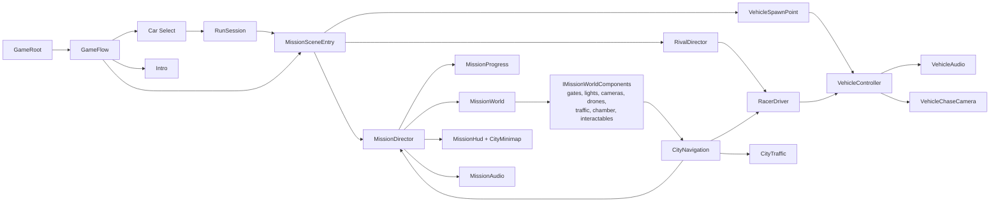

# NEON RIFT: NIGHT RUN — The Technical Book

**Master index.** A complete, searchable technical documentation set for the Neon Rift: Night Run Unity project, written from the repository as it stands at commit `602c7130` (Unity 6000.6.4f1, URP 17.6).

> **Later additions.** The book describes Night Run as of `602c7130`. The connected campaign and Level 2 (Harbor Rain),
> added afterwards, are documented in [CAMPAIGN.md](../CAMPAIGN.md), [Architecture.md](../Architecture.md#levels-and-the-connected-campaign),
> [BUILDING.md](../BUILDING.md) and [TESTING.md](../TESTING.md).

**How to use it:** find your question in **Find It Fast** below, jump to the chapter, and follow the file paths. Paths are repository-relative. In tables, `S/` means `Assets/_NeonRift/Scripts/` and `D/` means `Assets/_NeonRift/Data/`. For viva or interview preparation start with [47 Teacher Q&A](47_TEACHER_QA_GUIDE.md). For a one-page map, see [46 Developer Quick Reference](46_DEVELOPER_QUICK_REFERENCE.md).

---

## A. Table of contents

| # | Chapter | # | Chapter |
|---|---|---|---|
| 01 | [Project Overview](01_PROJECT_OVERVIEW.md) | 25 | [Lighting](25_LIGHTING.md) |
| 02 | [Architecture](02_ARCHITECTURE.md) | 26 | [Weather and Atmosphere](26_WEATHER_AND_ATMOSPHERE.md) |
| 03 | [Tech Stack](03_TECH_STACK.md) | 27 | [Water and Effects](27_WATER_AND_EFFECTS.md) |
| 04 | [Project Structure](04_PROJECT_STRUCTURE.md) | 28 | [Particles and VFX](28_PARTICLES_AND_VFX.md) |
| 05 | [Game Flow](05_GAME_FLOW.md) | 29 | [Audio System](29_AUDIO_SYSTEM.md) |
| 06 | [Bootstrap and Scenes](06_BOOTSTRAP_AND_SCENES.md) | 30 | [Music System](30_MUSIC_SYSTEM.md) |
| 07 | [City and World Generation](07_CITY_AND_WORLD_GENERATION.md) | 31 | [Cinematic Intro](31_CINEMATIC_INTRO.md) |
| 08 | [Buildings and Environment](08_BUILDINGS_AND_ENVIRONMENT.md) | 32 | [Timeline and Camera](32_TIMELINE_AND_CAMERA.md) |
| 09 | [Roads and Route Network](09_ROADS_AND_ROUTE_NETWORK.md) | 33 | [UI and HUD](33_UI_AND_HUD.md) |
| 10 | [Vehicle System](10_VEHICLE_SYSTEM.md) | 34 | [Minimap](34_MINIMAP.md) |
| 11 | [Vehicle Physics](11_VEHICLE_PHYSICS.md) | 35 | [Objectives and Mission Presentation](35_OBJECTIVES_AND_MISSION_PRESENTATION.md) |
| 12 | [Vehicle Audio](12_VEHICLE_AUDIO.md) | 36 | [Results and Debrief](36_RESULTS_AND_DEBRIEF.md) |
| 13 | [Vehicle Visuals](13_VEHICLE_VISUALS.md) | 37 | [Animation Systems](37_ANIMATION_SYSTEMS.md) |
| 14 | [Car Catalog and Data](14_CAR_CATALOG_AND_DATA.md) | 38 | [Camera System](38_CAMERA_SYSTEM.md) |
| 15 | [Car Selection](15_CAR_SELECTION.md) | 39 | [Performance](39_PERFORMANCE.md) |
| 16 | [Player Input](16_PLAYER_INPUT.md) | 40 | [Testing and Validation](40_TESTING_AND_VALIDATION.md) |
| 17 | [Rival AI](17_RIVAL_AI.md) | 41 | [Input Playtesting](41_INPUT_PLAYTESTING.md) |
| 18 | [Traffic System](18_TRAFFIC_SYSTEM.md) | 42 | [Build and Release](42_BUILD_AND_RELEASE.md) |
| 19 | [Mission System](19_MISSION_SYSTEM.md) | 43 | [Git and Repository](43_GIT_AND_REPOSITORY.md) |
| 20 | [Heist System](20_HEIST_SYSTEM.md) | 44 | [Assets and Licensing](44_ASSETS_AND_LICENSING.md) |
| 21 | [Security Gate](21_SECURITY_GATE.md) | 45 | [Known Limitations](45_KNOWN_LIMITATIONS.md) |
| 22 | [Data Core](22_DATA_CORE.md) | 46 | [Developer Quick Reference](46_DEVELOPER_QUICK_REFERENCE.md) |
| 23 | [Heat and Lockdown](23_HEAT_AND_LOCKDOWN.md) | 47 | [Teacher Q&A Guide](47_TEACHER_QA_GUIDE.md) |
| 24 | [Environmental Interactions](24_ENVIRONMENTAL_INTERACTIONS.md) | 48 | [Glossary](48_GLOSSARY.md) |
| — | [Documentation Audit](DOCUMENTATION_AUDIT.md) | | |

---

## B. Find It Fast

| Question / topic | Chapter | Code location |
|---|---|---|
| How does the game start up? | [05](05_GAME_FLOW.md), [06](06_BOOTSTRAP_AND_SCENES.md) | `S/Game/BootstrapLoader.cs`, `S/Game/GameRoot.cs`, `S/Game/GameFlow.cs` |
| How are scenes loaded and switched? | [06](06_BOOTSTRAP_AND_SCENES.md) | `GameFlow.TransitionAsync` |
| How is the city generated? | [07](07_CITY_AND_WORLD_GENERATION.md) | `S/Editor/District/NightRunBuilder.cs`, `CityLayout.cs`, `NightRunDistrict.cs` |
| How are buildings made? | [08](08_BUILDINGS_AND_ENVIRONMENT.md) | `NightRunDistrict.BuildStreetWall`, `S/Editor/World/BuildingPrefabBuilder.cs`, `CityInfill.cs`, `TowerDressing.cs` |
| Where do yards, car parks, parks come from? | [08](08_BUILDINGS_AND_ENVIRONMENT.md) | `S/Editor/District/CityInfill.cs` |
| Street furniture, signals, signs, CCTV? | [08](08_BUILDINGS_AND_ENVIRONMENT.md) | `S/Editor/District/CityProps.cs` |
| Landmarks (skyway, plaza, cranes)? | [08](08_BUILDINGS_AND_ENVIRONMENT.md) | `S/Editor/District/CityLandmarks.cs` |
| How do roads / routing / GPS work? | [09](09_ROADS_AND_ROUTE_NETWORK.md) | `S/World/RoadGraph.cs`, `S/Gameplay/Navigation/CityNavigation.cs` |
| How does car physics work? | [11](11_VEHICLE_PHYSICS.md) | `S/Vehicles/Physics/VehicleController.cs`, `VehicleWheel.cs`, `TyreModel.cs` |
| Suspension / tyres / gearbox / steering? | [11](11_VEHICLE_PHYSICS.md) | `VehicleWheel.cs`, `TyreModel.cs`, `Drivetrain.cs`, `Gearbox.cs`, `SteeringSystem.cs` |
| Engine sound? | [12](12_VEHICLE_AUDIO.md) | `S/Audio/VehicleAudio.cs`, `S/Editor/Audio/EngineSynth.cs` |
| Wheels, lights, LODs on cars? | [13](13_VEHICLE_VISUALS.md) | `S/Vehicles/VehicleRig.cs`, `VehicleLights.cs`, `S/Editor/Vehicles/VehicleLodSetup.cs` |
| Which cars exist and their data? | [14](14_CAR_CATALOG_AND_DATA.md) | `D/Vehicles/VehicleCatalog.asset`, `S/Vehicles/VehicleDefinition.cs` |
| How does car selection work? | [15](15_CAR_SELECTION.md) | `S/Frontend/CarSelectScreen.cs`, `VehicleShowroom.cs` |
| Controls / input? | [16](16_PLAYER_INPUT.md) | `Assets/_NeonRift/Settings/Input/NeonRiftControls.inputactions`, `S/Input/PlayerDrivingInput.cs` |
| How does rival AI work? | [17](17_RIVAL_AI.md) | `S/Gameplay/Racing/RacerDriver.cs`, `RivalDirector.cs` |
| What do the rivals do / qualifying? | [17](17_RIVAL_AI.md) | `S/Missions/RivalTask.cs`, `RivalDirector.BeginTask` |
| How does traffic work? | [18](18_TRAFFIC_SYSTEM.md) | `S/Gameplay/City/CityTraffic.cs`, `TrafficCar.cs` |
| How are objectives tracked? | [19](19_MISSION_SYSTEM.md) | `S/Missions/MissionProgress.cs`, `S/Gameplay/Mission/MissionDirector.cs` |
| Mission data (objectives, timers, announcements)? | [19](19_MISSION_SYSTEM.md) | `D/Missions/Mission_NightRun.asset` (built by `NightRunBuilder.CreateMissionData`) |
| How do hacks / multi-stage interactions work? | [20](20_HEIST_SYSTEM.md) | `S/Missions/InteractionRun.cs`, `S/Gameplay/Mission/Interactable.cs` |
| How does the security gate work? | [21](21_SECURITY_GATE.md) | `S/Gameplay/Mission/GateLockSystem.cs`, `SecurityBarrier.cs` |
| How does the Data Core work? | [22](22_DATA_CORE.md) | `S/Gameplay/Mission/DataCoreChamber.cs`, `S/Editor/District/NightRunBuilder.Heist.cs` |
| Heat, alert, lockdown? | [23](23_HEAT_AND_LOCKDOWN.md) | `MissionProgress.AddHeat`, `SecurityLightGroup.cs`, `SecurityAlarm.cs` |
| Security cameras? | [23](23_HEAT_AND_LOCKDOWN.md) | `S/Gameplay/City/SecurityCamera.cs` |
| Drones? | [23](23_HEAT_AND_LOCKDOWN.md), [37](37_ANIMATION_SYSTEMS.md) | `S/Gameplay/City/SecurityDrones.cs`, `HoverSentry.cs`, `S/Editor/World/DroneModels.cs` |
| How does lighting work? | [25](25_LIGHTING.md) | `NightRunBuilder.BuildLighting`, `S/Gameplay/City/LightBudget.cs`, `Assets/_NeonRift/Settings/Rendering/` |
| Fog / haze? | [26](26_WEATHER_AND_ATMOSPHERE.md) | `S/Rendering/GroundHazeFeature.cs`, `GroundHaze.cs` |
| Where is the rain system? | [26](26_WEATHER_AND_ATMOSPHERE.md) | **Not implemented.** Wet look: `DistrictTextures.Asphalt` |
| Particles? | [28](28_PARTICLES_AND_VFX.md) | **None**; additive meshes + `Art/Shaders/NeonRift_AdditiveGlow.shader` |
| Audio mixer / sounds? | [29](29_AUDIO_SYSTEM.md) | `S/Audio/AudioMixerService.cs`, `S/Gameplay/Mission/MissionAudio.cs` |
| Music / M toggle? | [30](30_MUSIC_SYSTEM.md) | `D/Missions/MissionAudio_NightRun.asset`, `S/Editor/Audio/ScoreComposer.cs`, `S/Game/GameSettings.cs` |
| How does the cinematic work? | [31](31_CINEMATIC_INTRO.md) | `S/Intro/IntroSceneEntry.cs`, `S/Editor/Intro/IntroBuilder.cs`, `D/Intro/Intro_NightRun.playable` |
| Timeline / cue track? | [32](32_TIMELINE_AND_CAMERA.md) | `S/Intro/IntroCue.cs`, `IntroCueTrack.cs`, `IntroCueClip.cs` |
| HUD? | [33](33_UI_AND_HUD.md) | `S/Gameplay/Mission/MissionHud.cs`, `Assets/_NeonRift/UI/MissionHud.uxml` |
| How does the minimap work? | [34](34_MINIMAP.md) | `S/Gameplay/Mission/CityMinimap.cs`, `MinimapProjection.cs` |
| Briefing card, splits, announcements? | [35](35_OBJECTIVES_AND_MISSION_PRESENTATION.md) | `MissionDirector.BuildBriefing`, `MissionHud.StampObjective` |
| Grade / debrief? | [36](36_RESULTS_AND_DEBRIEF.md) | `S/Missions/MissionGrade.cs`, `MissionDirector.BuildDebrief` |
| Where is this animation implemented? | [37](37_ANIMATION_SYSTEMS.md) | catalogue table |
| Gameplay camera? | [38](38_CAMERA_SYSTEM.md) | `S/Gameplay/VehicleChaseCamera.cs` |
| Performance work? | [39](39_PERFORMANCE.md) | `S/Editor/Validation/RoutePerf.cs`, `GpuBench.cs`, `PerfBuild.cs` |
| Tests? | [40](40_TESTING_AND_VALIDATION.md) | `S/Tests/EditMode/` |
| Mission auto-playtest? | [40](40_TESTING_AND_VALIDATION.md) | `S/Gameplay/Mission/NightRunValidator.cs`, `S/Editor/Validation/MissionSeries.cs` |
| How to build / open the project? | [42](42_BUILD_AND_RELEASE.md) | `ProjectSettings/EditorBuildSettings.asset` |
| Asset licences? | [44](44_ASSETS_AND_LICENSING.md) | `Assets/ThirdParty/**/ATTRIBUTION.txt`, `Docs/ThirdParty.md`, `LICENSE.md` |

---

## C. Scene index

| Scene | Path | Generated by | Entry point | Chapter |
|---|---|---|---|---|
| Bootstrap | `Assets/_NeonRift/Scenes/Bootstrap.unity` | hand-made | — (`GameRoot`) | [06](06_BOOTSTRAP_AND_SCENES.md) |
| Frontend | `Assets/_NeonRift/Scenes/Frontend.unity` | hand-made | `TitleScreen` | [05](05_GAME_FLOW.md) |
| CarSelect | `Assets/_NeonRift/Scenes/CarSelect.unity` | `GarageBuilder` | `CarSelectScreen` | [15](15_CAR_SELECTION.md) |
| TestTrack (dev) | `Assets/_NeonRift/Scenes/Dev/TestTrack.unity` | `ValidationRouteBuilder` (route) | `MissionSceneEntry` | [11](11_VEHICLE_PHYSICS.md) |
| NightRun | `Assets/_NeonRift/Scenes/NightRun.unity` | `NightRunBuilder` + `IntroBuilder` | `MissionSceneEntry`, `IntroSceneEntry` | [07](07_CITY_AND_WORLD_GENERATION.md), [31](31_CINEMATIC_INTRO.md) |

## D. Prefab index

| Folder | Prefabs | Made by | Chapter |
|---|---|---|---|
| `Assets/_NeonRift/Prefabs/Vehicles/` | `PF_Vehicle_MercedesSLS`, `PF_Vehicle_MercedesSLSGT3`, `PF_Vehicle_LamborghiniTerzo`, `PF_Vehicle_MercedesAMGGT3` (not in the catalog) | `VehiclePrefabBuilder` | [13](13_VEHICLE_VISUALS.md) |
| `…/Prefabs/Traffic/` | `PackCar_Compact`, `_Coupe`, `_Hatchback`, `_Minivan`, `_Offroad`, `_Pickup`, `_Sedan`, `_Sport`, `_SUV`, `_Wagon` | `TrafficCarBuilder` | [18](18_TRAFFIC_SYSTEM.md) |
| `…/Prefabs/Drones/` | `PF_Drone_Mech`, `PF_Drone_Buster` | `DroneModels` | [23](23_HEAT_AND_LOCKDOWN.md) |
| `…/Prefabs/Buildings/` | `PF_Bld_LondonSkyscraper`, `PF_Bld_SingaporeOffice`, `PF_Bld_NightSkylineCluster`, `PF_Bld_AsianNight_B1…B2_008` (19) | `BuildingPrefabBuilder` / `ThirdPartyIntake` | [08](08_BUILDINGS_AND_ENVIRONMENT.md) |
| `…/Prefabs/District/` | `PF_Prop_StreetLight_Led`, `_Sodium`, `_Warm`, `PF_Prop_JerseyBarrier`, `PF_Prop_SecurityBeacon` | `DistrictKit.CreatePrefabs` | [08](08_BUILDINGS_AND_ENVIRONMENT.md) |

## E. ScriptableObject / data asset index

| Asset | Type | Purpose | Chapter |
|---|---|---|---|
| `D/Config/GameConfig.asset` | `GameConfig` | Scenes, catalog, missions, mixer, fade | [06](06_BOOTSTRAP_AND_SCENES.md) |
| `D/Config/IntroSettings.asset` | `IntroSettings` | Intro policy, mode, skippable | [31](31_CINEMATIC_INTRO.md) |
| `D/Vehicles/VehicleCatalog.asset` | `VehicleCatalog` | Player cars in order | [14](14_CAR_CATALOG_AND_DATA.md) |
| `D/Vehicles/Vehicle_*.asset` (4) | `VehicleDefinition` | Identity, prefabs, profiles, stats, licence | [14](14_CAR_CATALOG_AND_DATA.md) |
| `D/Vehicles/Physics/VehiclePhysics_*.asset` (3) | `VehiclePhysicsProfile` | Driving tuning | [11](11_VEHICLE_PHYSICS.md) |
| `D/Vehicles/Audio/VehicleAudio_*.asset` (3) | `VehicleAudioProfile` | Car sound | [12](12_VEHICLE_AUDIO.md) |
| `D/Vehicles/ImportSetups/Setup_*.asset` (4) | `VehicleModelSetup` | Prefab build recipes | [13](13_VEHICLE_VISUALS.md) |
| `D/Missions/Mission_NightRun.asset` | `MissionDefinition` | Night Run objectives, announcements, rival tasks, par, qualifying | [19](19_MISSION_SYSTEM.md) |
| `D/Missions/Mission_DevTestTrack.asset` | `MissionDefinition` | Test-track mission | [11](11_VEHICLE_PHYSICS.md) |
| `D/Missions/Interaction_CoreSecurity.asset`, `Interaction_DataCoreUplink.asset`, `Interaction_HackGate.asset` | `InteractionDefinition` | Heist devices | [20](20_HEIST_SYSTEM.md) |
| `D/Missions/MissionAudio_NightRun.asset` | `MissionAudioSet` | Mission sounds and music | [29](29_AUDIO_SYSTEM.md) |
| `D/Racing/Racer_Vex.asset`, `Racer_Kade.asset` | `RacerProfile` | AI personalities | [17](17_RIVAL_AI.md) |
| `D/World/RoadNetwork_NightRun.asset` | `RoadNetwork` | Road graph | [09](09_ROADS_AND_ROUTE_NETWORK.md) |
| `D/World/BuildingCatalog.asset`, `Building_*.asset` (22) | `BuildingCatalog`, `BuildingDefinition` | Building models | [08](08_BUILDINGS_AND_ENVIRONMENT.md) |
| `D/Audio/AudioMixerConfig.asset` | `AudioMixerConfig` | Mixer groups, snapshots, parameters | [29](29_AUDIO_SYSTEM.md) |
| `D/Intro/Intro_NightRun.playable` | `TimelineAsset` | Intro Timeline | [31](31_CINEMATIC_INTRO.md) |
| `D/Intro/Intro_Surveillance.asset` | `VolumeProfile` | CCTV grade | [31](31_CINEMATIC_INTRO.md) |
| `D/Physics/PM_VehicleBody.asset` | `PhysicsMaterial` | Low-friction car body | [11](11_VEHICLE_PHYSICS.md) |
| `Assets/_NeonRift/Settings/Rendering/*.asset` | URP assets, Volume profiles | Rendering | [25](25_LIGHTING.md) |

## F. Important class index

| Class | Role | File |
|---|---|---|
| `GameRoot` | Composition root | `S/Game/GameRoot.cs` |
| `GameFlow` | Scene state machine | `S/Game/GameFlow.cs` |
| `RunSession` | Selected car, rivals, mission, result | `S/Game/RunSession.cs` |
| `VehicleController` | The car | `S/Vehicles/Physics/VehicleController.cs` |
| `VehicleWheel`, `TyreModel`, `Drivetrain`, `Gearbox`, `SteeringSystem` | Physics parts | `S/Vehicles/Physics/` |
| `VehicleAudio` | Car sound | `S/Audio/VehicleAudio.cs` |
| `VehicleSpawnPoint` | Spawning | `S/Gameplay/VehicleSpawnPoint.cs` |
| `VehicleChaseCamera` | Gameplay camera | `S/Gameplay/VehicleChaseCamera.cs` |
| `MissionSceneEntry` | Mission scene entry, pause | `S/Gameplay/MissionSceneEntry.cs` |
| `MissionDirector` | Runs a mission attempt | `S/Gameplay/Mission/MissionDirector.cs` |
| `MissionProgress` | Mission state machine | `S/Missions/MissionProgress.cs` |
| `MissionWorld` | Per-attempt event hub | `S/Gameplay/Mission/MissionWorld.cs` |
| `Interactable`, `InteractionRun` | Multi-stage hacks | `S/Gameplay/Mission/Interactable.cs`, `S/Missions/InteractionRun.cs` |
| `DataCoreChamber` | Data Core presentation | `S/Gameplay/Mission/DataCoreChamber.cs` |
| `SecurityBarrier`, `GateLockSystem` | Gates | `S/Gameplay/Mission/` |
| `RivalDirector`, `RacerDriver`, `RacingLine` | Rival AI | `S/Gameplay/Racing/` |
| `CityTraffic`, `TrafficCar` | Traffic | `S/Gameplay/City/` |
| `CityNavigation`, `RoadGraph` | Routing | `S/Gameplay/Navigation/`, `S/World/` |
| `MissionHud`, `CityMinimap`, `TerminalReadout` | HUD | `S/Gameplay/Mission/` |
| `CarSelectScreen`, `VehicleShowroom` | Car Select | `S/Frontend/` |
| `IntroSceneEntry`, `IntroCityLife`, `IntroOverlay` | Intro | `S/Intro/` |
| `NightRunBuilder`, `NightRunDistrict`, `CityLayout` | City generator | `S/Editor/District/` |
| `IntroBuilder`, `GarageBuilder` | Intro and garage generators | `S/Editor/Intro/`, `S/Editor/Frontend/` |

## G. Interface index

| Interface | File | Implemented by |
|---|---|---|
| `ISceneEntryPoint` | `S/Game/GameContext.cs` | `TitleScreen`, `CarSelectScreen`, `MissionSceneEntry`, `IntroSceneEntry` (via `IIntroEntryPoint`) |
| `IIntroEntryPoint` | `S/Game/IGameFlow.cs` | `IntroSceneEntry` |
| `IGameFlow` | `S/Game/IGameFlow.cs` | `GameFlow` |
| `IVehicleInputSource` | `S/Vehicles/DrivingInput.cs` | `PlayerDrivingInput`, `RacerDriver`, `WaypointDriver`, `RouteAutopilot`, `ScriptedDrivingInput` |
| `IVehicleInputReceiver` | `S/Vehicles/DrivingInput.cs` | `VehicleController` |
| `IMissionWorldComponent` | `S/Gameplay/Mission/IMissionWorldComponent.cs` | `MissionZone`, `Interactable`, `SecurityBarrier`, `GateLockSystem`, `SecurityLightGroup`, `SecurityAlarm`, `SecurityPostEffects`, `DataCoreChamber`, `SecurityCamera`, `TrafficSignalNetwork`, `LockdownScreens`, `CityTraffic`, `CrowdGroups`, `SecurityDrones`, `RivalDirector` |
| `IMissionTarget` | `S/Gameplay/Mission/IMissionTarget.cs` | `MissionZone`, `Interactable` |
| `IIntroCueHandler` | `S/Intro/IntroCue.cs` | `IntroSceneEntry` |

## H. Package / framework index

| Package | Version | Used for | Chapter |
|---|---|---|---|
| Universal RP | 17.6.0 | Rendering, Volumes, Render Graph haze | [25](25_LIGHTING.md) |
| Input System | 1.19.0 | All input | [16](16_PLAYER_INPUT.md) |
| Cinemachine | 6.6.0 | Chase, Car Select and intro cameras | [38](38_CAMERA_SYSTEM.md) |
| Timeline | 6.6.0 | Intro | [32](32_TIMELINE_AND_CAMERA.md) |
| glTFast | 6.20.0 | GLB import | [13](13_VEHICLE_VISUALS.md) |
| Test Framework | 1.8.0 | EditMode tests | [40](40_TESTING_AND_VALIDATION.md) |
| Video module | 1.0.0 | Optional pre-rendered intro | [31](31_CINEMATIC_INTRO.md) |
| uGUI | 2.6.0 | EventSystem only | [03](03_TECH_STACK.md) |
| Splines, ProBuilder, AI Navigation | — | **Installed, not used** | [03](03_TECH_STACK.md) |

## I. Major system dependency map

## J. Testing index

| Test file | Area | Chapter |
|---|---|---|
| `S/Tests/EditMode/FoundationTests.cs` | Catalog, session, wiring | [40](40_TESTING_AND_VALIDATION.md) |
| `S/Tests/EditMode/InputTests.cs` | Input bindings | [16](16_PLAYER_INPUT.md) |
| `S/Tests/EditMode/VehicleModelTests.cs` | Tyres, steering, gearbox, drivetrain | [11](11_VEHICLE_PHYSICS.md) |
| `S/Tests/EditMode/VehiclePhysicsTests.cs` | Driving on the bench (per car) | [11](11_VEHICLE_PHYSICS.md) |
| `S/Tests/EditMode/VehicleAudioTests.cs` | Audio model, mixer, score, limiter | [12](12_VEHICLE_AUDIO.md), [29](29_AUDIO_SYSTEM.md) |
| `S/Tests/EditMode/CityTests.cs` | City, graph, AI line, rubber band, traffic | [07](07_CITY_AND_WORLD_GENERATION.md), [17](17_RIVAL_AI.md) |
| `S/Tests/EditMode/MissionTests.cs` | State machine, data, scene wiring, grade | [19](19_MISSION_SYSTEM.md) |
| `S/Tests/EditMode/InteractionTests.cs` | Multi-stage interactions | [20](20_HEIST_SYSTEM.md) |
| `S/Tests/EditMode/IntroTests.cs` | Intro | [31](31_CINEMATIC_INTRO.md) |
| `S/Tests/EditMode/MinimapTests.cs` | Minimap projection | [34](34_MINIMAP.md) |
| `S/Tests/EditMode/CarSelectTests.cs` | Car Select | [15](15_CAR_SELECTION.md) |
| Play Mode tools | `NightRunValidator`, `MissionPlaytest`, `MissionSeries`, `InputPlaytest`, `RoutePerf`, `GpuBench`, `IntroCapture`, `VehicleAudioValidator` | [40](40_TESTING_AND_VALIDATION.md) |

## K. Asset / licensing index

| Asset group | Licence | Location | Chapter |
|---|---|---|---|
| SLS AMG, SLS GT3 | CC-BY-4.0 | `Assets/ThirdParty/Sketchfab/Vehicles/` | [44](44_ASSETS_AND_LICENSING.md) |
| Terzo Millennio | CC-BY-NC-4.0 (non-commercial) | same | [44](44_ASSETS_AND_LICENSING.md) |
| AMG GT3 Red Bull (unused) | CC-BY-NC-SA-4.0 | same | [44](44_ASSETS_AND_LICENSING.md) |
| Generic passenger car pack | not recorded | same | [44](44_ASSETS_AND_LICENSING.md) |
| 99.Miles buildings | CC-BY-4.0 | `Assets/ThirdParty/Sketchfab/Buildings/` | [44](44_ASSETS_AND_LICENSING.md) |
| Mech Drone, Buster Drone | CC BY 4.0 | `Assets/ThirdParty/Sketchfab/Drones/` | [44](44_ASSETS_AND_LICENSING.md) |
| Drone Design (unused) | CC BY-NC-ND 4.0 | same | [44](44_ASSETS_AND_LICENSING.md) |
| Music tracks | not recorded | `Assets/ThirdParty/SoundAudio/` | [44](44_ASSETS_AND_LICENSING.md) |
| Everything else (code, generated art, audio) | First-party, all rights reserved (`LICENSE.md`) | `Assets/_NeonRift/` | [44](44_ASSETS_AND_LICENSING.md) |

---

## L. Script index (all 198 C# files)

Generated from each type's XML documentation comment in the source (`Assets/_NeonRift/Scripts/`). Long summaries are shortened with "…".

#### `Scripts/Audio/`

| File | Main type | Purpose |
|---|---|---|
| `AudioMixerConfig.cs` | `AudioMixerConfig` | The game's mixer, its routing groups, snapshot names and exposed volume parameters. |
| `AudioMixerService.cs` | `AudioMixerService` | Runtime front for the mixer: user volume channels and state snapshots (menus, results, lockdown, ducking). Owned by the composition root and handed to scenes through the game context. |
| `AudioOutputRecorder.cs` | `AudioOutputRecorder` | Development tool: records the final mix at the AudioListener (mono) into a fixed buffer, for automated checks (clicks, pitch tracking) and for saving a WAV to listen to. Add it to the … |
| `AudioSignalAnalysis.cs` | `AudioSignalAnalysis` | Signal measurements used to validate audio without listening: clicks, level, pitch, brightness. |
| `EngineSoundModel.cs` | `EngineSoundModel` | Turns engine speed and load into a volume and pitch for every loop of an `EngineAudioSettings`. Neighbouring rpm layers are crossfaded with an equal-power law in log-rpm space; on- and … |
| `MasterLimiter.cs` | `MasterLimiter` | Final-stage safety limiter on the AudioListener: the summed mix never exceeds the ceiling (no digital clipping when sirens, a klaxon, the engine at the limiter and the lockdown score … |
| `MixerState.cs` | `MixerState` | Mixer snapshots the game can be in. Each maps to a snapshot in the mixer asset. |
| `TyreSoundModel.cs` | `TyreSoundModel` | Maps tyre state to sound intensities (0..1). Pure; shared by every car. |
| `VehicleAudio.cs` | `VehicleAudio` | Plays a vehicle's sound from its telemetry: layered engine loops, tyre squeal/scrub, loose-surface, road and wind beds, gear shifts, overrun pops, suspension thumps and impacts. Every loop … |

#### `Scripts/Core/`

| File | Main type | Purpose |
|---|---|---|
| `AssetLicense.cs` | `AssetLicense` | Provenance of a third-party asset. Kept with the data that uses it so release checks can filter. |

#### `Scripts/Editor/Audio/`

| File | Main type | Purpose |
|---|---|---|
| `AudioMixerBuilder.cs` | `AudioMixerBuilder` | Builds the game's AudioMixer: group tree, state snapshots and exposed user-volume parameters, then writes the `AudioMixerConfig` and hooks it into `GameConfig`. Unity has no public API for … |
| `Dsp.cs` | `Dsp` | Small offline DSP toolkit for the procedural sound generator (editor only). |
| `EngineSynth.cs` | `EngineSynth` | Offline engine sound synthesis. A combustion engine is modelled as per-cylinder exhaust pulses at the real firing angles, routed to two exhaust banks, each shaped by pipe resonances, a pipe … |
| `HeistAudioGenerator.cs` | `HeistAudioGenerator` | The heist sounds: terminal stage blips, denials, interference, re-sync, lockout and cancel cues; the tension bed under the extraction; the facility hum, arm servos, data stream, chamber … |
| `IntroAudioGenerator.cs` | `IntroAudioGenerator` | Original, procedural audio for the opening cinematic. Everything is synthesised here (no samples, no licensed music). The music is the game's own theme from `ScoreComposer` (A minor, 96 … |
| `MissionAudioGenerator.cs` | `MissionAudioGenerator` | Re-runnable recipe for the mission sounds: lockdown siren, barrier klaxon/motor/slam, the city ambience bed, the hacking loop and HUD/story cues. Synthesised in-house and deterministic like … |
| `ScoreComposer.cs` | `ScoreComposer` | The Neon Rift score: original, fully procedural music (no samples, no licensed material). One 8-bar theme in A minor at about 96 bpm (Am(add9) – Fmaj7 – Dm9 – Esus4 → E, two bars each), … |
| `VehicleAudioGenerator.cs` | `VehicleAudioGenerator` | Re-runnable recipe for every vehicle sound: synthesises the engine loops, tyre/road/wind beds and one-shots (deterministic, so re-running reproduces identical files), sets import settings, … |
| `VehicleAudioPrefabs.cs` | `VehicleAudioPrefabs` | Adds and routes the `VehicleAudio` component on vehicle prefabs. |

#### `Scripts/Editor/District/`

| File | Main type | Purpose |
|---|---|---|
| `BlockMeshes.cs` | `BlockMeshes` | One `MeshBuilder` per material for a group of geometry (a block, a landmark), emitted as one static renderer per material: the district's batching unit. Builders are created on first use. |
| `CityInfill.cs` | `CityInfill` | Fills the inside of a block (everything behind the podium street walls that no tower, lot or sidewalk uses) with urban fabric that has a reason to be there: back buildings, service yards, … |
| `CityLandmarks.cs` | `CityLandmarks` | Hand-composed structures that give each district an identity and the player something to navigate by: the elevated Harbor Skyway, the Lantern Arcade and Kowloon's overhead cables and … |
| `CityLayout.cs` | `CityLayout` | The layout of the Night Run city (≈ 1.1 × 1.4 km of streets around Sector 7). Everything here is plain data: roads, reserved areas, special lots, hero buildings and districts. `Decompose` … |
| `CityProps.cs` | `CityProps` | Street furniture and infrastructure the city is made believable with: sidewalk furniture per zone (bins, benches, hydrants, utility cabinets, vending machines, planters, dumpsters, pallets, … |
| `DistrictKit.cs` | `DistrictKit` | Materials, saved meshes and reusable prop prefabs for the district. Every asset is created on first use and updated in place afterwards, so re-running the builder keeps GUIDs (and scene … |
| `DistrictTextures.cs` | `DistrictTextures` | Procedural, tileable textures for the Night Run district (wet asphalt, pavement, facades, shopfronts, neon signage, glow shapes). Deterministic, generated in-house, saved as PNG so they … |
| `LookDevShots.cs` | `LookDevShots` | Captures a fixed set of Night Run viewpoints in Play Mode (lamps and the HUD are only live at runtime), so before/after look-dev shots are comparable. Street shots move the player car; … |
| `MeshBuilder.cs` | `MeshBuilder` | Accumulates quads for one material, so a whole block's facades become a single mesh (one draw per material). UVs are in metres divided by the texture's real-world tile size, so textures … |
| `NightRunBuilder.CityLife.cs` | `NightRunBuilder` | Signs of life: physical city traffic from the car pack (`CityTraffic`: roaming and parked), pedestrian silhouettes in groups (`CrowdGroups`) and security drones for the lockdown … |
| `NightRunBuilder.Garage.cs` | `NightRunBuilder` | The crew's garage on W Avenue: the Car Select hall (`BuildShell`) placed in the city with its roller door onto the avenue, walls and door that collide, a turntable you can stand a car on, … |
| `NightRunBuilder.Heist.cs` | `NightRunBuilder` | The Data Core heist: the interaction data (perimeter security terminal, extraction uplink) and the scene pieces that perform it — the terminal kiosk, the armoured sleeve, rail-mounted … |
| `NightRunBuilder.cs` | `NightRunBuilder` | Builds the Night Run vertical slice: the Sector 7 district (via `NightRunDistrict`), the Data Core compound, security gates, the extraction tunnel, lighting and post-processing, the HUD, … |
| `NightRunDistrict.cs` | `NightRunDistrict` | Builds the Night Run city from `CityLayout`: one asphalt ground plane, raised pavement blocks with kerbs, zone-styled podium street walls (shopfronts, lit floors, neon, signage, rooftop … |
| `PixelFont.cs` | `PixelFont` | A first-party 5×7 bitmap font used to bake neon signage textures (no third-party font files needed). Uppercase letters, digits, a few symbols and arrows. |
| `SkylineBackdrop.cs` | `SkylineBackdrop` | The metropolis beyond the playable city: three rings of tower silhouettes (1.7, 2.1 and 2.55 km from the centre) drawn with NeonRift/SkylineBackdrop. Each ring is hazier than the one in … |
| `TowerDressing.cs` | `TowerDressing` | Night dressing for the kit towers so they stop reading as black masses from the street and the air: swaps the kit materials for NeonRift/TowerFacade (procedural office windows, lobby band, … |
| `TrafficCarBuilder.cs` | `TrafficCarBuilder` | Turns the generic passenger car pack (one FBX: ten bodies in a ring, each with four loose wheels) into ten traffic prefabs: body and its four nearest wheels re-framed so the car sits on the … |
| `ViewCapture.cs` | `ViewCapture` | Renders the scene's main camera from a given pose into a PNG (look-dev and review from tools). |

#### `Scripts/Editor/Frontend/`

| File | Main type | Purpose |
|---|---|---|
| `GarageBuilder.cs` | `GarageBuilder` | Generates the Car Select scene: the crew's garage in Sector 7. A 26 × 30 m workshop hall with a polished concrete floor, steel columns and roof trusses, soft-box strip lights, a turntable … |
| `GaragePlanningWall.cs` | `GaragePlanningWall` | The crew's planning wall: textures generated from the real city data. A map of the streets (from `Roads`) with the garage, the planned route to the Data Core, the compound and the Rift Gate … |

#### `Scripts/Editor/`

| File | Main type | Purpose |
|---|---|---|
| `GltfMaterialFixer.cs` | `GltfMaterialFixer` | glTFast's clearcoat Shader Graph outputs invalid colour (flat cyan, i.e. NaN red) at runtime in this URP setup. Renderers using it are remapped to project-owned copies on the plain glTF PBR … |
| `ProjectValidator.cs` | `ProjectValidator` | Checks the wiring that would otherwise only fail at runtime: config, catalogs and build scenes. |
| `TestRunReporter.cs` | `TestRunReporter` | Runs the EditMode suite and writes a plain-text report to Logs/TestResults-EditMode.txt (for tooling and CI). |
| `ThirdPartyIntake.cs` | `ThirdPartyIntake` | Re-runnable recipe for every supplied third-party model: vehicle prefabs + definitions, building materials + prefabs + definitions, and both catalogs. Audit notes: Docs/ThirdParty.md. |

#### `Scripts/Editor/Intro/`

| File | Main type | Purpose |
|---|---|---|
| `IntroBuilder.CityLife.cs` | `IntroBuilder` | Builds the intro's street and sky life (`IntroCityLife`): traffic lanes, drone flights and orbits |
| `IntroBuilder.cs` | `IntroBuilder` | Generates the opening cinematic into the Night Run scene: a rig (shot cameras, car lineup slots, stage lights, surveillance grade, audio sources, overlay) and a Timeline asset built from … |
| `IntroCapture.cs` | `IntroCapture` | Review tool: while the intro plays in Play Mode, captures the Game view (with overlay) when the Timeline passes each requested time. Writes _done.txt when finished or when the intro reaches … |

#### `Scripts/Editor/TestTrack/`

| File | Main type | Purpose |
|---|---|---|
| `ValidationRouteBuilder.cs` | `ValidationRouteBuilder` | Builds the connected physics-validation loop on the dev test track and wires the scene's vehicle camera and dev tools. Re-runnable: the "ValidationRoute" object is rebuilt from scratch each … |

#### `Scripts/Editor/Validation/`

| File | Main type | Purpose |
|---|---|---|
| `GpuBench.cs` | `GpuBench` | Controlled GPU A/B bench (Play Mode): with the scene held still, applies each URP variant in turn, lets it settle, then averages `FrameTimingManager` GPU time over a fixed number of frames. … |
| `InputPlaytest.cs` | `InputPlaytest` | Play Mode input checks driven from tooling (the unity CLI / MCP). Keys are written as state events into the real `Keyboard` device, so they travel the same path as physical key presses from … |
| `MissionPlaytest.cs` | `MissionPlaytest` | Play Mode harness around `NightRunValidator`: starts a scenario on the running mission, captures the Game view (with the HUD) a moment after chosen world events and interaction stages, and … |
| `MissionSeries.cs` | `MissionSeries` | Runs several `NightRunValidator` scenarios back to back in one Play Mode session (restarting the mission through its normal retry path between runs) and writes a summary table plus every … |
| `PerfBuild.cs` | `PerfBuild` | Builds the macOS player used for the performance run (release, not development: the numbers should be a player's). Run it with -perfroute <folder> (see PerfRouteRunner). |
| `PlaytestCapture.cs` | `PlaytestCapture` | Timed Play Mode screenshots taken from inside the editor loop: optionally taps a key at t = 0, then captures the Game view (with UI Toolkit) at the given unscaled times. Tool calls stall … |
| `RoutePerf.cs` | `RoutePerf` | Full-route performance profile: rides along with a running `NightRunValidator` scenario (or any Play Mode session) and samples every frame with `ProfilerRecorder`s — PlayerLoop and … |

#### `Scripts/Editor/Vehicles/`

| File | Main type | Purpose |
|---|---|---|
| `VehicleLodSetup.cs` | `VehicleLodSetup` | Distance LODs for a gameplay vehicle, built from the renderers it already has (no new meshes): LOD0: everything (the player's car in the chase camera, close-ups); LOD1 below 18 % screen … |
| `VehicleModelSetup.cs` | `VehicleModelSetup` | Editor-only recipe that turns a third-party car model into a Neon Rift vehicle prefab. Keywords are matched case-insensitively against each renderer's hierarchy path and material names. |
| `VehiclePerformanceProbe.cs` | `VehiclePerformanceProbe` | Standard manoeuvres run on `VehicleTestBench`: settle, launch, top speed, braking, ramp steer, step steer and bumps. Results feed the automated tests and the "Measure Vehicle Performance" … |
| `VehiclePrefabBuilder.cs` | `VehiclePrefabBuilder` | Builds a vehicle prefab from a `VehicleModelSetup`: orients and scales the source model, grounds it at the root pivot, splits wheel geometry into four pivoted wheels and records a … |
| `VehicleTestBench.cs` | `VehicleTestBench` | Isolated, deterministic physics scene for one vehicle: a preview scene with its own physics world, stepped manually at the game's 100 Hz. Used by automated tests and by the performance … |

#### `Scripts/Editor/World/`

| File | Main type | Purpose |
|---|---|---|
| `BuildingPrefabBuilder.cs` | `BuildingPrefabBuilder` | Wraps third-party building models in prefabs with a ground-centre pivot, optional box collider, and URP materials. Source models are referenced, never modified. |
| `DroneModels.cs` | `DroneModels` | Prefabs for the two CC BY drone models (see each folder's ATTRIBUTION.txt): the Mech Drone (security pursuit drone: textured URP material, its looping hover animation as a legacy clip, … |

#### `Scripts/Frontend/`

| File | Main type | Purpose |
|---|---|---|
| `CarSelectScreen.cs` | `CarSelectScreen` | Car Select in the crew garage: browse the vehicle catalog (cards, performance from the physics bench, copy), preview the car on the `VehicleShowroom` turntable, and confirm into the … |
| `ShowroomEngine.cs` | `ShowroomEngine` | Engine sound for a car standing in the garage, from the car's own recordings in its `VehicleAudioProfile`: the lowest off-load loop idles at the profile's idle rpm, and a blip (selection, … |
| `TitleScreen.cs` | `TitleScreen` | Title screen entry point: START, WATCH INTRO, OPTIONS, QUIT |
| `VehicleShowroom.cs` | `VehicleShowroom` | The crew garage behind Car Select. Presents the selected car on a turntable under the stage lights, the rest of the catalog parked in the shadows, and the transitions between them: on a … |

#### `Scripts/Game/`

| File | Main type | Purpose |
|---|---|---|
| `BootstrapLoader.cs` | `BootstrapLoader` | Guarantees the Bootstrap scene is present no matter which scene Play Mode starts from, so every scene is always entered through the game flow. |
| `GameConfig.cs` | `GameConfig` | Top-level data the composition root needs: content catalogs and front-end scene names. |
| `GameContext.cs` | `GameContext` | Everything a scene is allowed to know about the running game. Handed to each scene's `ISceneEntryPoint` by the flow — scenes never look it up globally. |
| `GameFlow.cs` | `GameFlow` | Owns the single loaded content scene. The Bootstrap scene stays loaded underneath; content scenes are loaded additively, activated, then handed the `GameContext`. |
| `GameRoot.cs` | `GameRoot` | Composition root. Lives in the Bootstrap scene for the whole session and builds the objects every scene shares. This is the only place long-lived services are created. |
| `GameSettings.cs` | `GameSettings` | Player settings (volumes, music on/off, graphics), kept in PlayerPrefs and applied to the mixer and the quality settings. Shared by the pause menu, the title screen and the global music … |
| `IGameFlow.cs` | `IGameFlow` | High-level navigation between game states. Requests made during a transition are ignored. |
| `IntroSettings.cs` | `IntroSettings` | When and how the opening cinematic plays. Data-driven so it never gets in the way during development: play it on the first launch only (default), always, or never; the Title screen can … |
| `LoadingOverlay.cs` | `LoadingOverlay` | Full-screen fade that hides scene loads. Starts opaque so the empty Bootstrap scene is never seen. |
| `OptionsMenu.cs` | `OptionsMenu` | The game's menu overlay (UI Toolkit, built in code): a stack of pages of rows. Used as the pause menu in a mission and as the options menu on the title screen. Rows are buttons, sliders … |
| `PerfRouteArgs.cs` | `PerfRouteArgs` | Command line for the player-build performance run: -perfroute [output folder] boots straight into the default mission with the first car and lets PerfRouteRunner drive the route and write … |
| `RunSession.cs` | `RunSession` | Choices and results that travel between scenes for one play session. |

#### `Scripts/Gameplay/`

| File | Main type | Purpose |
|---|---|---|
| `CameraCullDistances.cs` | `CameraCullDistances` | Per-layer cull distances for a camera (Unity does not serialize `layerCullDistances`). Small street furniture on the Detail layer disappears beyond a distance where it is a few pixels … |
| `CrewGarage.cs` | `CrewGarage` | The crew's garage in the city (the same building as Car Select): its lights come on in banks, its roller door lifts and closes. Used by the intro; dark and shut during missions (its lights … |
| `DrivingRoute.cs` | `DrivingRoute` | A closed driving line with advisory speeds and named sections. Used by autopilot/AI drivers and by the validation tools that report per-section results. Points are in world space at … |
| `MissionSceneEntry.cs` | `MissionSceneEntry` | Entry point for any scene that hosts a mission: spawns the selected vehicle, gives it the player's controls, points the camera at it and, if the scene has one, starts the `MissionDirector` … |
| `PerfRouteRunner.cs` | `PerfRouteRunner` | Player-build performance run: launched with -perfroute <output folder> (see `PerfRouteArgs`), the game boots straight into the mission, drives the full BoulevardInAlleyOut route with … |
| `RouteAutopilot.cs` | `RouteAutopilot` | Drives a vehicle along a `DrivingRoute` through the same `IVehicleInputSource` a player uses: pure-pursuit steering and a braking-distance speed planner. Used for physics validation laps; … |
| `VehicleAudioValidator.cs` | `VehicleAudioValidator` | Development tool: drives a vehicle through a scripted audio test (idle, launch, lift-off, braking to a stop, idle, handbrake slide, wall impact, recovery) through the normal input … |
| `VehicleChaseCamera.cs` | `VehicleChaseCamera` | Chase camera that positions a `CinemachineCamera` behind a vehicle. Heading swings toward the direction of travel when the car slides, the look point leads the velocity, the lens widens … |
| `VehicleDebugHud.cs` | `VehicleDebugHud` | Development overlay with live vehicle telemetry and per-wheel suspension/tyre state. F3 toggles it. Not part of the player HUD; development builds only. |
| `VehicleSpawnPoint.cs` | `VehicleSpawnPoint` | Where a vehicle enters a mission scene. Forward (blue axis) is the driving direction. |
| `VehicleTelemetryLog.cs` | `VehicleTelemetryLog` | Development recorder: samples a vehicle every physics step and summarises the run per route section (speeds, accelerations, slip, body attitude, suspension use, contacts). Used for physics … |

#### `Scripts/Gameplay/City/`

| File | Main type | Purpose |
|---|---|---|
| `CityTraffic.cs` | `CityTraffic` | City traffic from the generic passenger car pack (`TrafficCar`: real Rigidbodies). Two pools: Roaming: driving the road graph's kerb-side lanes around the player, keeping their distance … |
| `CrowdGroups.cs` | `CrowdGroups` | Pedestrian silhouettes in small groups (static low-poly figures, no colliders) on plazas, at the night market and on pavements. They give the streets a sense of people at a distance; a … |
| `HoverSentry.cs` | `HoverSentry` | A large sentry drone holding station over the Data Core compound: a slow bob and a slow scanning yaw. Pure presentation (always on, intro and missions); one transform per sentry. |
| `LightBudget.cs` | `LightBudget` | Keeps a city's worth of lamp lights affordable: every lamp has a (disabled) real-time light, and only the `maxActive` nearest the viewer (with a preference for what is in front of it) are … |
| `LockdownScreens.cs` | `LockdownScreens` | Billboards, bus-shelter adverts and street screens that the security grid takes over in a lockdown: each one switches to the warning material as the lockdown wave reaches it (distance from … |
| `SecurityCamera.cs` | `SecurityCamera` | A street security camera. Idle while the grid is calm; once security is raised (Alert or Lockdown) it tracks the player inside its cone with line of sight, and holding them in view for … |
| `SecurityDrones.cs` | `SecurityDrones` | Security drones. Dormant until the counter-intrusion or a lockdown; then they lift off from the Data Core and hunt the crews: most of them tail the player, the rest each lock on to a rival … |
| `TrafficCar.cs` | `TrafficCar` | A physical city car (generic passenger car pack). Rigidbody with four raycast springs holding the body up, lateral tyre grip and a drive/brake force, so it rolls, pitches, gets shunted and … |
| `TrafficSignalNetwork.cs` | `TrafficSignalNetwork` | Runs the city's traffic signals: every north–south and east–west lens shares one runtime material per colour, so the whole grid cycles (green, amber, all-red) with six material updates. In … |

#### `Scripts/Gameplay/Mission/`

| File | Main type | Purpose |
|---|---|---|
| `CityMinimap.cs` | `CityMinimap` | North-up minimap drawn with Painter2D: roads of the `RoadNetwork` by class, closed gates in red, the GPS route to the objective, rival and target markers. The map is centred on the player … |
| `DataCoreChamber.cs` | `DataCoreChamber` | Presentation of the Data Core heist. Reads world events and the uplink's `InteractionRun`; owns no gameplay rules. Phases: Dormant: armoured sleeve closed, core dim, arms folded, holograms … |
| `GateLockSystem.cs` | `GateLockSystem` | The physical locks and status display of a hackable gate (or door, bridge, lift …). World events from the hack drive it: the status lamps go from sealed red to a pulsing amber while a hack … |
| `IMissionTarget.cs` | `IMissionTarget` | Something an objective can point at: a zone to reach or an interactable to use. |
| `IMissionWorldComponent.cs` | `IMissionWorldComponent` | Implemented by scene objects that take part in a mission (zones, interactables, barriers, lights, alarms). The `MissionDirector` finds them in its scene and binds them to the running … |
| `Interactable.cs` | `Interactable` | A world object the player uses from the car (terminals, uplinks, payloads): stop inside its trigger and work through its stages with Interact. Its kind comes from an `InteractionDefinition` … |
| `InteractionDefinition.cs` | `InteractionDefinition` | What kind of interaction an `Interactable` is (hack a terminal, extract a core …): its stages, how each is performed and what it costs. Shared by every interactable of that kind, so new … |
| `MinimapProjection.cs` | `MinimapProjection` | North-up minimap projection: world XZ around a centre point maps to panel pixels with +Z (north) pointing up and +X (east) pointing right. The map never rotates; only the player marker … |
| `MissionAudio.cs` | `MissionAudio` | Plays the mission's 2D sounds through the game mixer: ambience on the Ambience group, cues and the interaction loop on UI/SFX. Sources are created once; loops are started once and only … |
| `MissionAudioSet.cs` | `MissionAudioSet` | Non-vehicle sounds of a mission: ambience bed, interaction loop and HUD/story cues. |
| `MissionDirector.cs` | `MissionDirector` | Runs one attempt of a data-driven mission in its scene. Owns the `MissionProgress` state machine and the `MissionWorld` hub, binds every `IMissionWorldComponent` in the scene, routes zone … |
| `MissionHud.cs` | `MissionHud` | The Night Run gameplay HUD (UI Toolkit). A passive view: the `MissionDirector` pushes state in and receives the two results-screen choices back. Text is only rewritten when the value … |
| `MissionWorld.cs` | `MissionWorld` | What scene objects can see of a running mission: the player vehicle, security state, world events and HUD countdowns. Created by the `MissionDirector` per attempt and handed to every … |
| `MissionZone.cs` | `MissionZone` | A trigger volume the player can reach (objective destinations, extraction). Lives on the Trigger layer, which only collides with vehicles. Shows its beacon while it is the current objective. |
| `NightRunValidator.cs` | `NightRunValidator` | Development tool: plays a mission end to end in Play Mode through the same interfaces a player uses — the autopilot drives a `DrivingRoute`, stops at whatever interactable comes into focus … |
| `SecurityAlarm.cs` | `SecurityAlarm` | Lockdown sirens and rotating beacons. Silent and dark until security reaches `activeFrom`, then each siren fades in after the lockdown wave reaches it. Updates only while active. |
| `SecurityBarrier.cs` | `SecurityBarrier` | A physical barrier the city controls: sliding gates, checkpoint shutters, blast walls. World events open or close it. Closing is staged so the player can read it coming: an optional … |
| `SecurityLightGroup.cs` | `SecurityLightGroup` | A set of security-coloured emissive strips and lights (building crowns, kerb lines, gantries) that change colour with the security level. A lockdown spreads outward from the theft: each … |
| `SecurityPostEffects.cs` | `SecurityPostEffects` | Blends a lockdown grade (red push, heavier vignette) over the base night grade when security escalates. |
| `TerminalDisplay.cs` | `TerminalDisplay` | The physical side of an `Interactable`: its screens (NeonRift/TerminalScreen) show the stage strip, scrolling data and progress, change colour with the state (standby, working, denied, … |
| `TerminalReadout.cs` | `TerminalReadout` | HUD view of a multi-stage interaction: device header, the stage list with status, the active stage with its own widget (hold bar, timing track with target window and cursor, interference … |

#### `Scripts/Gameplay/Navigation/`

| File | Main type | Purpose |
|---|---|---|
| `CityNavigation.cs` | `CityNavigation` | The scene's view of the `RoadNetwork`: plans routes that respect the current state of security gates (a closed gate removes its edge; a pending or closing one is avoided unless nothing else … |

#### `Scripts/Gameplay/Racing/`

| File | Main type | Purpose |
|---|---|---|
| `RaceMarker.cs` | `RaceMarker` | A place rival drivers head for (named by mission data); its children are the slots they stop in. |
| `RacerDriver.cs` | `RacerDriver` | AI driver for a `VehicleController`, plugged in through the same `IVehicleInputSource` the player uses: no transforms are moved and no forces are faked. It plans a route over the city's … |
| `RacerProfile.cs` | `RacerProfile` | How an AI driver drives: commitment in corners and braking, lane craft, obstacle handling, recovery and (optional) rubber-banding. Same physics as the player; only the decisions come from … |
| `RacingLine.cs` | `RacingLine` | A drivable line built from a `RoadPath`: the road centreline with rounded corners, resampled every 2 m, with per-sample tangent, usable lateral range (kerbs, median) and an advisory speed … |
| `RivalDirector.cs` | `RivalDirector` | Rival crews in a mission: spawns the cars the player did not pick through the normal spawn path (same prefab, physics profile and audio), gives each a `RacerDriver`, and runs each crew … |
| `WaypointDriver.cs` | `WaypointDriver` | Drives a car along a short scripted polyline (cinematics: cars pulling out of a garage onto the street) through the normal input path: pure-pursuit steering and a speed target per waypoint … |

#### `Scripts/Input/`

| File | Main type | Purpose |
|---|---|---|
| `NeonRiftControls.cs` | `NeonRiftControls` | Generated Input System wrapper for NeonRiftControls.inputactions |
| `PlayerDrivingInput.cs` | `PlayerDrivingInput` | Bridges the Driving action map to the device-agnostic `IVehicleInputSource`. |

#### `Scripts/Intro/`

| File | Main type | Purpose |
|---|---|---|
| `IntroCityLife.cs` | `IntroCityLife` | Street and sky life for the opening cinematic, driven by the intro Timeline's clock so every shot looks the same on every play (and after a Skip): lanes of traffic (visual-only copies of … |
| `IntroCue.cs` | `IntroCueKind` | What an intro cue clip does while the Timeline plays it. |
| `IntroCueClip.cs` | `IntroCueClip` | Timeline clip asset for one intro cue (kind, text, subtitle) |
| `IntroCueTrack.cs` | `IntroCueTrack` | Timeline track of intro cues, bound to the object that handles them. |
| `IntroOverlay.cs` | `IntroOverlay` | The cinematic's 2D layer (UI Toolkit): black fades, white flashes, letterbox, text cards, the title reveal, the skip hint and the security-camera view. Everything is driven explicitly by … |
| `IntroSceneEntry.cs` | `IntroSceneEntry` | Runs the opening cinematic in the city scene (the mission rig stays idle): stages the car lineup, plays the generated Timeline (camera shots, cues, audio), handles Skip, holds on the NEON … |

#### `Scripts/Missions/`

| File | Main type | Purpose |
|---|---|---|
| `InteractionRun.cs` | `InteractionRun` | Runtime of one multi-stage interaction (hack a terminal, extract a core …): walks an ordered list of `InteractionStep`s, each with its own input rule, and reports what happens through … |
| `InteractionStep.cs` | `InteractionStep` | One stage of a multi-stage interaction (CONNECTING, AUTHENTICATING, BYPASSING …). Pure data; run by `InteractionRun`. Steps raise world events as they start and finish, so the environment … |
| `MessageTone.cs` | `MessageTone` | How the HUD presents a mission message. |
| `MissionAnnouncement.cs` | `MissionAnnouncement` | A HUD message shown when a world event fires (mission narrative lives in data, not code). |
| `MissionDefinition.cs` | `MissionDefinition` | A playable mission: which scene hosts it, how it is presented, and its ordered objectives. The scene supplies the targets (zones, interactables) and the reactions to world events; this … |
| `MissionGrade.cs` | `MissionGrade` | The debrief grade of a finished run: pace against the mission's par time, how quiet the job stayed (heat), the crew finishing order and clean driving (hard contacts), as a 0–100 score and a … |
| `MissionPhase.cs` | `MissionPhase` | NotStarted / Running / Completed / Failed |
| `MissionProgress.cs` | `MissionProgress` | Runtime state of one mission attempt: current objective, security level, heat and the objective timer. Plain C#, driven by the scene through `Tick`, `NotifyReached`, `NotifyInteracted` and … |
| `MissionRecords.cs` | `MissionRecords` | Personal bests per mission (completed runs only), kept in PlayerPrefs. |
| `ObjectiveDefinition.cs` | `ObjectiveDefinition` | One step of a mission. Objectives run in order; each one names a scene target (zone or interactable id), what it means for security, and which world events it fires. Scene objects react to … |
| `ObjectiveKind.cs` | `ObjectiveKind` | Reach (zone) or Interact (interactable) |
| `RivalTask.cs` | `RivalTask` | One stage of a rival crew's own heist, run in parallel with the player's: drive to a race marker (per crew, "via>goal" routes allowed), stop there and work for a while (a relay hack, an … |
| `RunResult.cs` | `RunResult` | Outcome of one mission attempt, handed from the mission scene to the results screen. |
| `ScoreMix.cs` | `ScoreMix` | How the adaptive score is mixed from the mission state (pure logic). Calm driving is the pad with a light groove; heist work brings the arpeggio in with the interaction's tension; an alert … |
| `SecurityLevel.cs` | `SecurityLevel` | How aware the city's security grid is of the player. Only ever escalates during a mission. |

#### `Scripts/Rendering/`

| File | Main type | Purpose |
|---|---|---|
| `GroundHaze.cs` | `GroundHaze` | Ground-hugging haze (exponential height fog) layered on top of URP's distance fog: the driving foreground stays clear (`startDistance`), haze thickens with distance close to the ground, and … |
| `GroundHazeFeature.cs` | `GroundHazeFeature` | Draws `GroundHaze` after opaques and the sky, before transparents: one full-screen triangle that reads the camera depth texture and alpha-blends haze over the colour target. No extra colour … |

#### `Scripts/Tests/EditMode/`

| File | Main type | Purpose |
|---|---|---|
| `CarSelectTests.cs` | `CarSelectTests` | Car Select garage: scene wiring (generated by GarageBuilder) and the catalog data it presents. |
| `CityTests.cs` | `CityTests` | City layout and road graph (pure data/logic), racing lines, the rubber band and the rival field. |
| `FoundationTests.cs` | `FoundationTests` | Catalog, session and project-wiring tests |
| `InputTests.cs` | `InputTests` | Drives virtual devices through the real Driving action map and checks the values that reach `PlayerDrivingInput`, the source the player's VehicleController reads every step. |
| `InteractionTests.cs` | `InteractionTests` | The multi-stage interaction runner (pure logic) and objective start delays. |
| `IntroTests.cs` | `IntroTests` | Intro policy, video fallback and scene wiring tests |
| `MinimapTests.cs` | `MinimapTests` | North-up minimap projection: the map never rotates, only the markers do. |
| `MissionTests.cs` | `MissionTests` | Mission state machine (pure logic) and the Night Run data/scene wiring. |
| `VehicleAudioTests.cs` | `VehicleAudioTests` | Engine blend model, tyre model, generated clips, mixer set-up, and VehicleAudio driven by real bench telemetry. |
| `VehicleModelTests.cs` | `VehicleModelTests` | Pure-model tests: tyre, steering, gearbox, drivetrain and profile data. No physics scene. |
| `VehiclePhysicsTests.cs` | `VehiclePhysicsTests` | Every catalog vehicle driven on the deterministic bench (isolated physics scene, 100 Hz). Bands are wide enough for tuning but catch broken physics: instability, jitter, NaNs, spins from … |

#### `Scripts/Vehicles/Audio/`

| File | Main type | Purpose |
|---|---|---|
| `ChassisAudioSettings.cs` | `ChassisAudioSettings` | Tyre, road, wind, suspension and impact sounds. |
| `EngineAudioSettings.cs` | `EngineAudioSettings` | How an engine's loops are blended from telemetry. |
| `EngineSoundLayer.cs` | `EngineSoundLayer` | One seamless engine loop recorded (or synthesised) at a fixed rpm and load. |
| `VehicleAudioProfile.cs` | `VehicleAudioProfile` | A car's sound. Referenced from `VehicleDefinition` and played by the audio module from the vehicle's telemetry, so any car can use any profile and no car has its own audio code. |

#### `Scripts/Vehicles/`

| File | Main type | Purpose |
|---|---|---|
| `DrivingInput.cs` | `DrivingInput` | Normalised driver intent, identical for player and AI drivers. |
| `VehicleCatalog.cs` | `VehicleCatalog` | Ordered list of vehicles available to the player. Adding a car = adding a definition here. |
| `VehicleDefinition.cs` | `VehicleDefinition` | Identity and presentation data for one selectable vehicle. |
| `VehicleDisplayStats.cs` | `VehicleDisplayStats` | Player-facing figures shown in Car Select. Authored for now; once the physics profile exists these must be checked against measured test-track results. |
| `VehicleLights.cs` | `VehicleLights` | Real lights for a car at night, placed from its `VehicleRig`: two headlight spots (the player's left one casts shadows), and a red tail light that brightens under braking and turns white in … |
| `VehicleRig.cs` | `VehicleRig` | Describes the visual structure of a vehicle prefab (body, wheels, lamps) so physics, lighting and presentation systems can drive it without knowing the source model's hierarchy. Root pivot: … |

#### `Scripts/Vehicles/Physics/`

| File | Main type | Purpose |
|---|---|---|
| `AeroSettings.cs` | `AeroSettings` | Aerodynamic coefficients multiplied by reference area (C·A, m²). Forces scale with speed squared. |
| `AssistSettings.cs` | `AssistSettings` | Driver aids. They act through the same physical channels a real car uses (throttle, brake torque). |
| `AxleSettings.cs` | `AxleSettings` | Suspension, wheel and tyre set-up for one axle. Ride height comes from the model's wheel positions. |
| `BrakeSettings.cs` | `BrakeSettings` | Brake torque, front bias, handbrake torque, ABS settings |
| `ChassisSettings.cs` | `ChassisSettings` | Mass properties of the sprung body. |
| `DriveType.cs` | `DriveType` | RearWheelDrive / FrontWheelDrive / AllWheelDrive |
| `Drivetrain.cs` | `Drivetrain` | Engine, clutch and gearbox. Turns pedal demand into drive torque at the driven wheels and keeps a physical engine speed: locked to the wheels when the clutch is engaged, free-revving … |
| `DrivingSurface.cs` | `DrivingSurface` | Tyre-relevant properties of a drivable collider (on the collider or a parent). Colliders without one count as dry asphalt. |
| `EngineSettings.cs` | `EngineSettings` | Engine or traction motor. Torque = peak torque × curve(rpm / max rpm) × throttle. |
| `Gearbox.cs` | `Gearbox` | Gear state and automatic shift logic. Gear −1 = reverse, 0 = neutral, 1..n = forward. A shift takes `shiftTime` with the clutch open; the new gear is reported immediately. |
| `ScriptedDrivingInput.cs` | `ScriptedDrivingInput` | Input source whose values are set from code: tests, cutscenes, autopilots. |
| `SteeringSettings.cs` | `SteeringSettings` | Steering angle = smoothed input × speed-dependent limit. The limit falls with speed toward the angle the front tyres can actually use (kinematic angle for the grip-limited corner + peak … |
| `SteeringSystem.cs` | `SteeringSystem` | Rate-limited steering with a speed-dependent lock and Ackermann geometry. Angles are road-wheel angles in degrees, positive = right. |
| `TransmissionSettings.cs` | `TransmissionSettings` | Gearbox, final drive and differentials. Shifting is automatic; manual shifting can call the same gearbox. |
| `TyreModel.cs` | `TyreModel` | Combined-slip tyre force. Longitudinal and lateral slip are normalised by their peak values and combined into one slip magnitude, so braking or accelerating while cornering trades lateral … |
| `TyreSettings.cs` | `TyreSettings` | Combined-slip tyre: force rises to a peak at the peak slip ratio / angle, then falls toward the sliding grip. Grip values are friction coefficients on a reference asphalt surface (grip 1). |
| `VehicleCollision.cs` | `VehicleCollision` | A body collision reported by `Collided` (damage, audio, camera shake). |
| `VehicleController.cs` | `VehicleController` | Rigidbody vehicle with raycast suspension, a combined-slip tyre model, engine/gearbox drivetrain, anti-roll bars and aerodynamics. All tuning comes from a `VehiclePhysicsProfile`; all … |
| `VehiclePhysicsProfile.cs` | `VehiclePhysicsProfile` | Everything that gives a car its driving personality. Referenced by `VehicleDefinition` and applied to the spawned prefab by `Configure`. Geometry (wheel positions, radii, ride height) comes … |
| `VehicleTelemetry.cs` | `VehicleTelemetry` | Snapshot of a vehicle's state after its last physics step. Intended for engine/tyre audio, HUD, camera and AI. Per-wheel detail is on `Wheels`. |
| `VehicleUnits.cs` | `VehicleUnits` | Unit constants (gravity, km/h ↔ m/s) |
| `VehicleWheel.cs` | `VehicleWheel` | One corner: raycast suspension (spring, damper, bump stop), wheel spin and tyre forces. State is public for telemetry and debugging; only `VehicleController` advances it. |

#### `Scripts/World/`

| File | Main type | Purpose |
|---|---|---|
| `BuildingCatalog.cs` | `BuildingCatalog` | All building prefabs available to city layout, grouped by tier. |
| `BuildingDefinition.cs` | `BuildingDefinition` | One placeable building prefab and the facts the city layout needs about it. |
| `RoadGraph.cs` | `RoadGraph` | Shortest paths over a `RoadNetwork` between arbitrary positions (each end is projected onto its nearest edge). Edges can be blocked or penalised per query, so routes follow gates as they … |
| `RoadNetwork.cs` | `RoadNetwork` | The drivable road graph of a city: nodes at intersections and road ends, edges with width, lanes, class, street name and an optional blocker id (security gates). Generated with the … |
