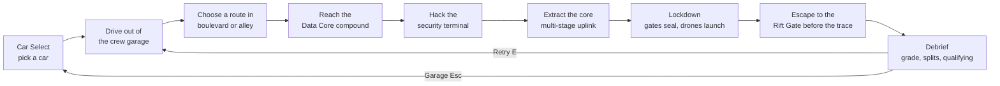

# 01 · Project Overview

> Part of the [NEON RIFT book](00_INDEX.md). Next: [02 Architecture](02_ARCHITECTURE.md).

## What Neon Rift is

**Neon Rift: Night Run** (`productName` in `ProjectSettings/ProjectSettings.asset`, version `0.1.0`) is a cyberpunk **racing + heist** game built in **Unity 6 (6000.6.4f1)** with the **Universal Render Pipeline**, the **Input System**, **Cinemachine** and **Timeline**.

The player picks a car in a crew garage, drives into a generated night city of about 1.1 × 1.4 km, breaks into the **Sector 7 Data Core**, and then escapes through a city that locks down around them. Two rival crews run their own heists at the same time. Only the first two crews out qualify.

| | |
|---|---|
| Genre | Arcade-simulation driving, heist, open-route racing |
| Platform | Desktop (macOS player builds exist; PC and Mobile URP assets are both configured) |
| Mission | **Night Run** (`Assets/_NeonRift/Data/Missions/Mission_NightRun.asset`) |
| Player cars | SLS AMG, SLS AMG GT3, Terzo Millennio (`Assets/_NeonRift/Data/Vehicles/VehicleCatalog.asset`) |
| Rival crews | VEX and KADE (`Assets/_NeonRift/Data/Racing/Racer_Vex.asset`, `Racer_Kade.asset`), driving the two cars the player did not pick |
| Code | 198 C# files, about 36,000 lines, 13 assemblies (`Assets/_NeonRift/Scripts/*/NeonRift.*.asmdef`) |
| Tests | 125 EditMode test cases (last run: 125 passed, 0 failed), in `Assets/_NeonRift/Scripts/Tests/EditMode/` |

## Player fantasy

You are the driver of a small crew. Your crew's hidden garage on W Avenue opens its roller door, you drive out into the neon city, steal a data package from a corporate grid, and outrun both the city's lockdown and the other crews.

## Core gameplay loop (Night Run)

The four mission objectives are data (see [19 Mission System](19_MISSION_SYSTEM.md)):

1. `reach_core`: INFILTRATE THE DATA CORE FACILITY.
2. `disable_security`: DISABLE FACILITY SECURITY.
3. `hack_core`: EXTRACT THE DATA CORE.
4. `escape`: ESCAPE TO THE RIFT GATE (80 s trace timer, shortened by heat).

## Design philosophy: racing + heist + environmental interaction + dynamic consequences

| Pillar | How the project does it | Main code |
|---|---|---|
| **Racing** | A physical car model and two AI rival crews on the same road graph | `VehicleController`, `RacerDriver`, `RivalDirector` |
| **Heist** | Multi-stage "stop and work the device" interactions | `InteractionRun`, `Interactable`, `DataCoreChamber` |
| **Environmental interaction** | Gates with physical bolts, terminals with screens, a chamber with robotic arms | `GateLockSystem`, `SecurityBarrier`, `TerminalDisplay` |
| **Dynamic consequences** | Heat, Alert/Lockdown, sealing gates, cameras, drones, signal grids and screens that react | `MissionProgress`, `SecurityLightGroup`, `SecurityCamera`, `SecurityDrones`, `TrafficSignalNetwork`, `LockdownScreens` |

How it differs from a conventional racing game:

- **There is no fixed track.** Routes are your choice on a city road graph (`RoadNetwork`), and they change when gates close.
- **Risk has a price.** The short alley costs **heat** (a gate hack logs +35 %). Heat raises security, shortens the escape timer and makes checkpoints seal sooner.
- **The opponents are working, not only racing.** Rivals stop to hack relays and tap the core's trunk line ([17 Rival AI](17_RIVAL_AI.md)).
- **The world reacts to string events, not to scripts.** Objectives fire event ids such as `core.breached`, and every reactive object listens for ids ([02 Architecture](02_ARCHITECTURE.md)).

## Major systems (one line each)

| System | Chapter |
|---|---|
| Boot, scenes and game flow | [05](05_GAME_FLOW.md), [06](06_BOOTSTRAP_AND_SCENES.md) |
| Generated city, buildings, roads | [07](07_CITY_AND_WORLD_GENERATION.md), [08](08_BUILDINGS_AND_ENVIRONMENT.md), [09](09_ROADS_AND_ROUTE_NETWORK.md) |
| Vehicles: physics, audio, visuals, data | [10](10_VEHICLE_SYSTEM.md) to [14](14_CAR_CATALOG_AND_DATA.md) |
| Car Select garage | [15](15_CAR_SELECTION.md) |
| Input | [16](16_PLAYER_INPUT.md) |
| Rival AI, traffic | [17](17_RIVAL_AI.md), [18](18_TRAFFIC_SYSTEM.md) |
| Mission, heist, gate, Data Core, lockdown | [19](19_MISSION_SYSTEM.md) to [24](24_ENVIRONMENTAL_INTERACTIONS.md) |
| Lighting, atmosphere, effects | [25](25_LIGHTING.md) to [28](28_PARTICLES_AND_VFX.md) |
| Audio and music | [29](29_AUDIO_SYSTEM.md), [30](30_MUSIC_SYSTEM.md) |
| Cinematic intro | [31](31_CINEMATIC_INTRO.md), [32](32_TIMELINE_AND_CAMERA.md) |
| UI, HUD, minimap, presentation, debrief | [33](33_UI_AND_HUD.md) to [36](36_RESULTS_AND_DEBRIEF.md) |
| Animation, camera, performance | [37](37_ANIMATION_SYSTEMS.md) to [39](39_PERFORMANCE.md) |
| Testing, build, repository, licensing | [40](40_TESTING_AND_VALIDATION.md) to [44](44_ASSETS_AND_LICENSING.md) |

## Project scale (measured from the repository)

| Item | Count | Source |
|---|---|---|
| C# scripts | 198 (≈36 k lines) | `Assets/_NeonRift/Scripts/` |
| Scenes in the build | 5 | `ProjectSettings/EditorBuildSettings.asset` |
| Night Run scene | ≈15,200 GameObjects, 862 lights, 63 reflection probes, 9,046 box colliders (29 MB YAML) | `Assets/_NeonRift/Scenes/NightRun.unity` |
| Generated district meshes | 8,880 files | `Assets/_NeonRift/Art/District/Meshes/` |
| Road graph | 72 nodes, 107 edges (last build log) | `Assets/_NeonRift/Data/World/RoadNetwork_NightRun.asset` |
| Generated audio clips | ≈97 | `Assets/_NeonRift/Audio/Generated/` |

## Current state

The game is complete for its scope: one mission (Night Run), three player cars, two rival crews, a full front end (cinematic intro, title, Car Select, pause and settings), a graded debrief, and automated tests and validation tools. Known limits are listed honestly in [45 Known Limitations](45_KNOWN_LIMITATIONS.md).
