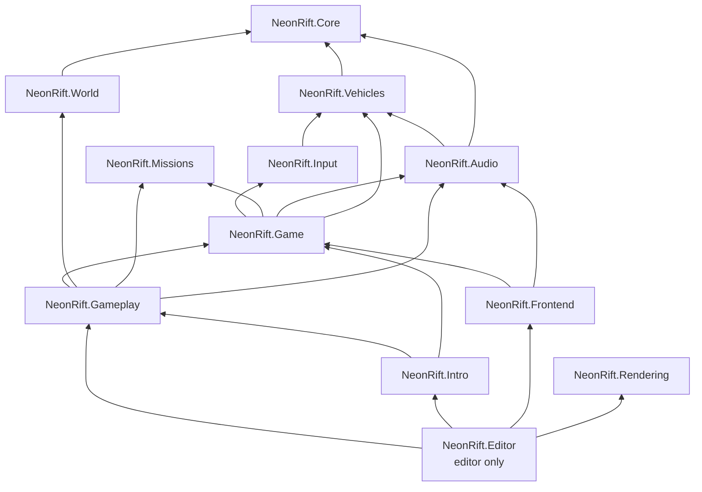
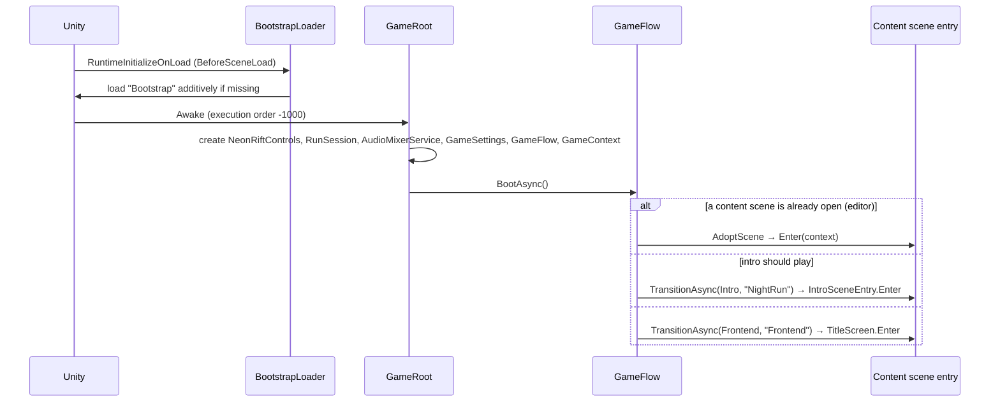
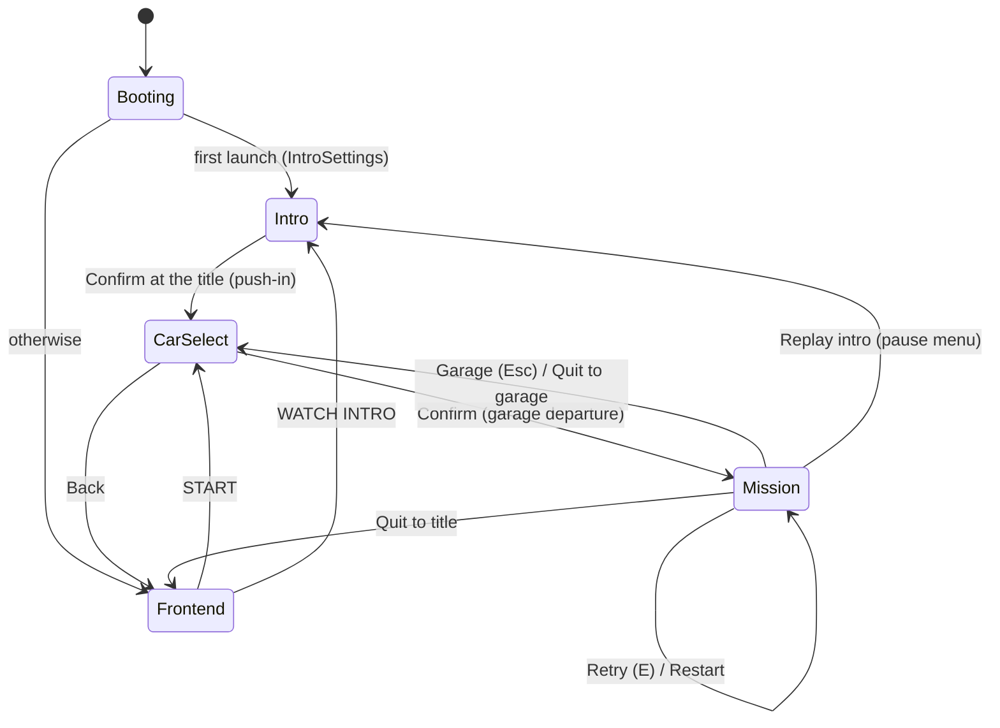
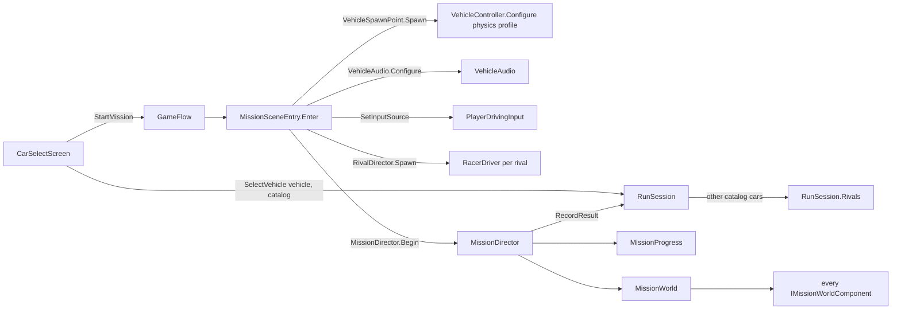

# 02 · Architecture

> [Index](00_INDEX.md) · Previous: [01 Overview](01_PROJECT_OVERVIEW.md) · Next: [03 Tech Stack](03_TECH_STACK.md)

## 1. High-level shape

Neon Rift is built around four rules. They appear everywhere in the code:

1. **One composition root.** `GameRoot` (`Assets/_NeonRift/Scripts/Game/GameRoot.cs`) lives in the always-loaded **Bootstrap** scene and creates every long-lived service. There are no singletons (see Decision D3 in `Docs/Decisions.md`).
2. **Context injection.** Each content scene has exactly one root component implementing `ISceneEntryPoint` (`Game/GameContext.cs`). `GameFlow` calls `Enter(GameContext)` after loading the scene and `Exit()` before unloading it. Scenes never look services up globally.
3. **Data in ScriptableObjects.** Vehicles, physics profiles, audio profiles, missions, interactions, AI profiles and the road network are all assets in `Assets/_NeonRift/Data/`.
4. **Missions talk through string event ids.** Objectives fire ids (`core.arrive`, `core.breached`, `lockdown` …). Scene objects implement `IMissionWorldComponent`, receive a per-attempt `MissionWorld`, and react to those ids. The director contains no mission-specific rules.

**Domain reload on entering Play Mode is disabled** (`ProjectSettings/EditorSettings.asset`: `m_EnterPlayModeOptionsEnabled: 1`, `m_EnterPlayModeOptions: 3`). This is why the code avoids static mutable state.

## 2. Assemblies (actual `.asmdef` references)

| Assembly | Folder | Owns |
|---|---|---|
| `NeonRift.Core` | `Scripts/Core` | `AssetLicense` |
| `NeonRift.Vehicles` | `Scripts/Vehicles` | `VehicleController`, `VehicleWheel`, `TyreModel`, `Drivetrain`, `Gearbox`, `SteeringSystem`, `VehiclePhysicsProfile`, `VehicleDefinition`, `VehicleCatalog`, `VehicleRig`, `VehicleLights`, `DrivingInput`, `IVehicleInputSource`, audio profile data |
| `NeonRift.World` | `Scripts/World` | `RoadNetwork`, `RoadGraph`, `RoadPath`, `BuildingDefinition`, `BuildingCatalog` |
| `NeonRift.Missions` | `Scripts/Missions` | `MissionDefinition`, `ObjectiveDefinition`, `MissionProgress` (pure state machine), `InteractionStep`, `InteractionRun`, `RivalTask`, `MissionGrade`, `MissionRecords`, `ScoreMix` |
| `NeonRift.Input` | `Scripts/Input` | Generated `NeonRiftControls`, `PlayerDrivingInput` |
| `NeonRift.Audio` | `Scripts/Audio` | `VehicleAudio`, `EngineSoundModel`, `TyreSoundModel`, `AudioMixerService`, `AudioMixerConfig`, `MasterLimiter` |
| `NeonRift.Game` | `Scripts/Game` | `GameRoot`, `GameFlow`, `GameContext`, `RunSession`, `GameConfig`, `GameSettings`, `IntroSettings`, `OptionsMenu`, `LoadingOverlay`, `BootstrapLoader` |
| `NeonRift.Gameplay` | `Scripts/Gameplay` | Mission runtime, city systems, racing AI, traffic, camera, spawn |
| `NeonRift.Frontend` | `Scripts/Frontend` | `TitleScreen`, `CarSelectScreen`, `VehicleShowroom`, `ShowroomEngine` |
| `NeonRift.Intro` | `Scripts/Intro` | `IntroSceneEntry`, Timeline cue track, `IntroOverlay`, `IntroCityLife` |
| `NeonRift.Rendering` | `Scripts/Rendering` | `GroundHaze` Volume override, `GroundHazeFeature` (Render Graph) |
| `NeonRift.Editor` | `Scripts/Editor` | Every generator, builder, validator and test harness (editor only) |
| `NeonRift.Tests.EditMode` | `Scripts/Tests/EditMode` | EditMode unit and integration tests |

## 3. Runtime flow

`GameFlow.TransitionAsync` (`Game/GameFlow.cs:122`) always runs in the same order: fade in (`LoadingOverlay.ShowAsync`) → `Exit()` → unload the old scene → load the new one additively → set it active → `Resources.UnloadUnusedAssets` → find the entry point (`FindEntryPoint`, which matches `IIntroEntryPoint` only for `GameState.Intro`) → `Enter(context)` → fade out. Requests made during a transition are ignored (`Request`).

## 4. Scene flow

`GameState` values (`Game/IGameFlow.cs`): `None`, `Booting`, `Intro`, `Frontend`, `CarSelect`, `Mission`.

## 5. Data flow for one run

## 6. Mission architecture

| Layer | Type | File |
|---|---|---|
| Data | `MissionDefinition`, `ObjectiveDefinition`, `MissionAnnouncement`, `RivalTask` | `Scripts/Missions/` |
| Pure state | `MissionProgress` (objectives, heat, security, timers, phases) | `Scripts/Missions/MissionProgress.cs` |
| Hub | `MissionWorld` (player, events, countdowns, announcements) | `Scripts/Gameplay/Mission/MissionWorld.cs` |
| Runner | `MissionDirector` (binds components, drives HUD, audio, mixer, results) | `Scripts/Gameplay/Mission/MissionDirector.cs` |
| Participants | `IMissionWorldComponent` implementers: `MissionZone`, `Interactable`, `SecurityBarrier`, `GateLockSystem`, `SecurityLightGroup`, `SecurityAlarm`, `SecurityPostEffects`, `DataCoreChamber`, `SecurityCamera`, `TrafficSignalNetwork`, `LockdownScreens`, `CityTraffic`, `CrowdGroups`, `SecurityDrones`, `RivalDirector` | various |

Full details: [19 Mission System](19_MISSION_SYSTEM.md).

## 7. Vehicle architecture

`VehicleController` is the only driving component. It implements `IVehicleInputReceiver` and reads `DrivingInput` from any `IVehicleInputSource`: the player (`PlayerDrivingInput`), AI (`RacerDriver`, `WaypointDriver`, `RouteAutopilot`) or scripts (`ScriptedDrivingInput`). Tuning comes from `VehiclePhysicsProfile`, geometry from the prefab's `VehicleRig`. See [10 Vehicle System](10_VEHICLE_SYSTEM.md).

## 8. AI architecture

Rivals use the player's input interface: `RacerDriver : IVehicleInputSource`. `RivalDirector` owns task lists, standings and qualifying. Traffic is separate and simpler (`CityTraffic` + `TrafficCar`). See [17 Rival AI](17_RIVAL_AI.md) and [18 Traffic](18_TRAFFIC_SYSTEM.md).

## 9. UI architecture

All screens are **UI Toolkit** (UXML/USS in `Assets/_NeonRift/UI/`, one `NeonRiftPanelSettings.asset`). Views are passive: `MissionHud`, `CarSelectScreen`, `IntroOverlay`, `OptionsMenu` and `TitleScreen` receive state from their controllers. The minimap draws with `Painter2D`. See [33 UI and HUD](33_UI_AND_HUD.md).

## 10. Audio architecture

One mixer (`Assets/_NeonRift/Audio/Mixer/NeonRiftMixer.mixer`), described by `AudioMixerConfig` and driven at runtime by `AudioMixerService` (snapshots plus user volumes). Vehicles play telemetry-driven loops (`VehicleAudio`), and missions play ambience, cues, music and the adaptive score (`MissionAudio`). See [29 Audio](29_AUDIO_SYSTEM.md).

## 11. Environment architecture

The whole city scene is generated by editor code (`NightRunBuilder` + `NightRunDistrict` + `CityLayout` + helpers). The generated scene is the build artefact: **change the builder, not the scene.** See [07 City and World Generation](07_CITY_AND_WORLD_GENERATION.md).

## 12. Persistence

| What | Where | Key |
|---|---|---|
| Settings (volumes, music on/off, quality, fullscreen, V-sync) | `GameSettings` → PlayerPrefs | prefix `NeonRift.Settings.` |
| Intro seen | `IntroSettings` → PlayerPrefs | `NeonRift.IntroSeen` |
| Best time / best score / qualified per mission | `MissionRecords` → PlayerPrefs | `NeonRift.Best.<id>.time`, `.grade`, `.qualified` |
| Session state (selected car, rivals, mission, last result) | `RunSession` (memory only) | — |
