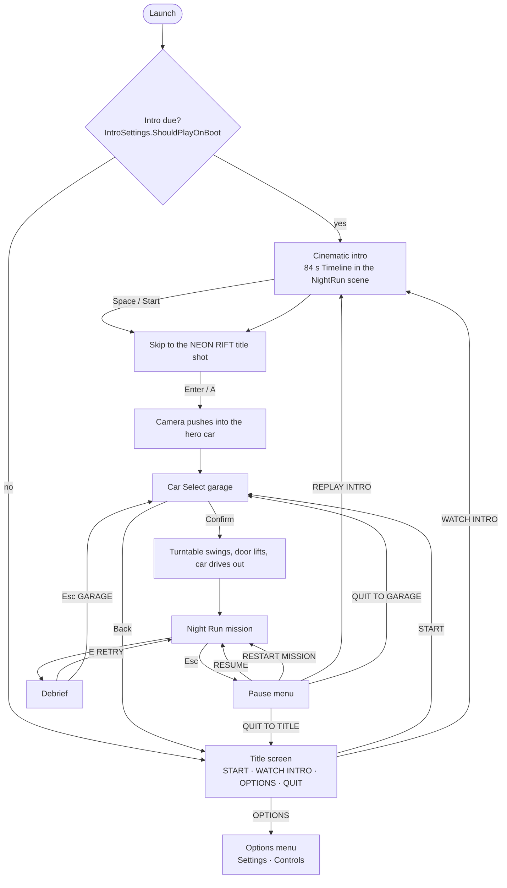

# 05 · Game Flow

> [Index](00_INDEX.md) · Previous: [04 Project Structure](04_PROJECT_STRUCTURE.md) · Next: [06 Bootstrap and Scenes](06_BOOTSTRAP_AND_SCENES.md)

## What the player experiences

## How the flow is implemented

| Step | Code | File |
|---|---|---|
| Boot | `GameFlow.BootAsync` | `Assets/_NeonRift/Scripts/Game/GameFlow.cs:34` |
| Decide intro or title | `IntroSettings.ShouldPlayOnBoot()` (policy `FirstLaunchOnly` / `Always` / `Never`) | `Scripts/Game/IntroSettings.cs:31` |
| Play the intro | `GameFlow.PlayIntro()` → `TransitionAsync(GameState.Intro, config.IntroScene)` (scene `NightRun`) → `IntroSceneEntry.Enter` | `GameFlow.cs:66`, `Scripts/Intro/IntroSceneEntry.cs:87` |
| Title | `TitleScreen.Enter` binds `start-button`, `intro-button`, `options-button`, `quit-button` | `Scripts/Frontend/TitleScreen.cs`, `UI/TitleScreen.uxml` |
| Go to Car Select | `GameFlow.GoToCarSelect()` | `GameFlow.cs:74` |
| Choose car and mission | `RunSession.SelectVehicle(vehicle, catalog)`, `SelectMission` | `Scripts/Game/RunSession.cs` |
| Start the mission | `GameFlow.StartMission()`: checks `session.IsReadyToLaunch` and `GameConfig.IsPlayable`, clears the last result, loads `SelectedMission.SceneName` | `GameFlow.cs:76` |
| Mission entry | `MissionSceneEntry.Enter`: spawns the player, binds input and camera, spawns rivals, starts the `MissionDirector` | `Scripts/Gameplay/MissionSceneEntry.cs:39` |
| Pause | `MissionSceneEntry.OpenPause` builds an `OptionsMenu` with seven rows | `MissionSceneEntry.cs:115` |
| Retry / Garage on the debrief | `MissionDirector.Retry` (E) → `Flow.StartMission()`; `Continue` (Esc) → `Flow.GoToCarSelect()` | `Scripts/Gameplay/Mission/MissionDirector.cs:731`, `:738` |
| Quit | `GameFlow.QuitGame` (stops Play Mode in the editor, `Application.Quit` in a player) | `GameFlow.cs:92` |

### Pause details (verified in `MissionSceneEntry.OpenPause`)

- `Time.timeScale = 0`, `AudioListener.pause = true` (the music track ignores the listener pause and keeps playing, ducked).
- The mixer goes to the **Ducked** snapshot over 0.3 s, the Driving action map is disabled, and `MissionDirector.Paused = true`.
- Rows: RESUME · RESTART MISSION · CONTROLS · SETTINGS · REPLAY INTRO · QUIT TO GARAGE · QUIT TO TITLE.
- `ResumeFromPause` restores the previous time scale and mixer state.

### Development shortcuts

| You press Play from | What happens | Code |
|---|---|---|
| `Bootstrap` | Normal boot: intro or title | `GameFlow.BootAsync` |
| `NightRun` (or any mission scene) | The open scene is **adopted**: the first catalog car is selected, the mission whose `sceneName` matches is selected, and the mission starts directly | `GameFlow.AdoptScene`, `PrepareDevelopmentSession` |
| `CarSelect` or `Frontend` | Adopted as that state | `GameFlow.StateForScene` |
| A player build with `-perfroute <folder>` | Boots straight into the default mission with the first car, and the performance runner drives the route | `Scripts/Game/PerfRouteArgs.cs`, `Scripts/Gameplay/PerfRouteRunner.cs` |

## Mixer state per game state

`GameRoot.OnStateChanged` switches the mixer to **Gameplay** for `Mission` and `Intro`, and to **Menu** for everything else. The mission director then switches to **Lockdown** and **Results** itself. See [29 Audio](29_AUDIO_SYSTEM.md).

## Related

- Scene loading and entry points: [06 Bootstrap and Scenes](06_BOOTSTRAP_AND_SCENES.md)
- Intro: [31 Cinematic Intro](31_CINEMATIC_INTRO.md)
- Car Select: [15 Car Selection](15_CAR_SELECTION.md)
- Mission: [19 Mission System](19_MISSION_SYSTEM.md)
