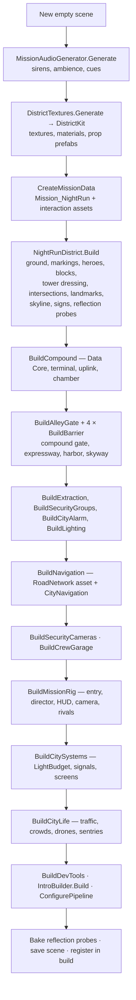

# 07 · City and World Generation

> [Index](00_INDEX.md) · Previous: [06 Bootstrap and Scenes](06_BOOTSTRAP_AND_SCENES.md) · Next: [08 Buildings and Environment](08_BUILDINGS_AND_ENVIRONMENT.md)

## The short answer

The city is **not modelled by hand**. An editor tool generates the whole `NightRun` scene from data in about 40 s: every block, street wall, prop, lamp, texture, material, mesh, reflection probe, the road graph, the mission data and the intro. The layout data lives in **`CityLayout.cs`**. **Change the builder, not the scene** (Decisions D23 and D24).

Menu: **Neon Rift ▸ Night Run ▸ Build Night Run (district + mission)** → `NightRunBuilder.BuildFromMenu` → `NightRunBuilder.Build(bakeProbes: true)` (`Assets/_NeonRift/Scripts/Editor/District/NightRunBuilder.cs:81`).

## The city at a glance

About **1.14 × 1.40 km**, five districts, data in `CityLayout.Districts`:

```
 z 700 ┌──────────── Skyline Drive ──────────────────────────────────┐
       │  SPIRE HEIGHTS   Spire Av                │  Dock Rd │ E Ring │
   480 ├──── Spire Boulevard ─(Spire Plaza + monument)────────────────┤
   300 ├──── North Boulevard ──┬─ Access Rd ─┬────────────┼──────────┤
       │ KOWLOON   W │ SECTOR 7│  DATA CORE  │ E Expwy    │ HARBOR   │
    60 │  MARKET   A │         │  alley      ├─ Freight Ln + SKYWAY ──┤
  −100 ├──── Market Street ────┴─────────────┼── [HARBOR CHECKPOINT] ─┤
  −320 ├──── South Street ───────────────────┼ Yard Rd ┼ (containers)│
       │ LOWTOWN (construction site)  Kiln St│ ▼ Rift Gate tunnel     │
  −520 ├──── Lowtown Road ──────────────────────────────┼────────────┤
  −700 └──── Southern Perimeter ────────────────────────┴────────────┘
     x −380      −200        0      160            320      560     760
```

| District (`CityLayout.Districts`) | Area | Character (`NightRunDistrict.Style`, `ZoneStyle`) |
|---|---|---|
| SECTOR 7 (hero) | x 0…320, z −320…300 | Shopfront podiums, neon awnings, blade signs, kerb neon, curated hero towers |
| SPIRE HEIGHTS | north of z 300 | Corporate high-rise, tall podiums, curtain-wall glass, LED fins |
| KOWLOON MARKET | x −400…0 | Dense, short podiums, signs, overhead cables, lantern strings |
| HARBOR YARDS | x 320…780 | Industrial warehouses, sodium lamps, container yard |
| LOWTOWN | south of z −320 | Worn mid-rise, fire escapes, construction site |

## Generation pipeline (order verified in `NightRunBuilder.Build`)



### Step 1: layout data → blocks (`CityLayout.Decompose`)

`CityLayout` is plain data:

| Data | Meaning | Code |
|---|---|---|
| `Roads` (`Road` struct) | Axis-aligned roads with name, sign text, half-width, lanes, sidewalk, `RoadClass`, median, ground flag, optional blocker id | `CityLayout.cs`, factory `R(...)` at line 85 |
| `Blockers` | Gate positions; the graph edge under each gets the gate id | `CityLayout.Blockers` |
| `Reserved` | Areas the generator leaves alone: Data Core compound, Rift Gate tunnel, crew garage | `CityLayout.Reserved` |
| `Lots` | Special lots: S7 Car Park, Spire Plaza, Night Market, Harbor Container Yard, Lowtown Construction | `CityLayout.Lots` |
| `Heroes` | Hand-placed catalog buildings (Singapore offices, London tower, Asian Night towers) | `CityLayout.Heroes` |
| `Districts` | Name, rectangle, HUD colour | `CityLayout.Districts` |

**Algorithm.** Every ground road contributes its x (vertical roads) or z (horizontal roads) line. The sorted lines cut the world into a grid of cells. Neighbouring cells with **no road between them** are merged with a union-find (`Find` in `Decompose`), so each merged group becomes a **block**. Adding a street re-forms the blocks around it automatically. `SlabPieces` and `Subtract` cut the reserved areas and lots out of the pavement slabs.

### Step 2: blocks → geometry (`NightRunDistrict`)

`NightRunDistrict.Build` (`Editor/District/NightRunDistrict.cs:126`):

1. `BuildGround`: one asphalt ground plane. **Roads are the gaps between raised pavement blocks** (kerb 15 cm), so junctions need no special geometry.
2. `BuildMarkings`: edge, centre and lane lines, double solid lines on arterials, zebras, stop lines.
3. `PlaceHeroes`: the `CityLayout.Heroes` prefabs, with `HeroLod`.
4. `BuildBlock` per block: pavement slab, kerb, **podium street walls** (`BuildStreetWall`), street lights, towers (`FillTowers` from the `BuildingCatalog`), props and infill (`CityInfill.Fill`).
5. `TowerDressing.Emit`: window shader, crown strips, rooftop plant, aviation lights.
6. `CityProps.BuildIntersections`: signals on mast arms, street-name blades, bollards, CCTV.
7. `CityLandmarks.Build`: skyway, Lantern Arcade, car park, plaza and monument, night market, container yard with gantry cranes, construction site with a tower crane, expressway median.
8. `SkylineBackdrop.Build`: three rings of tower silhouettes beyond the city.
9. `BuildNavigationSigns`: district gateway gantries and escape gantries.
10. `BuildReflectionProbes`: box-projected probes along the arterials.

### Mesh strategy (cost control)

| Technique | Where |
|---|---|
| `MeshBuilder` accumulates quads per material; UVs in metres ÷ texture tile size | `Editor/District/MeshBuilder.cs` |
| `BlockMeshes`: one combined renderer **per material per block** (the batching unit) | `Editor/District/BlockMeshes.cs` |
| `DistrictKit.SaveMesh` overwrites mesh assets in place, so GUIDs and scene references stay stable | `Editor/District/DistrictKit.cs:224` |
| Static batching / occluder flags on district geometry | `DistrictKit.Renderer` |
| Detail and Clutter layers culled at 180 m and 90 m | `Gameplay/CameraCullDistances.cs` |

### Determinism

Every generator uses fixed seeds (`System.Random`) and deterministic textures, so the same data produces the same city. Each block's infill has its own seed, so changing the infill never reshuffles street walls.

## Where to find each piece

| Feature | Builder | Runtime component (if any) |
|---|---|---|
| Layout data | `Editor/District/CityLayout.cs` | — |
| Master builder | `Editor/District/NightRunBuilder.cs` (+ `.Heist.cs`, `.Garage.cs`, `.CityLife.cs`) | — |
| Blocks, street walls, towers, lamps | `Editor/District/NightRunDistrict.cs` | `Gameplay/City/LightBudget.cs` |
| Block interiors | `Editor/District/CityInfill.cs` | — |
| Street furniture and intersections | `Editor/District/CityProps.cs` | `Gameplay/City/TrafficSignalNetwork.cs` |
| Landmarks | `Editor/District/CityLandmarks.cs` | — |
| Tower night look | `Editor/District/TowerDressing.cs` + `Art/Shaders/NeonRift_TowerFacade.shader` | — |
| Far skyline | `Editor/District/SkylineBackdrop.cs` + `NeonRift_SkylineBackdrop.shader` | — |
| Textures | `Editor/District/DistrictTextures.cs`, `PixelFont.cs` | — |
| Materials and prop prefabs | `Editor/District/DistrictKit.cs` | — |
| Road graph | `CityLayout.BuildNetwork` → `Data/World/RoadNetwork_NightRun.asset` | `Gameplay/Navigation/CityNavigation.cs` |

Details: [08 Buildings and Environment](08_BUILDINGS_AND_ENVIRONMENT.md), [09 Roads and Route Network](09_ROADS_AND_ROUTE_NETWORK.md), [25 Lighting](25_LIGHTING.md).

## Validation

- `CityTests` (`Scripts/Tests/EditMode/CityTests.cs`): `CityNetwork_IsValidAndConnected`, `CityIsMuchLargerThanTheSlice`, `EveryBlockHasAZoneAndPavement`, `HeroBuildingsAvoidRoadsAndReservedAreas`, `Path_SpawnToCore_FollowsRoads`, `Skyway_IsElevatedAndReachable`, `NightRun_CityLifeIsSetUp`.
- `LookDevShots` (`Editor/District/LookDevShots.cs`) captures fixed viewpoints for before/after comparison (**Neon Rift ▸ Night Run ▸ Capture Look-Dev Shots (Play Mode)**).
- The builder log (`Logs/NightRunBuild.txt` when written) prints counts of podiums, towers, lamps, signals, infill parcels and LODs.
