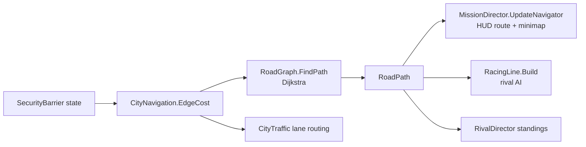

# 09 · Roads and Route Network

> [Index](00_INDEX.md) · Previous: [08 Buildings](08_BUILDINGS_AND_ENVIRONMENT.md) · Next: [10 Vehicle System](10_VEHICLE_SYSTEM.md)

## One source of truth for "where can a car go" (Decision D24)

The same road list in `CityLayout.Roads` produces two things:

1. The **visible roads**: gaps between raised pavement blocks, plus markings (`NightRunDistrict.BuildGround`, `BuildMarkings`).
2. The **runtime road graph** `RoadNetwork_NightRun.asset`, used by the HUD route, the minimap, the location readout, rival AI, traffic and race standings.

## Road data (`CityLayout.Road`, `Assets/_NeonRift/Scripts/Editor/District/CityLayout.cs`)

| Field | Meaning |
|---|---|
| `Name`, `Sign` | Street name (HUD readout) and sign text |
| `A`, `B` | Axis-aligned end points |
| `HalfWidth`, `Lanes` | Carriageway half width; lanes per direction |
| `Sidewalk`, `Median` | Pavement width; central median half width (expressway 0.8 m, Freight Lane 4.5 m) |
| `Class` | `RoadClass`: Arterial, Street, Alley, Service, Skyway, Tunnel |
| `Ground` | Ground roads cut the slabs and get markings; graph-only roads (skyway, compound, car park) don't |
| `BlockerId` | Gate id on this road |
| `SpeedLimit` | By class: Arterial 38, Skyway 40, Street 28, Tunnel 26, Alley 16, other 12 (m/s) |

Examples (verified): `W Avenue` x = 0, half width 7, 2 lanes, Arterial. `Market Street` z = −100, half width 6, 1 lane. `East Expressway` x = 320, half width 9, median 0.8. `Service Alley` x = 160, z −100…60, Alley. Graph-only: `Compound Drive`, `Compound Loop` (loops round the west of the core so routes don't pass through the pedestal), `Car Park`, `Skyway West Ramp` / `Harbor Skyway` / `Skyway East Ramp` (elevated to 8 m).

## Building the graph (`CityLayout.BuildNetwork`, line 412)

1. `NetworkNodes()` puts nodes at every junction and road end, plus nodes 6 m either side of each blocker (so a gate sits on its own short edge).
2. For each road, the nodes lying on it are sorted along the road, and consecutive pairs become `RoadEdge`s carrying width, lanes, median, class, street name, speed limit and **blocker id** (from `Road.BlockerId` or a `Blockers` entry within 6.5 m of the edge midpoint).
3. `CityDistrict` entries (id, display name, area, colour) are added.
4. Result: `Assets/_NeonRift/Data/World/RoadNetwork_NightRun.asset` (last build log: **72 nodes, 107 edges**). `RoadNetwork.Validate` problems are logged by `NightRunBuilder.BuildNavigation`.

## Runtime classes

| Class | File | Role |
|---|---|---|
| `RoadNetwork` (ScriptableObject) | `Scripts/World/RoadNetwork.cs` | Pure data: `RoadNode`, `RoadEdge`, `CityDistrict`; `NodePosition`, `TryGetNearestEdge`, `TryGetDistrict`, `ProjectXZ`, `Validate` |
| `RoadGraph`, `RoadPath` | `Scripts/World/RoadGraph.cs` | Shortest paths between **arbitrary positions**. Each end is projected onto its nearest edge, then **Dijkstra** runs over the nodes with per-query extra edge costs. The start edge is never treated as closed (a car past a gate can drive away). Allocation-free after construction apart from the result. `FindPath`, `CountReachable`, `EdgeLength` |
| `CityNavigation` (MonoBehaviour) | `Scripts/Gameplay/Navigation/CityNavigation.cs` | The scene's view of the graph with **live gate state**: closed gate = impassable (∞), counting down to close = +450 m (`pendingPenalty`). `Version` increments whenever a gate changes state, so drivers and the HUD re-plan. `Plan(from, to, path[, extraCost])`, `IsBlocked`, `StreetAt`, `TryGetDistrict` |

## Gates on the graph

Wired in `NightRunBuilder.Build` → `BuildNavigation(c, gates)`:

| Gate id (`CityLayout`) | Barrier object | Default |
|---|---|---|
| `AlleyGateId` | AlleyGate (hackable) | Closed until hacked |
| `CompoundGateId` | CompoundGate (on `Compound Drive`) | Open; seals 12 s after the lockdown |
| `CheckpointId` | ExpresswayCheckpoint (320, 170) | Open; seals 30 s after the lockdown |
| `HarborCheckpointId` | HarborCheckpoint (440, −100) | Open; seals 22 s after the lockdown |
| `SkywayGateId` | SkywayGate (on the west ramp) | Closed; opens on `escape.start` |

## Consumers

| Consumer | How it uses the graph |
|---|---|
| HUD route and minimap | `MissionDirector.UpdateNavigator` re-plans every `routeInterval` (0.5 s) or when `Version` changes; `MissionHud.SetNavigator`; `CityMinimap.SetRoute` draws it |
| Street / district readout | `CityNavigation.StreetAt` (nearest edge within 30 m), `TryGetDistrict` |
| Rival AI | `RacerDriver.Replan` → `RacingLine.Build(path)`; remembered blocked edges cost +250 m (`RacerDriver.AvoidCost`) |
| Traffic | `CityTraffic` drives kerb-side lanes of the graph; dead ends are pruned so cars don't strand at the gated compound spur |
| Standings | `RivalDirector.RouteMetres` |

## Validation

`CityTests`: `CityNetwork_IsValidAndConnected`, `Path_SpawnToCore_FollowsRoads`, `ClosedGates_ChangeTheRoute`, `RememberedBlockedEdge_IsRoutedAround`, `Skyway_IsElevatedAndReachable` (`Assets/_NeonRift/Scripts/Tests/EditMode/CityTests.cs`).
