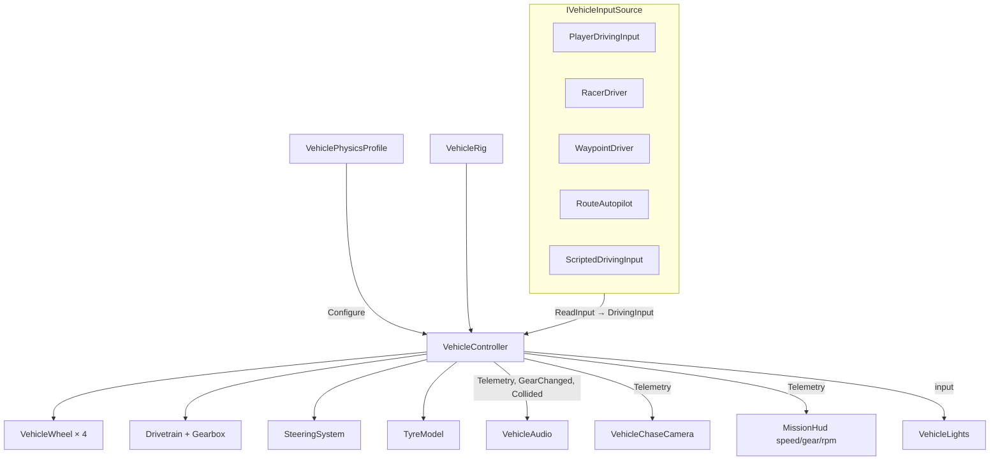

# 10 · Vehicle System

> [Index](00_INDEX.md) · Previous: [09 Roads](09_ROADS_AND_ROUTE_NETWORK.md) · Next: [11 Vehicle Physics](11_VEHICLE_PHYSICS.md)

## Overview

A car in Neon Rift is made of four things:

| Part | What it is | Where |
|---|---|---|
| **Definition** (data) | Identity, prefabs, physics profile, audio profile, display stats, licence | `VehicleDefinition` (`Assets/_NeonRift/Scripts/Vehicles/VehicleDefinition.cs`), assets `Assets/_NeonRift/Data/Vehicles/Vehicle_*.asset` |
| **Prefab** (geometry) | Nested source model + split wheel pivots + `VehicleRig` + Rigidbody + two-box collider + `VehicleController` + `VehicleAudio` + LODGroup | `Assets/_NeonRift/Prefabs/Vehicles/PF_Vehicle_*.prefab` |
| **Physics profile** (tuning) | Everything that makes it drive the way it does | `VehiclePhysicsProfile` (`Scripts/Vehicles/Physics/VehiclePhysicsProfile.cs`), `Data/Vehicles/Physics/VehiclePhysics_*.asset` |
| **Audio profile** (sound) | Engine loops, beds, one-shots, levels | `VehicleAudioProfile` (`Scripts/Vehicles/Audio/VehicleAudioProfile.cs`), `Data/Vehicles/Audio/VehicleAudio_*.asset` |

One component drives every car: **`VehicleController`** (`Scripts/Vehicles/Physics/VehicleController.cs`). Whoever spawns a car decides who drives it through **`IVehicleInputSource`**.

## Spawning (`VehicleSpawnPoint.Spawn`)

`Assets/_NeonRift/Scripts/Gameplay/VehicleSpawnPoint.cs:17`:

1. Instantiate `definition.GameplayPrefab` at the spawn pose.
2. `controller.Configure(definition.PhysicsProfile)`: builds the wheels, configures the body, drivetrain and steering, and makes the kinematic prefab Rigidbody dynamic.
3. Add or get `VehicleLights` and call `Build(detailedLights)`. Only the player gets shadows and full range.
4. `VehicleAudio.Configure(definition.AudioProfile, controller)`.

Then the caller sets the input source. `MissionSceneEntry` gives the player a `PlayerDrivingInput`, and `RivalDirector.Spawn` gives each rival a `RacerDriver`. Prefabs ship with a **kinematic** Rigidbody, so a prefab dropped in a scene without a profile stays inert, and Car Select can reuse it as a static model (`Docs/Architecture.md`).

## Input abstraction (`Scripts/Vehicles/DrivingInput.cs`)

| Type | Meaning |
|---|---|
| `DrivingInput` (struct) | Normalised intent: `Throttle`, `Brake`, `Steer`, `Handbrake` (identical for player and AI) |
| `IVehicleInputSource` | `DrivingInput ReadInput()`. Implemented by `PlayerDrivingInput`, `RacerDriver`, `WaypointDriver`, `RouteAutopilot`, `ScriptedDrivingInput` |
| `IVehicleInputReceiver` | `SetInputSource(IVehicleInputSource)`. Implemented by `VehicleController` |

## Which script controls what?

| Concern | Script | Key members |
|---|---|---|
| Rigidbody step, suspension application, differentials, aero, traction control, telemetry | `Vehicles/Physics/VehicleController.cs` | `Configure` (91), `Step` (163), `ApplySuspension` (219), `ApplyDifferentials` (252), `ApplyAerodynamics` (272), `UpdateTractionControl` (289), `UpdateTelemetry` (322), `UpdateVisuals` (385), `Teleport` (119), `Recover` (141) |
| One corner: raycast suspension, wheel spin, tyre forces, ABS, static hold | `Vehicles/Physics/VehicleWheel.cs` | `UpdateContact` (154), `SuspensionForce` (207), `DamperForce` (220), `ApplyLoad` (227), `UpdateTyre` (241) |
| Tyre force curve, combined slip, friction ellipse | `Vehicles/Physics/TyreModel.cs` | `Curve`, `LoadFactor`, `CombinedSlip`, `Force`, `AvailableLongitudinal`, `ClampToEllipse` |
| Engine, clutch, reverse selection | `Vehicles/Physics/Drivetrain.cs` | `Update` (83), `EngineBrakeAt`, `UnlimitedDriveTorque`, `UpdateDirection` |
| Gear state and automatic shifting | `Vehicles/Physics/Gearbox.cs` | `Shift`, `SelectDirection`, `Tick`, `UpdateAutomatic`, event `GearChanged` |
| Steering lock, rate limit, Ackermann | `Vehicles/Physics/SteeringSystem.cs` | `MaxAngleAt`, `Update` |
| Surface grip | `Vehicles/Physics/DrivingSurface.cs` | Per-collider grip; no component = dry asphalt (grip 1) |
| Units and constants | `Vehicles/Physics/VehicleUnits.cs` | `Gravity`, `KphToMs` |
| Collision events | `Vehicles/Physics/VehicleCollision.cs` | Raised by `VehicleController.OnCollisionEnter` → `Collided` |
| Telemetry snapshot | `Vehicles/Physics/VehicleTelemetry.cs` | Speed, rpm, gear, load, slip, g, yaw rate … |
| Visual structure | `Vehicles/VehicleRig.cs` | `WheelRig` (Pivot steered about Y, Spin rotated about X, radius, position), lamps |
| Head and tail lights | `Vehicles/VehicleLights.cs` | `Build(detailed)`, `SetHeadlightLevel`, `SetTailOverride` |
| Sound | `Audio/VehicleAudio.cs` | `Configure`, `Tick`, `UpdateEngine`, `UpdateTyres`, `UpdateThumps` |
| Recover (R) and out-of-bounds | `Gameplay/MissionSceneEntry.cs` | `OnResetVehicle` → `Recover()`; `FixedUpdate` teleports below −30 m |
| Dev telemetry overlay (F3) | `Gameplay/VehicleDebugHud.cs` | `OnGUI` |

## Vehicle-specific configuration

| Car (catalog order) | Definition | Prefab | Physics | Audio |
|---|---|---|---|---|
| SLS AMG (`mercedes_sls_amg_2010`) | `Vehicle_MercedesSLS.asset` | `PF_Vehicle_MercedesSLS` | `VehiclePhysics_MercedesSLS` — RWD, 1620 kg, 650 Nm, 7200 rpm, limiter 317 km/h | `VehicleAudio_MercedesSLS` (V8Road) |
| SLS AMG GT3 (`mercedes_sls_gt3`) | `Vehicle_MercedesSLSGT3.asset` | `PF_Vehicle_MercedesSLSGT3` | `VehiclePhysics_MercedesSLSGT3` — RWD, 1380 kg, 640 Nm, slicks, downforce | `VehicleAudio_MercedesSLSGT3` (V8Race) |
| Terzo Millennio (`lamborghini_terzo_millennio`) | `Vehicle_LamborghiniTerzo.asset` | `PF_Vehicle_LamborghiniTerzo` | `VehiclePhysics_LamborghiniTerzo` — AWD (40 % front), 1650 kg, 1050 Nm, single-speed EV, limiter 320 km/h | `VehicleAudio_LamborghiniTerzo` (EV) |
| AMG GT3 (`mercedes_amg_gt3`) | `Vehicle_MercedesAMGGT3.asset` | `PF_Vehicle_MercedesAMGGT3` | — | — | 

The AMG GT3 has a definition and prefab but is **not in the catalog** (material defects, CC-BY-NC-SA). `VehicleModelTests.Catalog_ExcludesAmgGt3_AndFlagsNonCommercialLicences` enforces this.

## Chapters in this section

- [11 Vehicle Physics](11_VEHICLE_PHYSICS.md): suspension, tyres, drivetrain, assists, aero
- [12 Vehicle Audio](12_VEHICLE_AUDIO.md)
- [13 Vehicle Visuals](13_VEHICLE_VISUALS.md): prefab build, wheels, lights, LODs
- [14 Car Catalog and Data](14_CAR_CATALOG_AND_DATA.md)
