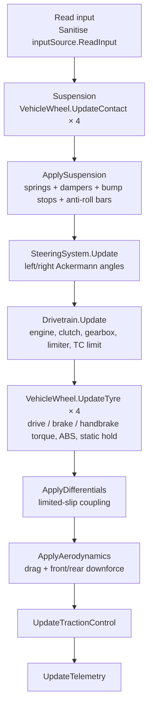

# 11 · Vehicle Physics

> [Index](00_INDEX.md) · Previous: [10 Vehicle System](10_VEHICLE_SYSTEM.md) · Next: [12 Vehicle Audio](12_VEHICLE_AUDIO.md)

All paths are under `Assets/_NeonRift/Scripts/Vehicles/Physics/` unless stated. The original design notes are in `Docs/VehiclePhysics.md` and Decisions D7, D8, D15, D16 and D17.

## Principles

- **Our own model, no `WheelCollider`** (D15). Unity's WheelCollider can't match the profile data and hides state that audio and AI need.
- **100 Hz fixed step** (D8): `Time.fixedDeltaTime = 0.01` (`ProjectSettings/TimeManager.asset`).
- **Physical units** (D16): kg, Nm, Hz, damping ratio, friction coefficients, C·A (m²).
- **Nothing moves the transform directly** while driving. `Teleport` and `Recover` are the only pose writes.

## The physics step (`VehicleController.Step`, line 163)



`FixedUpdate` calls `Step(Time.fixedDeltaTime)` unless `externalStepping` is set (the bench steps cars manually).

## Suspension (`VehicleWheel.cs`)

| Feature | Implementation |
|---|---|
| Contact | Raycast along the suspension axis. **5 rays per wheel** (`contactSamples`, ±40° around the tyre) sample the rolling profile, so sharp edges are rolled onto rather than stepped up (`UpdateContact`, line 154) |
| Spring | Rate from the axle's **natural frequency** (`springFrequency`, Hz) and corner mass, preloaded so static ride height equals the model's ride height (`SuspensionForce`, line 207) |
| Damper | Separate bump and rebound damping ratios with a **digressive knee** (`damperKneeSpeed`, `highSpeedDamping`): linear up to the knee, then a smaller high-speed share (`DamperForce`, line 220) |
| Bump stop | Progressive stop (`bumpStopScale`) in series with tyre radial stiffness; `bumpTravel` / `droopTravel` |
| Anti-roll bars | `VehicleController.ApplySuspension`: force = `antiRollStiffness × (compression left − compression right)` per axle |
| Force direction | Along the contact normal (`ApplyLoad`, line 227) |

Axle data: `AxleSettings.cs` (`springFrequency`, `bumpDamping`, `reboundDamping`, `damperKneeSpeed`, `highSpeedDamping`, `bumpTravel`, `droopTravel`, `bumpStopScale`, `antiRollStiffness`, `wheelMass`, plus a `TyreSettings`).

## Tyre model (`TyreModel.cs`, `TyreSettings.cs`)

**Combined slip with a friction ellipse.** Slip ratio and slip angle are each divided by their peak values, then combined:

```
s  = sqrt( (slipRatio / peakSlipRatio)² + (tan slipAngle / tan peakSlipAngle)² )
F  = Curve(s) · LoadFactor · surfaceGrip · load / s      (per unit of normalised slip)
Fx = longitudinalGrip · F · sx        Fy = −lateralGrip · F · sy
```

- `Curve`: a **sine rise** to 1 at the peak, then a **Gaussian fall** toward `slidingGripRatio` (`breakawaySharpness`).
- `LoadFactor`: load sensitivity. More load than static gives proportionally less friction (clamped 0.5 to 1.3).
- `AvailableLongitudinal` and `ClampToEllipse`: braking or accelerating in a corner trades lateral grip for longitudinal grip.
- Surface grip comes from `DrivingSurface` on the collider (grass 0.6 and gravel 0.45 on the test track).

## Wheel spin (D15)

`VehicleWheel.UpdateTyre` (line 241) integrates wheel spin **implicitly** against the tyre's stiffness (the larger of the local slope and the secant through zero slip). This keeps braking and traction stable at 100 Hz without sub-stepping and removes low-speed slip oscillation. A stopped wheel held by its brake uses **static friction** shared across held wheels (`holdMass`), so cars park on slopes without creeping.

## Drivetrain (`Drivetrain.cs`, `Gearbox.cs`, `EngineSettings.cs`, `TransmissionSettings.cs`)

| Part | Behaviour |
|---|---|
| Engine | Torque = peak torque × curve(rpm / max rpm) × throttle (`EngineSettings.TorqueAt`); soft rev limiter; engine braking (regen for the EV); inertia sets rev rate and is reflected onto the driven wheels |
| Clutch | Slips at launch (holds launch rpm), locks once the wheels catch up, opens for shifts (with rev-matching) and for the handbrake |
| Gearbox | Automatic with hysteresis, kick-down and a minimum shift interval (`Gearbox.UpdateAutomatic`); decisions use wheel-locked rpm. Gear −1 reverse, 0 neutral, 1..n forward. `Shift(int)` is the hook for manual shifting. Event `GearChanged(from, to)` |
| Reverse | **Hold brake at standstill** selects reverse (`Drivetrain.UpdateDirection`), never while the handbrake is held |
| Differentials | RWD / FWD / AWD with `frontTorqueShare`; limited-slip coupling per driven axle, `differentialLock` 0 (open) … 1 (locked) (`VehicleController.ApplyDifferentials`) |

## Brakes and assists

| Feature | Implementation |
|---|---|
| Brakes | `BrakeSettings`: `maxBrakeTorque`, `frontBias`, rear `handbrakeTorque` |
| **ABS** | `antiLock` / `antiLockTarget`: each wheel's brake torque is capped at the tyre force it can actually use (including engine braking already in use) |
| **Traction control** | `VehicleController.UpdateTractionControl`. Feed-forward: limit throttle so requested drive torque does not exceed driven-tyre capacity (plus wheel inertia). Feedback: cut further when a driven wheel is already past peak slip. Recovers at `TractionRecoveryRate` |
| Speed limiter | `AssistSettings.speedLimiterKph` (soft band) |

## Steering (`SteeringSystem.cs`, `SteeringSettings.cs`)

Rate-limited (slower at speed), with a **speed-dependent lock** that falls toward the grip-limited angle (the kinematic angle for the grip-limited corner plus peak front slip angle), and **Ackermann** geometry so the inner wheel turns more. Full keyboard lock at speed therefore means "at the limit", not "plough".

## Aerodynamics (`AeroSettings.cs`)

Drag (`dragArea`, CdA) at the centre of mass; downforce (`frontDownforceArea`, `rearDownforceArea`, ClA) at each axle: `q = ½ ρ v²`.

## Body

`VehicleController.ConfigureBody`: mass, centre of mass from front weight share and CG height, box inertia with per-axis scale, continuous collision. The prefab's two-box body collider uses the low-friction physic material `Assets/_NeonRift/Data/Physics/PM_VehicleBody.asset`.

## Telemetry (`VehicleTelemetry`)

Updated every step: speed (m/s, km/h, forward, normalised to predicted top speed), raw and effective throttle/brake/steer, steer angle, engine rpm and load, gear, shifting flag, clutch, max combined slip / slip ratio / slip angle, skid speed, grounded wheels, longitudinal/lateral g, yaw rate, traction-control factor. Per wheel: grounded, load, compression, bump-stop, rpm, slips, tyre force, surface grip. Consumers: `VehicleAudio`, `VehicleChaseCamera`, `MissionHud`, `RacerDriver`, `VehicleDebugHud`.

## Measured results (from `Docs/VehiclePhysics.md`, bench at 100 Hz)

| | SLS AMG | SLS AMG GT3 | Terzo Millennio |
|---|---|---|---|
| Layout | RWD, 7-speed | RWD, 6-speed, slicks, wing | AWD single-speed EV |
| 0–100 km/h | 4.4 s | 3.7 s | 3.0 s |
| Top speed (predicted) | 312 km/h | 278 km/h | 314 km/h |
| 100–0 km/h | 38.3 m | 30.5 m | 34.0 m |
| Steady grip 60 / 120 km/h | 0.92 / 0.97 g | 1.19 / 1.29 g | 1.06 / 1.13 g |

These are the numbers shown in Car Select (`VehiclePerformanceProbe.UpdateDisplayStats`).

## Tools and tests

| Tool | File | Purpose |
|---|---|---|
| `VehicleTestBench` | `Editor/Vehicles/VehicleTestBench.cs` | Isolated preview physics scene stepped manually at 100 Hz (deterministic, D17) |
| `VehiclePerformanceProbe` | `Editor/Vehicles/VehiclePerformanceProbe.cs` | Settle, launch, top speed, brake, ramp steer, step steer, bumps, route lap. Menu **Neon Rift ▸ Vehicles ▸ Measure Vehicle Performance** |
| Test track and validation route | `Scenes/Dev/TestTrack.unity`, `Editor/TestTrack/ValidationRouteBuilder.cs` | 1.55 km loop: acceleration, braking, banked turn, slalom, bumps, corners, gravel runoff |
| `RouteAutopilot`, `DrivingRoute`, `VehicleTelemetryLog` | `Scripts/Gameplay/` | Validation laps through the normal input path |
| `VehiclePhysicsTests` | `Tests/EditMode/VehiclePhysicsTests.cs` | Spawn at ride height without jitter, acceleration band, top speed, straight braking, cornering grip, full-lock step steer doesn't spin, bumps, wall impact and recovery, slope hold, validation lap, spawn applies profile (run per catalog car) |
| `VehicleModelTests` | `Tests/EditMode/VehicleModelTests.cs` | Tyre curve and ellipse, load sensitivity, steering lock and Ackermann, gearbox shifts, reverse selection, launch clutch, handbrake clutch, profile validity |

## Known limitations

No unsprung mass (no wheel hop), no tyre relaxation length, temperature or wear; differentials are speed-coupling approximations; two-box body collider; collision events fire only in Play Mode. Full list: `Docs/VehiclePhysics.md` and [45 Known Limitations](45_KNOWN_LIMITATIONS.md).
