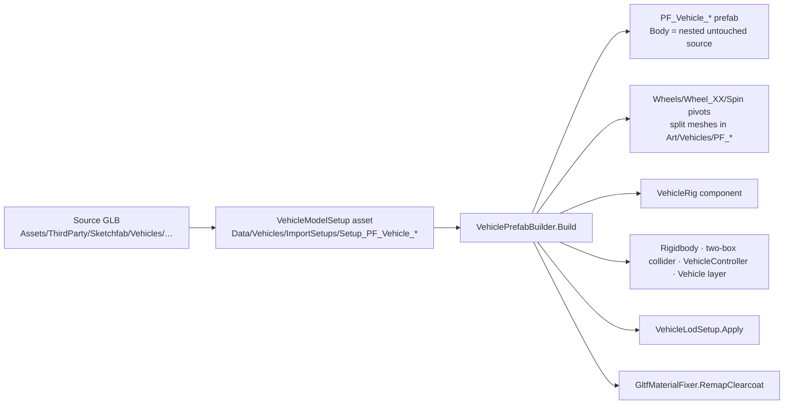

# 13 · Vehicle Visuals

> [Index](00_INDEX.md) · Previous: [12 Vehicle Audio](12_VEHICLE_AUDIO.md) · Next: [14 Car Catalog and Data](14_CAR_CATALOG_AND_DATA.md)

## How a Sketchfab car becomes a game car

| Step | Code |
|---|---|
| Recipes (keywords for wheels, lamps, hidden parts; orientation and scale fixes) | `ThirdPartyIntake.VehicleRecipes` (`Assets/_NeonRift/Scripts/Editor/ThirdPartyIntake.cs:90`), stored as `VehicleModelSetup` (`Editor/Vehicles/VehicleModelSetup.cs`) |
| Build the prefab | `VehiclePrefabBuilder.Build` (`Editor/Vehicles/VehiclePrefabBuilder.cs:56`): orient, scale and ground the model; `Classify` renderers by keyword; `SplitParts` / `QuadrantBounds` / `ExtractMesh` split merged wheel geometry into four corners; `AddPhysics` (Rigidbody, two-box collider with `PM_VehicleBody`, `VehicleController`, layer Vehicle) |
| Clearcoat fix | `GltfMaterialFixer.RemapClearcoat` (`Editor/GltfMaterialFixer.cs`): glTFast's clearcoat graph produced NaN (flat cyan) output, so renderers are remapped to project-owned copies on the plain glTF PBR graph (Decision D12) |
| Menus | **Neon Rift ▸ Assets ▸ Run Third-Party Intake**, **Neon Rift ▸ Assets ▸ Rebuild Vehicle Prefabs And Catalog**, **Neon Rift ▸ Vehicles ▸ Build All Vehicle Prefabs** |

The source model is never modified. It stays a nested prefab, and only transforms and renderer enable states are overridden (Decision D11).

## `VehicleRig` (`Scripts/Vehicles/VehicleRig.cs`)

Describes the visual structure so physics, lighting and presentation can drive any car without knowing its hierarchy. Root pivot at ground level, centred, +Z forward, metres.

| Member | Meaning |
|---|---|
| `WheelRig` | Per corner: `WheelPosition`, the **Pivot** (steered about local Y), the **Spin** transform (rotated about local X), radius, width; static parts such as calipers are children of the pivot only |
| Lamps | Head and tail lamp positions used by `VehicleLights` |

## Wheel visuals

`VehicleController.UpdateVisuals` (`Vehicles/Physics/VehicleController.cs:385`) runs in `LateUpdate`: each wheel's pivot gets its steer angle and suspension travel, and the Spin transform gets its rolled angle from the wheel's angular velocity. Motion-blur rims (SLS AMG, SLS GT3, Terzo) are hidden at rest (`Docs/ThirdParty.md` vehicle audit).

## Lights (`Scripts/Vehicles/VehicleLights.cs`)

| Light | Detail |
|---|---|
| Headlights | Two spot lights from the rig. `Build(detailed: true)` (player): full intensity and range, and the **left** one casts soft shadows. AI cars: 60 % intensity and range, no shadows |
| Tail light | A 130° spot at bumper height aimed back and down. It brightens under braking and turns white in reverse. Range 7 m for the player, 5 m otherwise. It is a spot (not a point light) so the sloping rear glass sits outside its cone: this fixed a hot specular "rear-glass blob" (`Docs/Environment.md`, URP visual pass) |
| Overrides | `SetHeadlightLevel`, `SetTailOverride` (used by Car Select and the intro) |

## LODs (`Editor/Vehicles/VehicleLodSetup.cs`)

Built from the renderers the car already has (no new meshes):

- **LOD0:** everything.
- **LOD1** (below 18 % screen height): drops the interior, engine bay, brakes, damage glass and small non-light parts.
- **LOD2** (below 5 %): body panels, glass, wheels and lights only.
- **Culled** below 0.8 %. Lights stay in every level.

Triangle counts (`Docs/Environment.md`): SLS AMG 169 k → 47.5 k → 45 k; GT3 165 k → 50 k → 46 k; Terzo 103 k → 84 k → 64 k. Menu **Neon Rift ▸ Vehicles ▸ Apply Vehicle LODs To Catalog Prefabs**.

## Damage

There is **no damage model**. The prefab builder hides `DAMAGE_GLASS` meshes (`ATTRIBUTION.txt` of the SLS models), and collisions only produce sound, camera shake and HUD contact counts.

## Validation

`VehicleModelTests` (rig and catalog checks) and `FoundationTests.Catalog_ReportsDuplicateIdsAndMissingPrefabs` (`Assets/_NeonRift/Scripts/Tests/EditMode/`).
