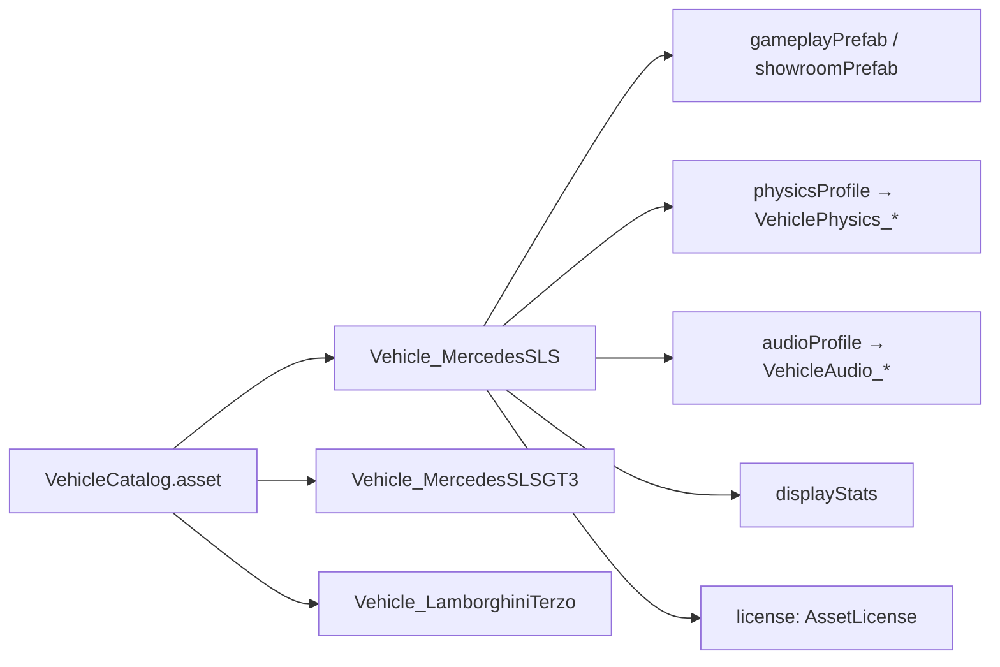

# 14 · Car Catalog and Data

> [Index](00_INDEX.md) · Previous: [13 Vehicle Visuals](13_VEHICLE_VISUALS.md) · Next: [15 Car Selection](15_CAR_SELECTION.md)

## Adding a car is a data change (Decision D4)

## `VehicleCatalog` (`Assets/_NeonRift/Scripts/Vehicles/VehicleCatalog.cs`)

`Assets/_NeonRift/Data/Vehicles/VehicleCatalog.asset`, in order:

| # | Definition | `id` | `displayName` | `category` | Licence (`AssetLicense`) |
|---|---|---|---|---|---|
| 0 (default) | `Vehicle_MercedesSLS.asset` | `mercedes_sls_amg_2010` | SLS AMG | Grand Tourer | CC-BY-4.0, commercial allowed |
| 1 | `Vehicle_MercedesSLSGT3.asset` | `mercedes_sls_gt3` | SLS AMG GT3 | GT3 Race Car | CC-BY-4.0, commercial allowed |
| 2 | `Vehicle_LamborghiniTerzo.asset` | `lamborghini_terzo_millennio` | Terzo Millennio | Electric Hypercar Concept | **CC-BY-NC-4.0, non-commercial** |
| — (not in catalog) | `Vehicle_MercedesAMGGT3.asset` | `mercedes_amg_gt3` | AMG GT3 | GT3 Race Car | CC-BY-NC-SA-4.0 |

API: `Vehicles`, `Count`, `Default` (= first entry), `TryGet(id)`, `IndexOf`, `Validate` (duplicate ids, missing prefabs).

## `VehicleDefinition` (`Scripts/Vehicles/VehicleDefinition.cs`)

| Field | Purpose |
|---|---|
| `id` | Stable string id (saves, lookups) |
| `displayName`, `manufacturer`, `category`, `description` | Car Select copy |
| `gameplayPrefab` | Spawned in missions |
| `showroomPrefab` | Car Select model (falls back to the gameplay prefab) |
| `physicsProfile` | `VehiclePhysicsProfile` (the single source of tuning) |
| `audioProfile` | `VehicleAudioProfile` |
| `displayStats` | `VehicleDisplayStats` |
| `displayStatsProvisional` | False once the stats are measured |
| `license` | `AssetLicense` (`Scripts/Core/AssetLicense.cs`): `LicenseId`, `Author`, `SourceUrl`, `CommercialUseAllowed` |
| `DrivetrainLabel` (computed) | "RWD" / "FWD" / "AWD" from the physics profile |

## `VehicleDisplayStats` (`Scripts/Vehicles/VehicleDisplayStats.cs`)

`topSpeedKph`, `zeroToHundredSeconds`, `powerHp`, `massKg`, `handlingRating` (0–10), `brakingDistanceMetres`. These are **measured on the physics bench, not manufacturer claims**: `VehiclePerformanceProbe.UpdateDisplayStats` (menu **Neon Rift ▸ Vehicles ▸ Update Car Select Stats From Physics**). The Terzo Millennio has no official figures at all.

## `VehiclePhysicsProfile` (`Scripts/Vehicles/Physics/VehiclePhysicsProfile.cs`)

Assets in `Data/Vehicles/Physics/`. Sections: `ChassisSettings` (mass, weight split, CG height, inertia scale), `AxleSettings` front/rear (suspension and `TyreSettings`), `EngineSettings`, `TransmissionSettings`, `BrakeSettings`, `SteeringSettings`, `AeroSettings`, `AssistSettings`, plus *Tuning Notes* text. Methods: `Axle(front)`, `IsDriven(front)`, `EstimateTopSpeed`, `Validate`.

| Profile | Drive | Mass | Peak torque | Max rpm | Final drive | Diff lock | Brake torque / bias | Downforce ClA F/R | Limiter |
|---|---|---|---|---|---|---|---|---|---|
| `VehiclePhysics_MercedesSLS` | RWD | 1620 kg | 650 Nm | 7200 | 3.27 | 0.35 | 7200 Nm / 0.64 | 0.04 / 0.10 | 317 km/h |
| `VehiclePhysics_MercedesSLSGT3` | RWD | 1380 kg | 640 Nm | 7500 | 3.36 | 0.55 | 9500 Nm / 0.60 | 0.55 / 1.05 | — |
| `VehiclePhysics_LamborghiniTerzo` | AWD (40 % front) | 1650 kg | 1050 Nm | 16000 | 1.0 | 0.30 | 8500 Nm / 0.62 | 0.25 / 0.45 | 320 km/h |

(Values read from the assets. ABS and traction control are on for all three.)

## `VehicleAudioProfile`

`Data/Vehicles/Audio/VehicleAudio_MercedesSLS.asset`, `_MercedesSLSGT3`, `_LamborghiniTerzo`. Built and linked by `VehicleAudioGenerator.Profile` / `Link`. See [12 Vehicle Audio](12_VEHICLE_AUDIO.md).

## Import setups

`Data/Vehicles/ImportSetups/Setup_PF_Vehicle_*.asset` (`VehicleModelSetup`): keywords and fixes used by `VehiclePrefabBuilder`. Copy text comes from `ThirdPartyIntake.VehicleRecipes` (menu **Neon Rift ▸ Vehicles ▸ Apply Vehicle Copy From Recipes**).

## How to add a car

1. Put the model under `Assets/ThirdParty/Sketchfab/Vehicles/<Name>/` with an `ATTRIBUTION.txt`.
2. Add a recipe in `ThirdPartyIntake.VehicleRecipes()` (wheel, lamp and hidden-part keywords; orientation and scale).
3. Run **Neon Rift ▸ Assets ▸ Run Third-Party Intake**: prefab + definition + catalog entry.
4. Create a `VehiclePhysicsProfile`, generate audio, measure stats, run the tests.

## Rivals

The cars **not** picked become the rival field: `RunSession.SelectVehicle(vehicle, catalog)` (`Scripts/Game/RunSession.cs`). Tested by `CityTests.Session_RivalsAreTheCarsNotPicked`.

## Validation

`FoundationTests` (`Catalog_ReportsDuplicateIdsAndMissingPrefabs`, `Catalog_LooksUpById_AndDefaultIsFirst`, `ProjectWiring_IsValid`), `VehicleModelTests.CatalogProfiles_AreValid_AndPredictPlausibleTopSpeeds`, `CarSelectTests.CatalogVehicles_HaveCarSelectData`, `ProjectValidator` (menu **Neon Rift ▸ Validate Project**; `Warnings()` lists non-commercial assets).
