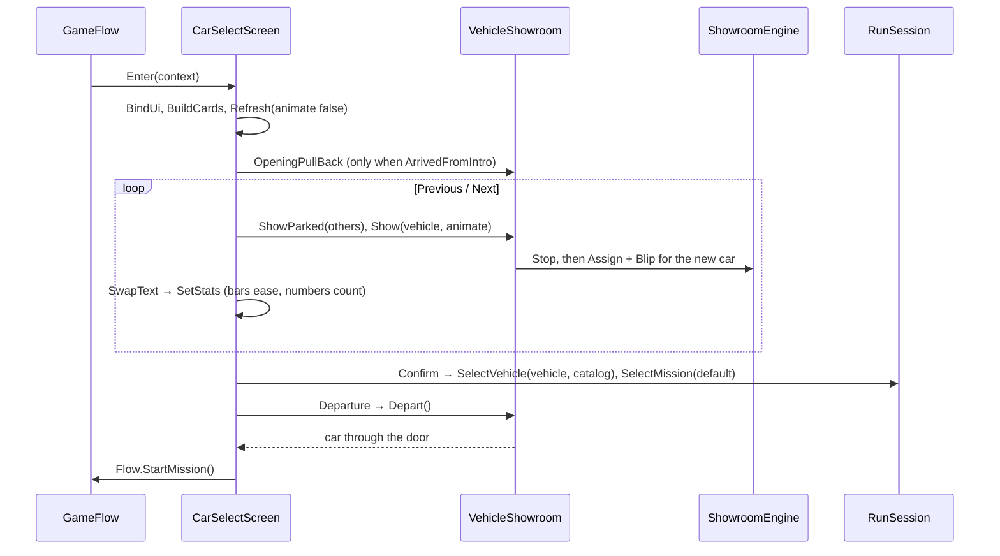

# 15 · Car Selection

> [Index](00_INDEX.md) · Previous: [14 Car Catalog](14_CAR_CATALOG_AND_DATA.md) · Next: [16 Player Input](16_PLAYER_INPUT.md)

## What the player sees

A crew garage at night. The selected car stands on a turntable under a key light, the other two catalog cars are parked in the shadows, and a planning wall of screens shows the city map and the Data Core. Q/E or ←/→ switch cars, A/D (right stick, or dragging) turn the turntable, and Enter confirms: the turntable swings the car to the roller door, the door lifts, the engine revs, and the car drives out into the night. Then the mission loads.

## Where it lives

| Piece | File / asset |
|---|---|
| Scene | `Assets/_NeonRift/Scenes/CarSelect.unity` (generated) |
| Scene generator | `Assets/_NeonRift/Scripts/Editor/Frontend/GarageBuilder.cs` (menu **Neon Rift ▸ Car Select ▸ Build Garage**) |
| Planning wall textures | `Scripts/Editor/Frontend/GaragePlanningWall.cs`: a map generated from the real `RoadNetwork` (garage, route to the core, compound, Rift Gate) and a core schematic → `Assets/_NeonRift/Art/Garage/Textures/` |
| Screen controller (entry point) | `Scripts/Frontend/CarSelectScreen.cs` |
| 3D presentation | `Scripts/Frontend/VehicleShowroom.cs` |
| Showroom engine sound | `Scripts/Frontend/ShowroomEngine.cs` |
| UI | `Assets/_NeonRift/UI/CarSelect.uxml`, `CarSelect.uss` (elements `vehicle-name`, `vehicle-category`, `vehicle-maker`, `vehicle-desc`, `stats`, `chip-drive`, `chip-power`, `chip-weight`, `cards`, `prev-button`, `next-button`, `confirm-button`, `back-button`, `cs-fade`) |
| Post-processing and blends | `Settings/Rendering/Garage_Volume.asset`, `Garage_CameraBlends.asset` |

## Flow

| Step | Method |
|---|---|
| Enter | `CarSelectScreen.Enter` (45): binds Menu actions (`Previous`, `Next`, `Confirm`, `Back`); the start index is the session's selected car |
| Previous / next | `Previous` / `Next` → `Select(i)` → `Refresh` (199) |
| Turn the car | `Update` reads `Menu.Rotate` → `VehicleShowroom.Spin`; pointer drag → `VehicleShowroom.Drag`; with no input the turntable idles round |
| Car swap animation | `VehicleShowroom.Swap` (90): stage dims to 8 %, outgoing lights off, turntable whips to 720°/s; the new car spins in from 150° off and settles; DRLs then headlight beams, a brake-light pulse, and an engine blip from the car's own loops (`ShowroomEngine.Blip`) |
| Background cars | `VehicleShowroom.ShowParked` (157): the other catalog cars in the parked slots, presentation-only |
| Stats | `SetStats`: category, drivetrain, power, weight, measured 0–100, top speed, handling, 100–0 braking; `StatRow.Tick` eases bars and counts numbers over 0.5 s |
| Confirm | `Confirm` (273): `session.SelectVehicle(car, catalog)` (the others become rivals), `SelectMission(GameConfig.DefaultMission)` if none, then the `Departure` coroutine (292) |
| Departure | `VehicleShowroom.Depart` (246): turntable swings the nose to `exitDirection` (−Z) while the door rises; switch to the depart camera; blips; pull away with eased acceleration and spinning wheels; then `Flow.StartMission()` |
| Back | `Back` → `Flow.GoToFrontend()` |

## Presentation-only cars

`VehicleShowroom.MakePresentationOnly` (311) uses the **gameplay prefab** but makes it inert: Rigidbody kinematic, collisions off, **interpolation off**, colliders disabled, every behaviour except `VehicleRig` disabled, audio sources off. Turning interpolation off fixed the "car leaves the garage at an angle" bug: the interpolated body was writing back a stale pose that fought the turntable. `Depart` also squares the car to the door exactly before pulling away, and caps the per-frame step at 0.05 s.

## Cameras

Cinemachine cameras made by `GarageBuilder` (`Cameras`) and switched by `VehicleShowroom.SetCamera` (priority):

| Camera | Use |
|---|---|
| Hero | Default framing (27° lens, car slightly left of centre), slow dolly drift (`heroDrift`) |
| Swap | Low side shot during a car switch |
| Depart | Follow camera for the drive-out |
| Opening | Headlight close-up matching the intro's last frame (`RunSession.ArrivedFromIntro`) |

## Lighting and garage

`GarageBuilder.BuildShell` (99): a 26 × 30 m hall (concrete floor, steel columns, trusses), soft-box strips, wall washers, key light and two rims on the turntable, workbench, tool chests, tyre rack, planning wall, roller door, two parking bays, and a stand-in street through the door. A box-projected reflection probe is baked (`BakeProbe`), and the Volume is set up by `Volume` and `ConfigureRendering`. The **same shell** stands in the city on W Avenue (`NightRunBuilder.Garage.cs`), which is what makes the intro → Car Select match cut work.

## Persistence

The selected car lives in `RunSession` (memory only, for this session). It is not saved between launches.

## Validation

`CarSelectTests` (`Assets/_NeonRift/Scripts/Tests/EditMode/CarSelectTests.cs`): `CatalogVehicles_HaveCarSelectData`, `CarSelectScene_IsAWiredGarage`. Play Mode checks with `PlaytestCapture` are recorded in `Docs/Intro.md` (switching SLS AMG → GT3 → Terzo; departure frames; Terzo confirmed as the player car in the mission).
