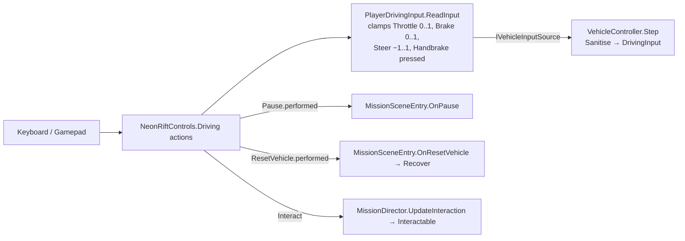

# 16 · Player Input

> [Index](00_INDEX.md) · Previous: [15 Car Selection](15_CAR_SELECTION.md) · Next: [17 Rival AI](17_RIVAL_AI.md)

## Technology

Unity **Input System 1.19.0** only (`activeInputHandler: 1` in `ProjectSettings/ProjectSettings.asset`). Actions live in one asset, `Assets/_NeonRift/Settings/Input/NeonRiftControls.inputactions`, from which Unity generates the typed C# wrapper `Assets/_NeonRift/Scripts/Input/NeonRiftControls.cs` (Decision D5: no string lookups). Two action maps: **Driving** and **Menu**. Each scene enables only the maps it needs. UI navigation uses `InputSystemUIInputModule` in the Bootstrap scene.

## Controls (read from the `.inputactions` file and `GameRoot`)

### Driving map

| Action | Type | Keyboard | Gamepad |
|---|---|---|---|
| Throttle | Value | W, ↑ | Right trigger |
| Brake (hold at a stop to reverse) | Value | S, ↓ | Left trigger |
| Steer | Value | A / D, ← / → | Left stick X |
| Handbrake | Button | Space | B / East |
| Interact (hold to hack; retry on the debrief) | Button | E | A / South |
| ResetVehicle (recover) | Button | R | Select |
| Pause | Button | Esc | Start |

### Menu map

| Action | Keyboard | Gamepad |
|---|---|---|
| Previous | Q, ← | Left shoulder, d-pad left |
| Next | E, → | Right shoulder, d-pad right |
| Rotate (Car Select turntable) | A / D | Right stick X |
| Confirm | Enter, keypad Enter | A / South |
| Back | Esc | B / East |
| Skip (intro) | Space | Start |
| Up / Down (menus) | ↑ / W, ↓ / S | d-pad, left stick |

### Global and dev keys

| Key | Where it is bound | Effect |
|---|---|---|
| **M** / gamepad **Y** (`buttonNorth`) | `GameRoot.Awake` creates an `InputAction("ToggleMusic")` in code (`Scripts/Game/GameRoot.cs`) | `GameSettings.ToggleMusic()` anywhere in the game |
| **F3** | `VehicleDebugHud` (`Scripts/Gameplay/VehicleDebugHud.cs`) reads `Keyboard.current` directly | Telemetry overlay; disabled outside debug/development builds (`Debug.isDebugBuild`) |

## From key press to car

| Class | File | Role |
|---|---|---|
| `NeonRiftControls` | `Scripts/Input/NeonRiftControls.cs` (generated) | `DrivingActions`, `MenuActions`, `IDrivingActions`, `IMenuActions` |
| `PlayerDrivingInput` | `Scripts/Input/PlayerDrivingInput.cs` | Bridges Driving actions to `IVehicleInputSource`; `DescribeDevices(out canDrive)` lists the input devices |
| `MissionSceneEntry` | `Scripts/Gameplay/MissionSceneEntry.cs` | Enables Driving on `Enter`, logs `[Input] Driving controls enabled. Devices: …`, disables it while paused |
| `CarSelectScreen`, `IntroSceneEntry`, `OptionsMenu`, `TitleScreen` | Frontend / Intro / Game | Use the Menu map |

**Editor note** (README): keyboard input only reaches the game while the Game view has focus. If `[Input]` warns that no keyboard or gamepad is connected, the editor's Input System backend has lost its devices; restart the editor.

## Validation

| Test / tool | File | What it checks |
|---|---|---|
| `InputTests` (an `InputTestFixture`) | `Scripts/Tests/EditMode/InputTests.cs` | Keyboard throttle, brake, steer, throttle+steer together, handbrake and interact; gamepad driving and buttons; disabling the Menu map leaves Driving enabled |
| `InputPlaytest` | `Scripts/Editor/Validation/InputPlaytest.cs` | Play Mode: writes key state events into the real device (`Hold`, `Release`, `Tap`), runs `RunStandardScript` and `RunMinimapScript`, writes `Logs/InputPlaytest.txt`. See [41 Input Playtesting](41_INPUT_PLAYTESTING.md) |
