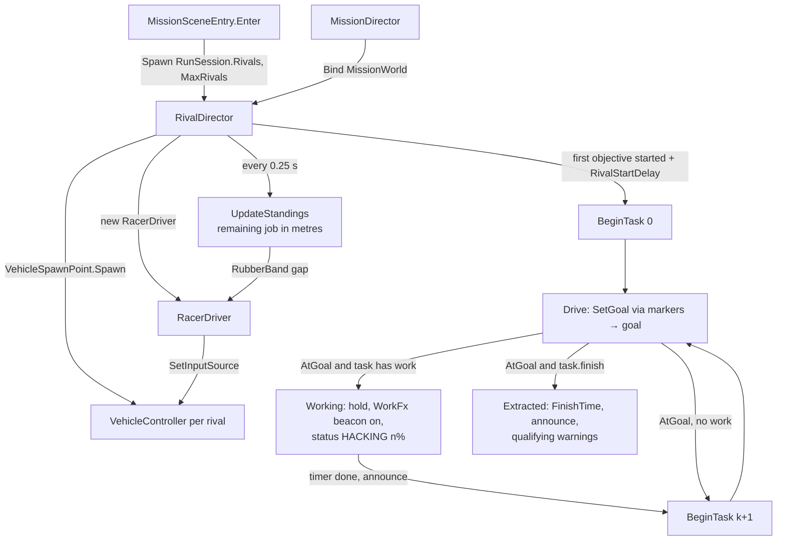

# 17 · Rival AI

> [Index](00_INDEX.md) · Previous: [16 Player Input](16_PLAYER_INPUT.md) · Next: [18 Traffic System](18_TRAFFIC_SYSTEM.md)

## The short answer

Two rival crews, **VEX** and **KADE**, drive the two catalog cars the player did not pick. Each car is controlled by a **`RacerDriver`**, which plugs into the car through the **same `IVehicleInputSource` interface as the player** (Decision D25): no transforms are moved and no forces are faked. **`RivalDirector`** gives each crew **its own heist** (relay hack → core trunk tap → extraction), keeps live standings and decides **qualifying** (only the first two out qualify).

## Files

| Class | File |
|---|---|
| `RivalDirector` (+ `Slot`, `Racer`) | `Assets/_NeonRift/Scripts/Gameplay/Racing/RivalDirector.cs` |
| `RacerDriver` | `Scripts/Gameplay/Racing/RacerDriver.cs` |
| `RacerProfile` (ScriptableObject) | `Scripts/Gameplay/Racing/RacerProfile.cs`; assets `Assets/_NeonRift/Data/Racing/Racer_Vex.asset`, `Racer_Kade.asset` |
| `RacingLine` | `Scripts/Gameplay/Racing/RacingLine.cs` |
| `RaceMarker` | `Scripts/Gameplay/Racing/RaceMarker.cs` (5 in the NightRun scene) |
| `RivalTask` (data) | `Scripts/Missions/RivalTask.cs` |
| Task list in the mission | `MissionDefinition.RivalTasks`, `RivalStartDelay`, `QualifyingPlaces` (`Scripts/Missions/MissionDefinition.cs`) |
| Scene wiring (spawns, markers, work FX, profiles) | `NightRunBuilder.BuildRivals` (`Scripts/Editor/District/NightRunBuilder.cs`) |
| Task data authoring | `NightRunBuilder.CreateMissionData` |

## Architecture

## The crews' heist (`RivalTask` data, authored in `NightRunBuilder.CreateMissionData`)

| Task | VEX (slot 0) | KADE (slot 1) | Work | Labels | Done message |
|---|---|---|---|---|---|
| 1 Relay hack | marker `spire_relay` (Spire Boulevard, eastbound kerb lane, x 80) | marker `kowloon_relay` (Lantern Street, northbound kerb lane, z 20) | 12 s ± 15 % | TO RELAY / HACKING RELAY | "{name}: SPIRE RELAY CRACKED" / "{name}: KOWLOON RELAY CRACKED" |
| 2 Core trunk tap | marker `trunk_tap` slot 0 (Spire Avenue southbound, (154.75, 350)) | `trunk_tap` slot 1 (North Boulevard eastbound, (110, 294.75)) | 16 s ± 15 % | TO THE CORE / TAPPING CORE | "{name} HAS A CORE PACKAGE · RUNNING FOR THE GATE" |
| 3 Extraction | `extraction` (Rift Gate) | `extraction` | — | TO RIFT GATE | "{crew} EXTRACTED" (finish) |

`RivalStartDelay` 0.6 s, `QualifyingPlaces` 2. Constants: `NightRunBuilder.RivalRelaySeconds = 12`, `RivalUplinkSeconds = 16`. Marker ids: `RivalRelayNorthId`, `RivalRelayWestId`, `RivalTrunkTapId`, `RivalExtractionId`, `RivalStagingId` (S7 car park, used by the intro only).

**Why kerb lanes.** Every stop sits on the road graph, facing the way the crew leaves, so there are no U-turns across medians. In validation, two earlier placements failed: uplink bays inside the compound got sealed by the player's lockdown, and taps in the S7 car-park lot made the two drivers deadlock while yielding to each other (`Docs/NightRun.md`).

**Work FX.** While a crew works, `Racer.WorkFx` (a magenta beacon column plus a point light, `RivalWorkFx_n`, built in `BuildRivals`) stands over its car.

## `RivalDirector` key methods

| Method | Line | What it does |
|---|---|---|
| `Spawn(vehicles, max)` | 115 | Spawns up to `max` rivals through `VehicleSpawnPoint.Spawn` (same prefab, physics and audio), creates a `RacerDriver`, logs `[Rivals] contact …` telemetry on collisions |
| `Bind` / `Unbind` | 166 / 192 | Reset per attempt; `PlanRoutes` caches every leg's route length |
| `OnObjectiveStarted` | 244 | The first objective starts the race (after `RivalStartDelay`); the mission end holds every car |
| `BeginTask(i, k)` | 266 | Queues via markers, sets the goal (hold if the task has work or finishes), sets the status label |
| `Update` | 296 | Via points (14 m radius), work timers, arrivals, finishing, standings every 0.25 s |
| `OnRivalFinished` | 367 | HUD: "1 QUALIFYING PLACE LEFT" / "QUALIFYING CLOSED · NO PLACE LEFT FOR YOU" |
| `RivalRemaining` / `PlayerRemaining` | 377 / 402 | **Whole remaining job** in metres: route to the goal + work left × 22 m/s (`workMetresPerSecond`) + later legs; the player gets the route to the current objective + later objective legs + 9 s per interaction objective (`playerWorkSeconds`) |
| `UpdateStandings` | 415 | Sorts finished crews by finish time, then the rest by remaining job; applies the rubber band; sets `PlayerPosition` |
| `FinishPosition` | 450 | Player's place = rivals already extracted + 1 |
| `TryGetGap` | 458 | "88 M BEHIND KADE" style gap for the HUD |
| `DescribeAi` | 439 | Per-rival report line (contacts, reversals, resets, yields, task, status) for validators |

Race-panel rows are rebuilt only when the status changes, and work progress moves in 10 % steps (`Racer.SetWorkStatus`), so there is no per-frame allocation.

## `RacerDriver`: how a rival drives

`RacerDriver.ReadInput` (line 163) runs every physics step:

1. **Plan.** `Replan` (124) asks `CityNavigation.Plan` for a route that respects gate state and the driver's own blocked-edge memory (`AvoidCost`: +250 m for 25 s after a reversal on that edge). It builds a **`RacingLine`** (centreline with rounded corners, resampled every 2 m, per-sample tangent, usable lateral range and an advisory speed from curvature and the street limit). It re-plans when `CityNavigation.Version` changes (a gate moved), and at most every 1.5 s when far off the line.
2. **Arrive.** Within 4 m of the end, set `AtGoal`; hold if asked (`Park`: brake to a stop, then handbrake only, because holding brake at a standstill would select reverse).
3. **Probe.** `UpdateProbe` (515) every 0.1 s: five lateral sphere casts ahead (walls, props, gates, and the Traffic layer), **path occupancy** (`PathClearance`, 485: another car's 3.8 m body within 2.2 m of the candidate line), **side risk** (cars alongside rule out lines that would side-swipe them), and **yield** (`ScanTraffic`, 359: a car predicted to pass within 2.8 m in the next 1.6 s makes it match speed for 0.5 s).
4. **Lateral line.** Moves `offset` toward the chosen lateral line at `LaneChangeRate`. Lane choice and overtaking are just "point + right × offset".
5. **Steer.** Pure pursuit on the offset line with look-ahead = clamp(min + time × speed), normalised by the car's speed-dependent steering lock.
6. **Speed.** A **braking-distance planner** over the line (`v² = v_next² + 2·b·d`) × `PaceScale` (rubber band), capped by the obstacle ahead and by **`FollowSpeed`** (`√(theirs² + 2·b·(gap − 0.45 s × own speed))`: never hits a leader that brakes as hard as we can).
7. **Intent rules** (`NextTurn`, `TurnDistance`): never pass a peer that is about to turn (or while about to turn yourself), with "about to turn" = max(40 m, 3.5 s at speed). A **player alongside** who is converging makes the rival drop 2 m/s below the player and hold its lane.
8. **Stuck recovery** (`Recovering`, 252): no progress for `stuckSeconds` → back out with opposite lock (never into a car behind it), remember the edge, re-plan after the second reversal. After `reversesBeforeReset` (3) failed reversals, or six "car behind" waits (jam breaker), `Reset` (320) puts it back on its line, **out of the player's view only**; in view it is just righted (`InPlayerView`).

Overtaking and merging are not separate systems: they fall out of the lateral line choice from the probe sweep plus the occupancy and side-risk rules.

## `RacerProfile`: driver personality

| Field | VEX | KADE |
|---|---|---|
| `cornerGrip` (commitment in corners) | 1.00 | 0.92 |
| `braking` (m/s²) | 8.5 | 7.5 |
| `streetSpeedScale` | 1.30 | 1.20 |
| `aggression` | 0.85 | 0.55 |
| `catchUp` / `easeOff` (rubber band) | 0.05 / 0.06 | 0.05 / 0.06 |

(Set in `NightRunBuilder.BuildRivals` through `RacerProfile.EditorConfigure`.) Other fields: look-ahead min/max/time, lane-change rate, probe base/time, stuck/reverse seconds, reverses before reset, `bandDistance` (220 m).

**Rubber band** (`RacerProfile.RubberBand`, Decision D25): pace multiplier = 1 + `catchUp` × t when behind the player, 1 + `easeOff` × t when ahead, with t = gap / `bandDistance` clamped to ±1. So it is bounded to ±5–6 % on the target speed. Tested by `CityTests.RubberBand_IsBoundedAndSymmetricInSign`.

## Qualifying and results

- `MissionDefinition.QualifyingPlaces` = 2. In `MissionDirector.BuildDebrief`, a player finishing third **still completes the mission** but is shown **NOT QUALIFIED** ("ONLY THE FIRST 2 OUT ADVANCE"); the crews list marks QUALIFIED / EXTRACTED / STILL RUNNING. `MissionRecords.MarkQualified` stores the qualification in PlayerPrefs.
- The grade's position component uses `FinishPosition` among `rivals.Count + 1` cars ([36 Results](36_RESULTS_AND_DEBRIEF.md)).

## Drones on the rivals

After the counter-intrusion or lockdown, `SecurityDrones.TargetFor` assigns one drone to each rival still running (the last drones in the list), and the rest tail the player ([23 Heat and Lockdown](23_HEAT_AND_LOCKDOWN.md)).

## Validation

- `CityTests.RacingLine_SlowsForCornersAndStops`, `RubberBand_IsBoundedAndSymmetricInSign`, `Session_RivalsAreTheCarsNotPicked`; `MissionTests.NightRunSceneProvidesEveryTargetAndReaction` (rival tasks name existing markers, crews work different sites, the last task finishes, `QualifyingPlaces` = 2, every slot has work FX).
- Play Mode: `MissionSeries` with `NightRunValidator` (contacts, reversals, resets, finishing). Final runs (`Docs/NightRun.md`): VEX extracted at 124.9 s, just ahead of the scripted player at about 125 s; in another run the player won at 127.8 s with both crews about 390 m from the gate.

## Intro use

In the intro, the two bay cars leave the garage on scripted lines with **`WaypointDriver`** (`Scripts/Gameplay/Racing/WaypointDriver.cs`: pure pursuit plus speed per waypoint, real physics). `RacerDriver` is the fallback when no garage exists (`IntroSceneEntry.Depart`).
