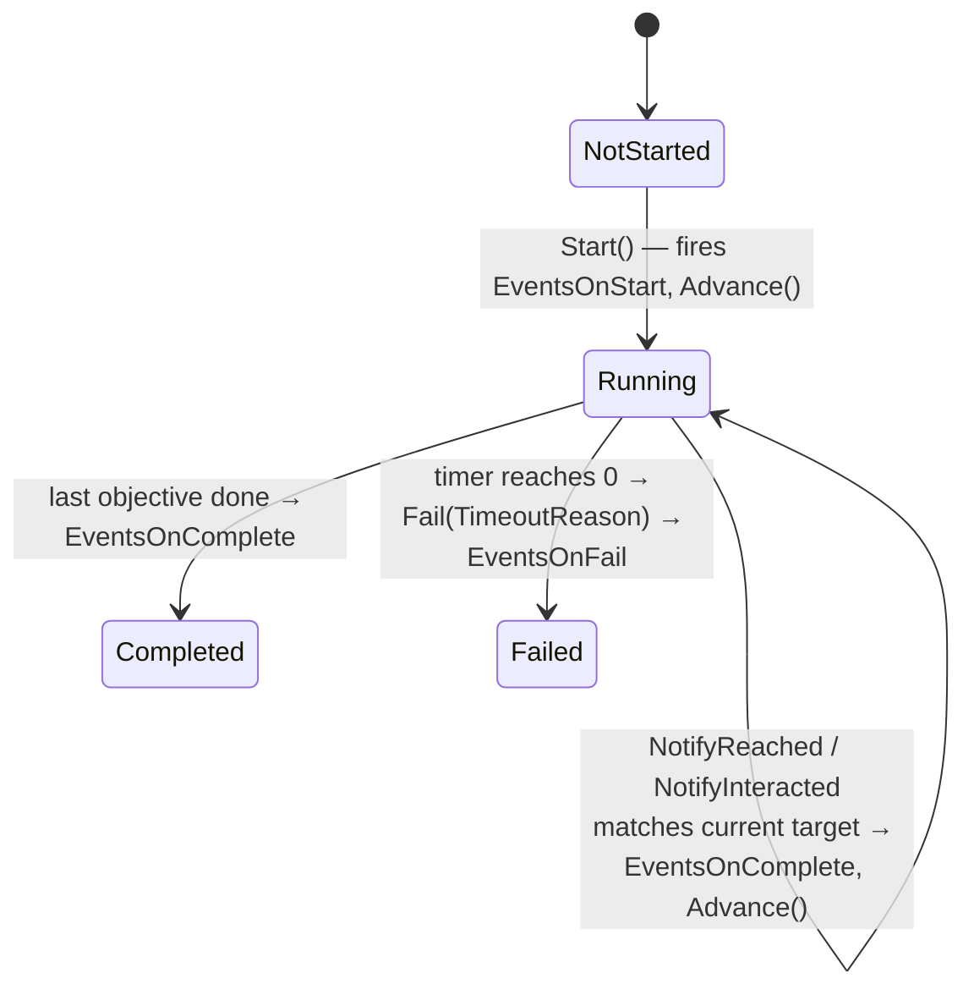
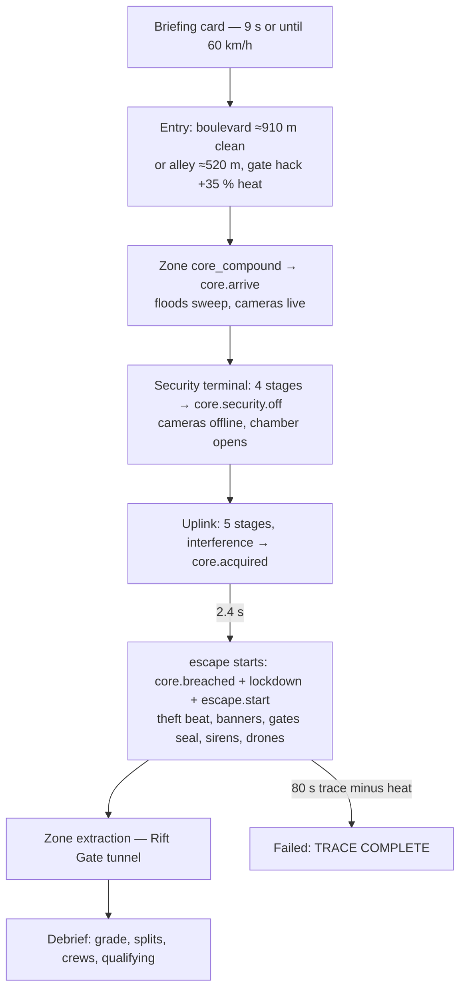

# 19 · Mission System

> [Index](00_INDEX.md) · Previous: [18 Traffic](18_TRAFFIC_SYSTEM.md) · Next: [20 Heist System](20_HEIST_SYSTEM.md)

## Design (Decision D21)

A mission is **data plus a pure state machine**; the scene **reacts to string event ids**. The director has no mission-specific code. Adding a mechanic means adding an `IMissionWorldComponent` (or an `InteractionDefinition`) and referencing event ids from data.

## Pieces

| Layer | Class | File |
|---|---|---|
| Mission data | `MissionDefinition` | `Assets/_NeonRift/Scripts/Missions/MissionDefinition.cs` |
| Objective data | `ObjectiveDefinition` (`ObjectiveKind`: Reach / Interact) | `Scripts/Missions/ObjectiveDefinition.cs`, `ObjectiveKind.cs` |
| HUD messages from events | `MissionAnnouncement` (`MessageTone`) | `Scripts/Missions/MissionAnnouncement.cs`, `MessageTone.cs` |
| State machine (pure C#) | `MissionProgress` (`MissionPhase`, `SecurityLevel`) | `Scripts/Missions/MissionProgress.cs`, `MissionPhase.cs`, `SecurityLevel.cs` |
| Per-attempt hub | `MissionWorld` | `Scripts/Gameplay/Mission/MissionWorld.cs` |
| Runner | `MissionDirector` | `Scripts/Gameplay/Mission/MissionDirector.cs` |
| Participants | `IMissionWorldComponent`, `IMissionTarget` | `Scripts/Gameplay/Mission/IMissionWorldComponent.cs`, `IMissionTarget.cs` |
| Reach target | `MissionZone` (Trigger layer, beacon while current) | `Scripts/Gameplay/Mission/MissionZone.cs` |
| Interact target | `Interactable` + `InteractionDefinition` | `Scripts/Gameplay/Mission/Interactable.cs`, `InteractionDefinition.cs` |
| Result | `RunResult`, `MissionOutcome` | `Scripts/Missions/RunResult.cs` |
| Grade and records | `MissionGrade`, `MissionRecords` | `Scripts/Missions/MissionGrade.cs`, `MissionRecords.cs` |

## The Night Run data (`Assets/_NeonRift/Data/Missions/Mission_NightRun.asset`)

Authored in code by `NightRunBuilder.CreateMissionData` (`Scripts/Editor/District/NightRunBuilder.cs:174`).

| # | Objective id | Kind → target | Title | Security | Timer | Events |
|---|---|---|---|---|---|---|
| 1 | `reach_core` | Reach → zone `core_compound` | INFILTRATE THE DATA CORE FACILITY | Calm | — | on complete `core.arrive` |
| 2 | `disable_security` | Interact → `core_security_terminal` | DISABLE FACILITY SECURITY | — | — | (terminal raises `core.security.off`) |
| 3 | `hack_core` | Interact → `core_uplink` | EXTRACT THE DATA CORE | Calm | — | on complete `core.acquired` |
| 4 | `escape` | Reach → zone `extraction` | ESCAPE TO THE RIFT GATE | **Lockdown** | **80 s** ("TRACE COMPLETE — YOU WERE FOUND") | `startDelay` 2.4 s; on start `core.breached`, `lockdown`, `escape.start` |

Mission-level fields: events on start `mission.start`, on complete `mission.complete`, on fail `mission.failed`; `heatTimePenalty` 25 s per 1.0 heat; `minimumTimeLimit` 30 s; `maxRivals` 2; `parTime` 115 s; `qualifyingPlaces` 2; `rivalTasks` ([17](17_RIVAL_AI.md)); crew roles "SPIRE RELAY · OWN JOB", "KOWLOON RELAY · OWN JOB"; and about 17 announcements (for example `mission.start` → "SECTOR 7 GRID ONLINE · FOLLOW THE CYAN BEACON", `core.breached` → banner "SECURITY BREACH DETECTED | SECTOR 7 LOCKDOWN INITIATED").

The dev mission `Mission_DevTestTrack.asset` drives the TestTrack scene.

## The state machine (`MissionProgress`)

| Method | Behaviour |
|---|---|
| `Start` | Phase Running, fire mission start events, advance to objective 0 |
| `Tick(dt)` | Elapsed time; objective `startDelay` countdown; timer countdown → `Fail` |
| `NotifyReached(zoneId)` / `NotifyInteracted(id)` | `TryComplete`: only completes when kind and target match the current objective |
| `Advance` → `StartObjective` | Raises security to the objective's level (**security only escalates**), starts the timer as max(min(minimumTimeLimit, limit), limit − heat × heatTimePenalty), fires the objective's start events |
| `AddHeat(amount, reason)` | Heat clamped to 1; a running timer loses `gained × heatTimePenalty` immediately; Calm → **Alert** on the first heat |
| Events out | `ObjectiveStarted`, `ObjectiveCompleted`, `SecurityChanged`, `HeatAdded`, `WorldEvent`, `PhaseChanged` |

**How the game knows which objective is active:** `MissionProgress.ObjectiveIndex` / `Current`; `IsCurrentTarget(targetId)` answers "is this zone or interactable the one we are waiting for?". `MissionWorld.IsObjectiveTarget` exposes this to scene objects, for example so an `Interactable` only becomes usable when it is current.

## The director (`MissionDirector`)

`Begin(context, mission, player, camera)` (line 80) creates a fresh `MissionProgress` and `MissionWorld`, wires their events, calls `BindScene` (finds every `IMissionWorldComponent` in the scene, indexes `IMissionTarget`s by id, publishes `ObjectivePositions`, calls `Bind(World)` on each), sets the Gameplay mix, initialises `MissionAudio` and the HUD, then `Progress.Start()`.

| Method | Role |
|---|---|
| `Update` (206) | `Progress.Tick`, interaction focus, HUD, navigator, race panel, briefing, results timing, theft beat |
| `UpdateInteraction` (232) | Picks the focused `Interactable` (one in use keeps focus), feeds the Interact button (`Driving.Interact`), drives the `TerminalReadout` and the hack loop audio |
| `OnZoneEntered` / `OnInteractionCompleted` | → `Progress.NotifyReached` / `NotifyInteracted` |
| `OnObjectiveStarted` (298) | Activates the target's beacon, refreshes interactables, notifies the world, updates the HUD objective |
| `OnObjectiveCompleted` | Records split time, `hud.StampObjective` |
| `OnSecurityChanged` (331) | Lockdown: camera kick and focus on the alert origin, **Lockdown** mixer snapshot, lockdown cue |
| `OnHeatAdded` | HUD toast "+n % HEAT" and heat cue |
| `OnWorldEvent` (388) → `RunAnnouncements` | Shows the mission's announcements for that id; `beatEvent` (`core.breached`) starts the **theft beat** |
| `StartBeat` / `UpdateBeat` / `EndBeat` | 2.6 s camera swing (`VehicleChaseCamera.CinematicBeat`), letterbox, time scale eased to 0.45 and back |
| `OnPhaseChanged` (357) | Finish position, `RunSession.RecordResult`, **Results** snapshot, score outro, debrief after `resultsDelay` (2 s) |
| `BuildBriefing` / `BuildDebrief` | [35](35_OBJECTIVES_AND_MISSION_PRESENTATION.md), [36](36_RESULTS_AND_DEBRIEF.md) |
| `Retry` / `Continue` / `RestartMission` | E → `Flow.StartMission()`, Esc → `Flow.GoToCarSelect()` |

## `MissionWorld`: what scene objects see

`Player`, `PlayerBody`, `Security`, `Heat`, `Phase`, `Mission`, `ObjectiveIndex`, `ObjectivePositions`, `Elapsed`, `AlertOrigin`. Methods `Raise(eventId)`, `Announce(text, tone)`, `AddHeat`, `IsPlayer(collider)`, `IsObjectiveTarget`, `IsMissionTarget`, HUD countdowns (`SetCountdown`, `ClearCountdown`, `TryGetNextCountdown`), and `Matches(list, id)`. Events: `EventRaised`, `SecurityChanged`, `Announced`, `ObjectiveStarted`.

## Mission flow, end to end

Section details: [20 Heist](20_HEIST_SYSTEM.md), [21 Security Gate](21_SECURITY_GATE.md), [22 Data Core](22_DATA_CORE.md), [23 Heat and Lockdown](23_HEAT_AND_LOCKDOWN.md).

## Validation

- `MissionTests` (`Scripts/Tests/EditMode/MissionTests.cs`): `ObjectivesAdvanceInOrderAndFireWorldEvents`, `HeatRaisesAlertAndShortensTheEscapeTimer`, `HeatIsClampedAndTimerRespectsMinimum`, `TimerExpiryFailsTheMission`, `UntimedObjectivesNeverFail`, `NightRunMissionDataIsValid`, `NightRunSceneProvidesEveryTargetAndReaction`, grade and records tests.
- `InteractionTests.ObjectiveStartDelayHoldsTheNextObjective`.
- `NightRunValidator` scenarios `BoulevardInAlleyOut`, `AlleyInExpresswayOut`, `TraceTimeout`, `AlleyInFailRetry` ([40](40_TESTING_AND_VALIDATION.md)).
