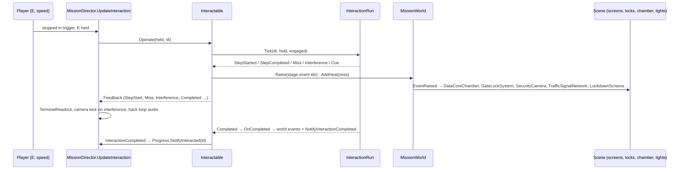

# 20 · Heist System (multi-stage interactions)

> [Index](00_INDEX.md) · Previous: [19 Mission System](19_MISSION_SYSTEM.md) · Next: [21 Security Gate](21_SECURITY_GATE.md)

## Idea

Terminals, the extraction uplink and gate controllers share **one framework**: the player stops the car inside a trigger zone and works through ordered **stages**, each with its own input rule. Stages raise **world events**, so screens, locks, lights, cameras, signals and machinery react without mission-specific code. Original notes: `Docs/Interactions.md`.

## Classes

| Piece | Assembly | File | Role |
|---|---|---|---|
| `InteractionStep` (+ `InteractionStepKind`, `InteractionCue`) | Missions | `Assets/_NeonRift/Scripts/Missions/InteractionStep.cs` | One stage: label, detail, kind, duration, checkpoint flag, timing window / misses / heat, sustain interference, events on start/complete, progress cues. Builders `WithTiming(width, centre, misses, heatPerMiss)`, `WithInterference(at[], responseSeconds, rollback)`, `WithCues(...)` |
| `InteractionRun` | Missions | `Scripts/Missions/InteractionRun.cs` | **Pure C# runner**: `Tick(dt, held, engaged)`, `Reset`, `Cancel`, `Miss`, `StartStep`, `CompleteStep`; state `Idle / Running / Completed / Failed`; `Overall` progress weighted by duration; `CancelGrace` = 0.6 s |
| `InteractionDefinition` (asset) | Gameplay | `Scripts/Gameplay/Mission/InteractionDefinition.cs` | Prompt verb, hold seconds, **max speed (km/h)**, decay, heat on complete, messages, device name, stages, lockout, fail heat, fail/cancel events, tension level |
| `Interactable` | Gameplay | `Scripts/Gameplay/Mission/Interactable.cs` | Scene trigger: availability by objective and events, runs stages (`Operate`, `CreateRun`), raises events and heat, locks out on failure, `Feedback` for presentation; `{id}` in event ids is expanded to its own id (`Expand`) |
| `TerminalDisplay` | Gameplay | `Scripts/Gameplay/Mission/TerminalDisplay.cs` | The device's screens (`NeonRift/TerminalScreen` shader), light and 3D blips |
| `TerminalReadout` | Gameplay | `Scripts/Gameplay/Mission/TerminalReadout.cs` | HUD panel: header, link state, stage list, active widget, data stream, progress |

## Stage kinds

| Kind | The player… | Rule |
|---|---|---|
| `Auto` | stays stopped in the zone | Machinery and handshakes |
| `Hold` | holds **E** | Releasing bleeds progress (`decayPerSecond`) |
| `Timing` | presses **E** while the sweeping cursor is in the window | A miss adds `missHeat`, moves the window and counts toward `maxMisses` (0 = unlimited). Reaching the limit fails the run → lockout plus fail heat. The press that starts a run never counts as an answer |
| `Sustain` | stays stopped and answers **interference** with E | Interference stalls progress for `responseSeconds`; ignored, it rolls back `rollback` of the stage. It never fails |

**Engaged** means inside the trigger and slower than `maxSpeedKph`. Being disengaged for more than 0.6 s **cancels** the run back to the last `checkpoint` stage reached.

## The three Night Run devices (data authored in code)

### Perimeter security terminal: `Interaction_CoreSecurity.asset`

`NightRunBuilder.CoreTerminalDefinition` (`Scripts/Editor/District/NightRunBuilder.Heist.cs:30`). Device **"S7-CORE // PERIMETER SECURITY NODE"**, verb HACK, max speed 8 km/h, lockout 4 s, fail heat 0.10 ("INTRUSION FILTER LOCKOUT · TRACE LOGGED"). The interactable `core_security_terminal` stands at (145, 0, 127.5), west of the core, and raises **`core.security.off`** on completion.

| # | Stage | Kind | Duration | Detail |
|---|---|---|---|---|
| 1 | CONNECTING | Auto | 1.1 s | Handshake with the perimeter node |
| 2 | AUTHENTICATING | Hold | 1.8 s | Spoofing a maintenance credential: hold E |
| 3 | BYPASSING | Timing | 1.5 s / sweep | Window 0.26 at 0.64; **3 misses** allowed; +4 % heat per miss |
| 4 | SECURITY OVERRIDE | Auto | 1.0 s | Cameras, floods and chamber locks → crew control |

### Extraction uplink: `Interaction_DataCoreUplink.asset`

`NightRunBuilder.ConfigureUplinkDefinition` (`NightRunBuilder.Heist.cs:46`). Device **"S7-CORE // EXTRACTION UPLINK"**, verb EXTRACT, max speed 6 km/h, lockout 3 s ("LINK COLLAPSED"), tension 1.0. The interactable `core_uplink` is the ring around the core; on completion the objective fires **`core.acquired`**.

| # | Stage | Kind | Duration | Checkpoint | Events |
|---|---|---|---|---|---|
| 1 | CONNECT EXTRACTION DEVICE | Auto | 2.2 s | ✔ | start `core.extract.connect` |
| 2 | INITIALIZE EXTRACTION | Auto | 1.6 s | | start `core.extract.init` |
| 3 | STABILIZE DATA LINK | Timing | 1.3 s | ✔ | start `core.extract.stabilize`; window 0.22 at 0.40, unlimited misses, +3 % heat per miss |
| 4 | **DATA EXTRACTION** | Sustain | **14 s** | ✔ | **Interference at 38 % and 74 %** (2.6 s to answer, 12 % rollback). Cues: 3 % `core.extract.begin`, **50 % `grid.anomaly`**, **80 % `core.extract.trace`** |
| 5 | EXTRACTION COMPLETE | Auto | 0.9 s | | — |

### Alley gate controller: `Interaction_HackGate.asset`

See [21 Security Gate](21_SECURITY_GATE.md) (five stages: CONNECTING, AUTHENTICATING, BYPASSING SECURITY, OVERRIDE, GATE RELEASE).

## Runtime flow

## Presentation

- **HUD** (`TerminalReadout`): link state STANDBY / LINK ACTIVE / SIGNAL WEAK / LOCKOUT / COMPLETE; numbered stages (OK / ·· / --); the active widget is a hold bar, a timing track (window + cursor, green while inside) or an interference alarm with a re-sync countdown; hex data stream; overall percent. It flashes green on completion, red on a miss and amber on interference.
- **World** (`TerminalDisplay`): `MaterialPropertyBlock` drives the stage strip, scrolling rows, progress bar and scan line. Colours: standby cyan, working, alarm red, complete green, lockout. Screens tear on misses and interference.
- **Audio**: stage blips, denied, interference, re-sync, lockout and cancel cues; a tension bed scaled by `tension × progress` (`MissionAudioSet`, generated by `HeistAudioGenerator`).
- **Camera**: `VehicleChaseCamera.SetFraming` holds a wide framing of the car and the core while the chamber opens and data is pulled; the player keeps control.

## Validation

`InteractionTests` (`Scripts/Tests/EditMode/InteractionTests.cs`): `StagesRunInOrderAndRaiseTheirEvents`, `TimingPressInsideTheWindowPassesAndMissesCostHeatThenLockOut`, `InterferenceStallsUntilAnsweredAndRollsBackWhenIgnored`, `LeavingCancelsBackToTheLastCheckpoint`, `CuesFireOnceAtTheirProgress`. Play Mode (`Docs/NightRun.md`): terminal 4.8 s, uplink 20.9 s with both interference events answered, cues fired on time.
