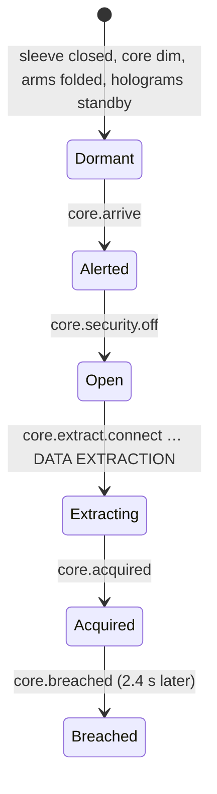

# 22 · Data Core

> [Index](00_INDEX.md) · Previous: [21 Security Gate](21_SECURITY_GATE.md) · Next: [23 Heat and Lockdown](23_HEAT_AND_LOCKDOWN.md)

## What it is

The **Sector 7 Data Core** sits in a walled compound (reserved rect x 105…215, z 60…195; core at **(160, 0, 127.5)**). The player drives in through the north **compound gate** (Access Road) or the **alley**, hacks the **perimeter security terminal** (west of the core), then parks on the **uplink ring** around the core while robotic arms dock a data cable onto the car and pull the package.

## Who does what

| Concern | Class | File |
|---|---|---|
| Rules: stages, timing, interference | `InteractionRun` via `Interactable` (`core_security_terminal`, `core_uplink`) | `Scripts/Missions/InteractionRun.cs`, `Scripts/Gameplay/Mission/Interactable.cs` |
| Presentation of the whole facility | **`DataCoreChamber`** (reads world events and the uplink's `InteractionRun`; **owns no rules**) | `Assets/_NeonRift/Scripts/Gameplay/Mission/DataCoreChamber.cs` |
| Terminal screens | `TerminalDisplay` | `Scripts/Gameplay/Mission/TerminalDisplay.cs` |
| Reach zone | `MissionZone` `core_compound` | `Scripts/Gameplay/Mission/MissionZone.cs` |
| Geometry (kiosk, pedestal, sleeve, rail, arms, cable, rings, holograms, strobes, 3D audio) | builder | `NightRunBuilder.BuildCompound` (`Scripts/Editor/District/NightRunBuilder.cs:257`), `BuildCoreTerminal`, `BuildChamber` (254), `BuildArm` (415) in `NightRunBuilder.Heist.cs` |
| Facility sounds | `HeistAudioGenerator` (`Hum`, `Servo`, `Stream`, `ChamberOpen`, `Clunk`, `Release`, `Acquired`, `Breach`) | `Scripts/Editor/Audio/HeistAudioGenerator.cs` |

## `DataCoreChamber` phases (from its class summary and methods)

| Phase / event | What moves and lights (`UpdateSleeve`, `UpdateCore`, `UpdateFacility`, `UpdateArms`, `UpdateLink`, `UpdateHolograms`, `UpdateAudio`) |
|---|---|
| **Alerted** (`core.arrive`) | Floodlights sweep, compound strips go amber, the compound cameras go live, a red scan plane hunts up the column, holograms turn amber, the facility hum starts |
| **Security off** (`core.security.off`) | Six curved **armoured sleeve** panels unlock one after another (a small outward kick) and **sink into the pedestal over 3.2 s**; hydraulic one-shot; the column's light floods out; rings spin up. Cameras turn to watch the core |
| **Connect** | Two arms on carriages ride a **rail** round the pedestal to the car's side (`RailPoint`). The **connector arm** (two-bone IK, elbow up: `Pose`) reaches for the roof, docks with a clunk and lowers a glowing **data cable** (`BuildPath`, `Sample`) onto the car. The **scanner arm** sweeps a beam front to back |
| **Extraction** | Pulses travel core → arm → cable → car (2.5 → 16 per second with progress); the core shifts cyan → white-blue → magenta; amber strobes from 30 %; scan rings speed up; holograms show the stage strip and progress; 3D data-stream loop and 2D tension bed |
| **Interference** | Pulses freeze; link, cable, pulses and core flash red; holograms tear; camera kick |
| **City cues** | 50 % `grid.anomaly`: every traffic signal stutters amber, screens within 420 m glitch. 80 % `core.extract.trace`: compound cameras reboot, compound beacons spin, **security drones launch** |
| **Acquired** (`core.acquired`) | Cable releases, core collapses to an ember; **DATA ACQUIRED** banner + stinger |
| **Breached** (`core.breached`) | Core turns the alarm colour, floods turn red; theft beat; lockdown |

**Camera.** `UpdateCamera` (240) asks `VehicleChaseCamera.SetFraming` for a slow, wide framing of the car and the core while the chamber opens and data is pulled. The player keeps control.

## Terminal (`core_security_terminal`)

Kiosk at (145, 0, 127.5) facing east (`TerminalKiosk`): body, main screen, status hologram, screen glow light, speaker. Four stages: CONNECTING → AUTHENTICATING (hold) → BYPASSING (timing) → SECURITY OVERRIDE ([20 Heist](20_HEIST_SYSTEM.md)).

## Uplink (`core_uplink`)

A ring around the core. Five stages: CONNECT EXTRACTION DEVICE → INITIALIZE EXTRACTION → STABILIZE DATA LINK (timing) → DATA EXTRACTION (14 s sustain, interference at 38 % and 74 %) → EXTRACTION COMPLETE. Max speed 6 km/h.

## Sentries

Two **Buster Drone** sentries (posed, baked to static meshes) hover and scan over the compound at all times (`HoverSentry`, `Scripts/Gameplay/City/HoverSentry.cs`; built by `NightRunBuilder.BuildSentries`).

## Validation

`MissionTests.NightRunSceneProvidesEveryTargetAndReaction` (targets and reactions exist in the scene). Play Mode via `MissionPlaytest` (captures after chosen events and stages; images in `Docs/Screenshots/Heist/`): completed in 125.5 s, terminal 4.8 s, uplink 20.9 s.
