# 23 · Heat and Lockdown (city reaction)

> [Index](00_INDEX.md) · Previous: [22 Data Core](22_DATA_CORE.md) · Next: [24 Environmental Interactions](24_ENVIRONMENTAL_INTERACTIONS.md)

## Heat: the consequence currency (Decision D22)

`MissionProgress.Heat` (0…1). One number, shown on the HUD, that couples **route choice before the theft** to **options after it**.

| Source of heat | Amount | Code |
|---|---|---|
| Completing the alley gate hack (each time) | +35 % | `Interaction_HackGate` `heatOnComplete` 0.35 |
| A missed timing press | +5 % (gate), +4 % (core terminal), +3 % (uplink) | `InteractionStep.missHeat` |
| Lockout after 3 misses | +12 % (gate), +10 % (terminal) | `InteractionDefinition` fail heat |
| Security camera holds the player in view for 1.1 s (once security is raised) | +8 %, 14 s cooldown | `SecurityCamera` (`range` 38 m, FOV 80°, line of sight) |

What heat does (`MissionProgress.AddHeat`):

- **First heat raises security Calm → Alert.**
- **Timed objectives shrink.** The escape timer starts at max(min(30, 80), 80 − heat × 25). Heat gained **during** the escape removes time immediately.
- **Checkpoints seal sooner.** `SecurityBarrier` countdowns subtract `heatPenalty` × heat (minimum `minDelay`).
- The debrief's **Quiet** score is 25 × (1 − heat).

## Security levels (`Assets/_NeonRift/Scripts/Missions/SecurityLevel.cs`)

`Calm` → `Alert` → `Lockdown`. **Only ever escalates** during a mission. Alert comes from heat; Lockdown comes from the `escape` objective (security level Lockdown).

## What triggers what (verified wiring)

```mermaid
flowchart TD
    H[Heat added] -->|first time| ALERT[SecurityLevel.Alert]
    ARR[core.arrive] --> CAM1[Compound cameras arm]
    ARR --> SLG1[Compound light group → alert amber]
    OFF[core.security.off] --> CAM2[Compound cameras offline, watch the core]
    ANOM[grid.anomaly — 50 % of extraction] --> SIG1[TrafficSignalNetwork: amber stutter]
    ANOM --> SCR1[LockdownScreens: screens within 420 m glitch]
    TRACE[core.extract.trace — 80 %] --> CAM3[Compound cameras reboot]
    TRACE --> DRN[SecurityDrones launch]
    TRACE --> ALM1[SecurityAlarm beacons]
    BR[escape starts: core.breached + lockdown + escape.start] --> LOCK[SecurityLevel.Lockdown]
    LOCK --> BAR[Gates: alley slams, compound 12 s, expressway 30 s, harbor 22 s]
    LOCK --> WAVE[SecurityLightGroup: red wave from the core at 140 m/s]
    LOCK --> SCR2[LockdownScreens: warnings with the same wave]
    LOCK --> SIG2[TrafficSignalNetwork: whole grid flashes red]
    LOCK --> SIR[SecurityAlarm: 10 sirens fade in as the wave reaches them]
    LOCK --> PFX[SecurityPostEffects: lockdown grade]
    LOCK --> MIX[Mixer: Lockdown snapshot, score drive stem]
    LOCK --> TRF[CityTraffic: pull over and stop]
    LOCK --> DRN
    ESC[escape.start] --> SKY[Skyway gate opens]
    BR --> BEAT[Theft beat camera + banner + stinger]
```

## Systems and files

| System | Calm | Lockdown | Class / file | Built by |
|---|---|---|---|---|
| **Gates** | Alley gate locked (hackable); skyway gate closed | Alley slams (1 s warning); **compound gate** seals in 12 s (−4 s per heat, min 7); **expressway checkpoint** 30 s (−12 per heat, min 12); **harbor checkpoint** 22 s (−8 per heat, min 10); **skyway gate opens** on `escape.start` | `SecurityBarrier` (`Scripts/Gameplay/Mission/SecurityBarrier.cs`) | `NightRunBuilder.Build` → `BuildBarrier` ×5 |
| **Road closures for AI and HUD** | — | Closed gates impassable, closing gates +450 m | `CityNavigation.EdgeCost` | `BuildNavigation` |
| **Security light strips** (kerb lines, crowns, gantries; 35 groups) | Faint cyan | Red (3.6, 0.12, 0.14), switching after distance ÷ 140 m/s, pulsing | `SecurityLightGroup` (`Scripts/Gameplay/Mission/SecurityLightGroup.cs`) | `BuildSecurityGroups` |
| **Warning screens** (billboards, shelter adverts, street screens) | Adverts | Warning material, same wave; glitch on `grid.anomaly` within 420 m | `LockdownScreens` (`Scripts/Gameplay/City/LockdownScreens.cs`) | `BuildCitySystems` |
| **Traffic signals** | Green/amber/all-red cycle | Whole grid flashes red; amber stutter on `grid.anomaly` | `TrafficSignalNetwork` (`Scripts/Gameplay/City/TrafficSignalNetwork.cs`) | `BuildCitySystems` |
| **Security cameras** (12: alley, compound gate, expressway, tunnel, harbor checkpoint, skyway …) | Idle (green LED) | Track the player in range and line of sight (red LED); +8 % heat per 1.1 s exposure | `SecurityCamera` (`Scripts/Gameplay/City/SecurityCamera.cs`) | `BuildSecurityCameras` |
| **Sirens and beacons** | Silent, dark | 10 sirens (gain 0.35) fade in after the wave reaches them; rotating beacons | `SecurityAlarm` (`Scripts/Gameplay/Mission/SecurityAlarm.cs`) | `BuildCityAlarm` |
| **Lockdown grade** | Base night volume | Alert volume at 0.25 weight; Lockdown volume blended over 1.2 s after 0.6 s | `SecurityPostEffects` (`Scripts/Gameplay/Mission/SecurityPostEffects.cs`) + `Settings/Rendering/NightRun_Alert.asset`, `NightRun_Lockdown.asset` | `BuildLighting` |
| **Security drones** (5 Mech Drones) | Dormant | Lift off from the core, then 3 tail the player and 1 tails each rival still running; red/blue strobes; searchlight held on the car | `SecurityDrones` (`Scripts/Gameplay/City/SecurityDrones.cs`) | `BuildDrones` (`NightRunBuilder.CityLife.cs`) |
| **Traffic** | Roaming | Pulls over and stops | `CityTraffic.OnSecurity` | `BuildTraffic` |
| **HUD** | Cyan route | Magenta route, closed gates red on the minimap, lockdown frame, trace timer, seal countdowns | `MissionHud`, `CityMinimap` | — |
| **Audio** | Gameplay mix | Lockdown snapshot, lockdown stinger and cue, score drive stem | `MissionDirector.OnSecurityChanged`, `MissionAudio` | — |

## Drones in detail (`SecurityDrones`)

- **Launch:** on `launchOn` events (`core.extract.trace`) or `SecurityLevel.Lockdown` (`Launch`).
- **Targets:** `TargetFor(i)`: the last drones each take one rival still running; the rest tail the player.
- **Flight:** a slot behind, beside and above the target (`trail` 9 m, `altitude` 15 m, staggered heights), leading the car by 0.45 s of velocity; climbs out of the core for the first 2.5 s; flies faster than the car (`speed` 30 m/s minimum); banks and pitches with its velocity.
- **Searchlight and beam:** aimed at the car with a 1.2 m hand-held wander, so the light on the car visibly comes from the drone. Strobes flash red and blue through a `MaterialPropertyBlock`.
- **Model:** `PF_Drone_Mech` (Mech Drone, CC BY; `Scripts/Editor/World/DroneModels.cs`).

## The theft beat

On `core.breached` (`MissionDirector.beatEvent`), for 2.6 s: the camera swings 55° round and 3.4 m up on the far side of the car from the core (`VehicleChaseCamera.CinematicBeat`), letterbox bars slide in, the time scale eases to 0.45 and back, and the driving HUD steps back.

## Failure

The escape timer runs out → `MissionProgress.Fail("TRACE COMPLETE — YOU WERE FOUND")`. The `TraceTimeout` validator scenario tests this (trace 71.3 s = 80 − 0.35 × 25 with 35 % heat).
