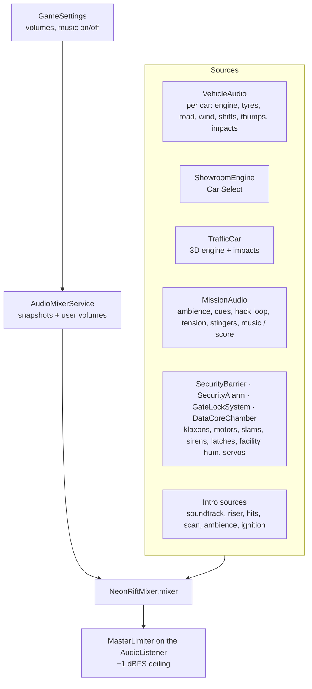

# 29 · Audio System

> [Index](00_INDEX.md) · Previous: [28 Particles and VFX](28_PARTICLES_AND_VFX.md) · Next: [30 Music System](30_MUSIC_SYSTEM.md)

## Architecture



## Mixer (`Assets/_NeonRift/Audio/Mixer/NeonRiftMixer.mixer`)

Built by `AudioMixerBuilder` (`Assets/_NeonRift/Scripts/Editor/Audio/AudioMixerBuilder.cs`, menu **Neon Rift ▸ Audio ▸ Build Audio Mixer**). Unity has no public mixer-authoring API, so it drives the editor's mixer controller through reflection (Decision D20). It is described at runtime by `AudioMixerConfig` (`Scripts/Audio/AudioMixerConfig.cs`, asset `Data/Audio/AudioMixerConfig.asset`).

```
Master            [MasterVolume]
├─ Gameplay       [EffectsVolume]
│  ├─ Engine
│  ├─ Tires
│  ├─ SFX
│  └─ Ambience
├─ Music          [MusicVolume]
│  └─ Score
└─ UI             [UIVolume]
```

User volumes are exposed parameters on **parent** groups. State **snapshots** act on **leaf** groups, so the two never conflict.

| Snapshot (`MixerState`) | Use | Offsets (dB, `Docs/Audio.md`) |
|---|---|---|
| Gameplay | Driving, intro | Tires −3, Ambience −4 |
| Menu | Title, Car Select | Engine −12, Tires −20, SFX −6, Ambience −15 |
| Results | Debrief | Engine −18, Tires −25, SFX −8, Ambience −12 |
| Lockdown | City lockdown | Engine −2, Ambience −4 |
| Ducked | Pause menu | Engine −8, Tires −8, Ambience −8, Score −10 |

`AudioMixerService` (`Scripts/Audio/AudioMixerService.cs`): `TransitionTo(state, seconds)`, `SetVolume` / `GetVolume`, dB↔linear helpers. Created by `GameRoot`; the mixer runs on **unscaled time** so pause ducking fades while time is frozen. `GameRoot.OnStateChanged` picks Gameplay vs Menu; `MissionDirector` switches to Lockdown and Results; `MissionSceneEntry.OpenPause` uses Ducked.

## Voices, priorities and headroom

- Real voices **64** (`ProjectSettings/AudioManager.asset`), up from 32: with three cars at about 22 loops each, the score and ambience used to be virtualised (measured about 35 dB down).
- Priorities: score and outro 0; mission cues and stingers 4; ambience 8; tension 16; interaction loop 24; gate klaxon/motor 96; sirens 112; non-camera cars +140 (`VehicleAudio.OtherCarPriorityOffset`).
- **`MasterLimiter`** (`Scripts/Audio/MasterLimiter.cs`) on the listener (NightRun and CarSelect scenes): −1 dBFS ceiling, instant attack on each frame's peak, 150 ms release. A safety net, not the mix.
- Device change: `MissionAudio` and `VehicleAudio` listen to `AudioSettings.OnAudioConfigurationChanged`, restart loops and re-sync the score.

## Mission audio (`MissionAudio` + `MissionAudioSet`)

| | |
|---|---|
| Player | `Scripts/Gameplay/Mission/MissionAudio.cs`: 2D sources created once; loops started once; `Play(Cue)`, `SetTension`, `SetInteract`, `StartScore`, `SetScoreSecurity`, `EndScore`, `OnWorldEvent` (stingers) |
| Data | `Scripts/Gameplay/Mission/MissionAudioSet.cs`, asset `Data/Missions/MissionAudio_NightRun.asset`: ambience bed (0.55), interaction loop (0.6), cues (objective, interact complete, heat, lockdown, countdown tick, message, success, failure), heist stage cues (step start/done, miss, interference, resync, lockout, cancel), tension loop (0.7), `eventStingers`, `musicTrack` (0.30), score stems and outros |
| Routing | Ambience → Ambience group; cues and interaction loop → UI/SFX; music → Score |

## Generated sound library (all synthesised in-house)

| Generator | Menu | Output (`Assets/_NeonRift/Audio/Generated/`) |
|---|---|---|
| `VehicleAudioGenerator` + `EngineSynth` + `Dsp` | Neon Rift ▸ Audio ▸ Generate Vehicle Audio | `Engine_V8Road`, `Engine_V8Race`, `Engine_EV`, `Engine_Pops`, `Tyres`, `Road`, `Mechanical`, `Impacts` |
| `MissionAudioGenerator` | Neon Rift ▸ Audio ▸ Generate Mission Audio (also run by the Night Run build) | `Mission/`: `Siren_Loop`, `Klaxon_Loop`, `BarrierMotor_Loop`, `Barrier_Slam`, `City_AmbienceLoop`, `Hack_Loop`, `Cue_*`, `Gate_LockRelease`, `Gate_Latch` |
| `HeistAudioGenerator` | (called by the mission generator) | `Mission/Heist_*`: StepStart, StepDone, Denied, Interference, Resync, Lockout, Cancel, Tension_Loop, FacilityHum_Loop, Servo_Loop, DataStream_Loop, ChamberOpen, Dock, Release, DataAcquired, Breach |
| `ScoreComposer` | (called by the mission generator) | `Mission/Score_Bed`, `Score_Pulse`, `Score_Arp`, `Score_Drive`, `Score_OutroSuccess`, `Score_OutroFailure` |
| `IntroAudioGenerator` | Neon Rift ▸ Intro ▸ Generate Intro Audio | `Intro/`: `Intro_Bed`, `Intro_Groove`, `Intro_Riser`, `Intro_Impact`, `Intro_Whoosh`, `Intro_Scan`, `Intro_Ignition` |

All are deterministic and re-runnable. Loops contain whole numbers of periods (seamless). The only third-party audio is the two supplied music tracks in `Assets/ThirdParty/SoundAudio/` ([30](30_MUSIC_SYSTEM.md)).

## Where each sound comes from

| Sound | Component |
|---|---|
| Engine, gear, tyre squeal and scrub, loose surface, road, wind, suspension thumps, impacts | `VehicleAudio` ([12](12_VEHICLE_AUDIO.md)) |
| Traffic engines and impacts | `TrafficCar` |
| Sirens | `SecurityAlarm` (10 positions in `NightRunBuilder.BuildCityAlarm`) |
| Gate klaxon, motor, slam | `SecurityBarrier` |
| Lock release ratchet, latch | `GateLockSystem` |
| Facility hum, servos, data stream, chamber hydraulics, dock, release | `DataCoreChamber` (3D) |
| Terminal stage blips | `TerminalDisplay` (3D speaker) |
| Hacking loop, tension bed, HUD cues, stingers, ambience, music | `MissionAudio` |
| Garage light clunks, door motor | `CrewGarage` |

## M music toggle

`GameRoot` binds **M** / gamepad **Y** to `GameSettings.ToggleMusic()` (`Scripts/Game/GameSettings.cs`). This sets the Music bus to −80 dB or back to the music volume, and the choice is saved in PlayerPrefs. The HUD shows `M · MUSIC ON/OFF` (`MissionHud.SetMusicHint`).

## Tests and tools

`VehicleAudioTests` (mixer groups, snapshots and volumes; score stems sample-locked; `ScoreMix` follows mission state and lands on the grid; `MasterLimiter` holds the ceiling); `AudioOutputRecorder` and `AudioSignalAnalysis` (`Scripts/Audio/`) for recording and measuring the real mix; recorded excerpts in `Docs/Audio/*.wav`.

**Not checked by ear:** the score balance and the intro mix were measured but have not been judged on speakers by a person (`Docs/Audio.md`).
