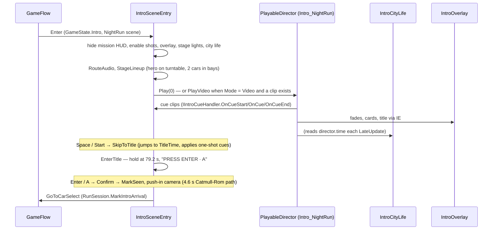

# 31 · Cinematic Intro

> [Index](00_INDEX.md) · Previous: [30 Music System](30_MUSIC_SYSTEM.md) · Next: [32 Timeline and Camera](32_TIMELINE_AND_CAMERA.md)

## Purpose

An **84 s real-time cinematic**, rendered in the actual Night Run city, that tells the premise without dialogue: a crew in a hidden garage on W Avenue goes after the Sector 7 Data Core. It ends on the NEON RIFT / NIGHT RUN title, looking into the same garage that Car Select uses, so pressing Enter becomes a **match cut** into Car Select. All story, cards and procedural sound are original.

## The parts

| Part | Class / asset | File |
|---|---|---|
| Builder (generates the rig and the Timeline) | `IntroBuilder` (+ `IntroBuilder.CityLife.cs`) | `Assets/_NeonRift/Scripts/Editor/Intro/IntroBuilder.cs` |
| Runtime entry point (`IIntroEntryPoint`) | `IntroSceneEntry` | `Scripts/Intro/IntroSceneEntry.cs` |
| Timeline asset | `Intro_NightRun.playable` | `Assets/_NeonRift/Data/Intro/Intro_NightRun.playable` |
| Custom cue track | `IntroCueTrack`, `IntroCueClip`, `IntroCueBehaviour`, `IntroCueKind`, `IIntroCueHandler` | `Scripts/Intro/IntroCueTrack.cs`, `IntroCueClip.cs`, `IntroCue.cs` |
| 2D overlay (fades, flashes, letterbox, cards, title, skip hint, CCTV frame) | `IntroOverlay` + `UI/IntroOverlay.uxml`, `IntroOverlay.uss` | `Scripts/Intro/IntroOverlay.cs` |
| Street and sky life | `IntroCityLife` | `Scripts/Intro/IntroCityLife.cs` |
| Garage lights and door | `CrewGarage` | `Scripts/Gameplay/CrewGarage.cs` |
| Settings | `IntroSettings` (`Policy` FirstLaunchOnly / Always / Never, `Mode` Realtime / Video, `Skippable`, seen key `NeonRift.IntroSeen`) | `Scripts/Game/IntroSettings.cs`, `Data/Config/IntroSettings.asset` |
| Surveillance grade | Volume profile | `Data/Intro/Intro_Surveillance.asset` |
| Audio | `IntroAudioGenerator` + the trailer track | `Scripts/Editor/Audio/IntroAudioGenerator.cs`, `Assets/ThirdParty/SoundAudio/danger-chaos-cinematic-trailer-hybrid.mp3` |
| Review tool | `IntroCapture.Begin(folder, times…)` | `Scripts/Editor/Intro/IntroCapture.cs` |

Menus: **Neon Rift ▸ Intro ▸ Build Intro (open Night Run scene)** (also run by every Night Run build), **Neon Rift ▸ Intro ▸ Reset 'Intro Seen' (play it on next launch)**, **Neon Rift ▸ Intro ▸ Generate Intro Audio**.

## How it runs

- **Lineup:** the cars are the catalog's **gameplay prefabs** spawned through `VehicleSpawnPoint` (same models, physics, lights and engines). The hero is the session's selected car or the catalog default (`StageLineup`, line 148).
- **Departure:** on the `Departure` cue, the two bay cars drive out on scripted lines with **`WaypointDriver`** (real physics), through the door and up W Avenue (`Depart`, line 467).
- **Skip:** `OnSkip` → `SkipToTitle` (242) jumps to `TitleTime` (75.2 s); one-shot cues are applied so the world lands in a consistent state. A skip pressed before the Timeline's first evaluation is deferred a frame.
- **Confirm:** `Confirm` (285): `IntroSettings.MarkSeen`, push-in through the garage door, round the hero, ending exactly on Car Select's opening frame (`UpdatePushIn`, `CatmullRom`); Car Select opens on that close-up and pulls back.
- **Exit:** restores the time scale, destroys the lineup, resets the garage, disables the rig. The rig is inert in missions (tested by `IntroTests.NightRunScene_HasAWiredIntro`).
- **Video path:** `IntroSettings.Mode.Video` + a `VideoClip` plays a pre-rendered intro through a `VideoPlayer` (`PlayVideo`, 188), and the real-time title takes over at its end. **Implemented but untested: no clip is supplied.** Without a clip it falls back to real time (`IntroTests.VideoModeWithoutAClip_FallsBackToRealtime`).

## Timeline structure (`IntroBuilder.BuildTimeline`, line 322)

| Track | Content |
|---|---|
| Animation track per shot camera | Eased position plus a look direction keyed as a quaternion (`MoveClip`); each shot camera has an `Animator` |
| Cinemachine track | Cuts and blends between the **25** shot cameras |
| `IntroCueTrack` | Story beats (table below), bound to `IntroSceneEntry` |
| Audio tracks | Ambience (city loop 0–84 s), **Soundtrack** (trailer track 0–84 s, or the procedural Score bed and groove as fallback), Riser (TitleTime − 6 s), Hits, Scan (39.7–43.7 s) |

## Cue timeline (`IntroBuilder.Cues`, line 293)

| Time (s) | Cue | Effect |
|---|---|---|
| 0–84 | Letterbox | Cinema bars |
| 1.2–6 | FadeIn | From black |
| 2–75.2 | SkipHint | "SPACE · START SKIP" |
| 25.5–29.8 | Card | *IN NEON RIFT, INFORMATION IS POWER. / AND THE GRID WATCHES EVERY STREET.* |
| 34.2–39.2 | Card | *AT ITS HEART: THE SECTOR 7 DATA CORE. / EVERY SECRET IN THE CITY PASSES THROUGH IT.* |
| 39.5–43.5 | Surveillance | CCTV overlay + grade: *UNUSUAL ACTIVITY · W AVENUE · UNIT 7* |
| 43.2, 46.7 | Dip | Soft cuts |
| 47.6 | GarageLights | `CrewGarage.LightsOn`: banks strike with flicker and clunks |
| 48.4–52.2 | Card | *TONIGHT, A CREW GOES IN FOR IT. / EXTRACT THE PACKAGE. OUTRUN THE LOCKDOWN.* |
| 53 | Headlights | Lineup headlights on |
| 60.2–63.6 | Card | *THREE CARS. ONE RUN. / NO SECOND CHANCE.* |
| 62.6 | Ignition | Engines start (ignition sound) |
| 64.2 | DoorOpen | `CrewGarage.OpenDoor` |
| 65.6 | Departure | Bay cars drive out |
| 71–75 | Flash × 6 | Montage flashes every 0.7 s |
| 73.1–73.8 | Surveillance | *VEHICLE MOVEMENT · SECTOR 7 PERIMETER* |
| 75.2 | Flash | Title flash |
| 75.7–84 | Title | **NEON RIFT**, then **NIGHT RUN**, then **PRESS ENTER · A** (hold at 79.2 s) |

## Shot-by-shot breakdown (`IntroBuilder.Shots`, line 247)

World anchors are read from the built city: the core position (the director's alert origin), the compound gate (by name), the signal head lens on W Avenue (`SignalHead`) and the CCTV head near (8, −108). `G(x, y, z)` = a garage-local point.

| # | Shot | Time (s) | Purpose | Camera | Objects | Lighting | Audio |
|---|---|---|---|---|---|---|---|
| 1 | 01_City | 0–9 | Establish the city | Far aerial (−700, 320, −1050) drifting in, looking toward downtown | Whole city, skyline rings | Night grade, fade-in | Ambience, soundtrack |
| 2 | 02_Descent | 9–16 | Down through the skyline toward W Avenue | (−260, 180, −560) → (−62, 34, −352) | Towers; **sky-traffic drones** with searchlights (`IntroCityLife` flights Sky_A–C) | Tower facades, aviation lights | |
| 3 | 03a_Avenue | 16–20.5 | Street life | Low dolly up W Avenue, x −4.5, z −215 → −185 | Shopfronts, steam; **traffic lanes** both ways; **patrol drone**; pavement **crowds** | Street lamps (budgeted), neon | |
| 4 | 03b_Market | 20.5–25 | Signals and signs | Over Market Street (8.5 → 16, z −103) looking east | Traffic both ways, crowds, patrol drone | Signal lenses, signs | |
| 5 | 04a_Camera | 25–28 | The grid watches | Close on a real street CCTV head | Security camera | | Card 1 |
| 6 | 04b_Gate | 28–31 | Security infrastructure | The compound gate from the street | Gate; **two guard drones** | Security strips | |
| 7 | 05a_Facility | 31–35 | The Data Core compound from above | gate + (50, 30, 51) → (32, 23, 33) | Compound, **3 orbiting drones**, Buster sentries | Floods, core beam | |
| 8 | 05b_Core | 35–39.5 | The core itself | Around the core at 4–6 m | Core column, rings | Core glow | Card 2 |
| 9 | 06_Surveillance | 39.5–43.5 | CCTV of the garage door | High fixed camera (8.6, 7.6, −273) | Roller door "UNIT 7"; traffic passing | Green CCTV grade | Scan sound |
| 10 | 07a_Exterior | 43.5–47 | The hidden garage from the street | (6, 1, −232) → (1.5, 1.25, −243) | Door, southbound traffic | Door lamp, sodium street lamps | |
| 11 | 07b_Reveal | 47–52.5 | Inside: lights strike | Garage interior high corner | Three cars | Banks strike with flicker | Clunks, card 3 |
| 12 | 08a_Headlight | 52.5–55 | The hero's headlight | Close-up (Car Select's opening look) | Hero car | Headlights on | |
| 13 | 08b_Slide | 55–57.5 | Slide along the hero | Low side slide | Hero | | |
| 14 | 08c_Bay | 57.5–60 | A rival in its bay | In front of the left bay | Bay car | | |
| 15 | 09a_Planning | 60–62.5 | Crew preparation | Planning wall | Map from the real road data, core schematic | Screen glow | Card 4 |
| 16 | 09b_Ignition | 62.5–64 | Ignition | Low behind the hero | Cars | | Ignition, engines |
| 17 | 10a_Door | 64–67.5 | The door lifts onto the street | Inside looking at the door | Roller door rising | Street light spills in | Door motor |
| 18 | 10b_RollOut | 67.5–71 | Two cars roll out into W Avenue | Street level outside the door | Bay cars (`WaypointDriver`) | | Engines |
| 19–24 | 11a_Gate, 11b_Signal, 11c_Core, 11d_Camera, 11e_Avenue, 11f_Compound | 71–75.2 | Montage: the grid notices | 0.7 s cuts with flashes | Gate, signal, core, camera, avenue, compound | | Hits, riser |
| 25 | 12_Title | 75.2–84 | Title | Across W Avenue looking into the open, lit garage | Hero on the turntable; the odd passing car | Garage lit | Title, soundtrack fade |
| — | Push-in (Confirm) | 4.6 s | Match cut into Car Select | `PushCamera` on a Catmull-Rom path through the door to Car Select's opening frame | Hero | | Fade |

## Generated / runtime elements

- **City life** (`IntroCityLife`): 9 traffic lanes with 36 visual-only pack cars (wheels turning), 8 drone flights (sky, avenue, market, garage, two gate guards) and 3 core orbiters (Mech Drones with searchlights and beams). Each element is active only inside its shot window, driven by `director.time` in `LateUpdate`, so every play and every skip looks identical.
- **Crowds:** extra pavement groups along W Avenue and Market Street (`NightRunBuilder.BuildCrowds`).
- **Sentries:** two Buster Drones over the compound (`HoverSentry`).

## Validation

`IntroTests` (`FirstLaunchOnly_PlaysUntilSeen`, `AlwaysAndNever_IgnoreTheSeenFlag`, `VideoModeWithoutAClip_FallsBackToRealtime`, `GameConfig_PointsAtTheIntro`, `NightRunScene_HasAWiredIntro`). Play Mode frame captures with `IntroCapture` (`Docs/Screenshots/Intro2/`). Known: the intro mix has not been judged by ear. In the editor, the first play after a rebuild can show cars flat cyan while shaders compile asynchronously.
