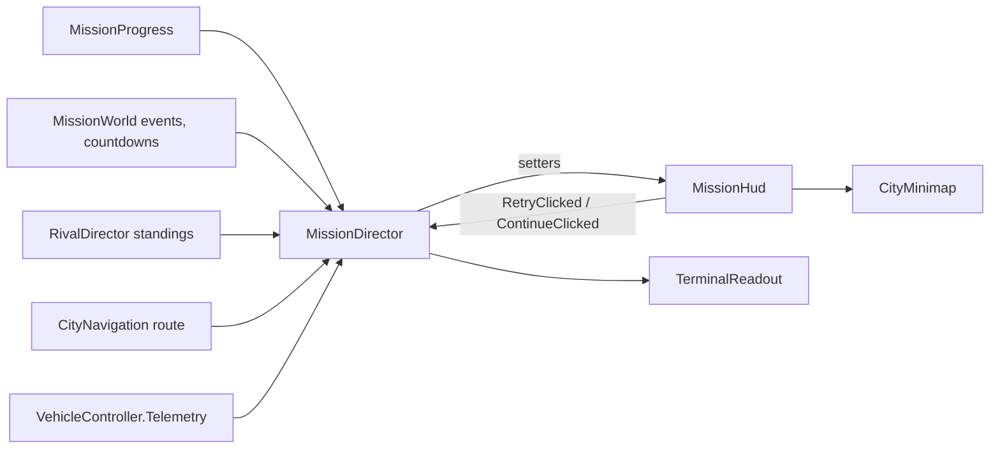

# 33 · UI and HUD

> [Index](00_INDEX.md) · Previous: [32 Timeline and Camera](32_TIMELINE_AND_CAMERA.md) · Next: [34 Minimap](34_MINIMAP.md)

## Technology

All UI is **UI Toolkit** (Decision D6): UXML layouts and USS styles in `Assets/_NeonRift/UI/`, a shared theme (`NeonRift.uss`, `NeonRiftTheme.tss`) and one `NeonRiftPanelSettings.asset` (1920×1080 reference, match 0.5). Views are **passive**: controllers push state in, and text is only rewritten when the value changes (no per-frame allocation).

| Screen | UXML / USS | Controller |
|---|---|---|
| Loading fade | `UI/LoadingOverlay.uxml` | `Scripts/Game/LoadingOverlay.cs` |
| Title | `UI/TitleScreen.uxml` (START, WATCH INTRO, OPTIONS, QUIT, `M · MUSIC ON / OFF`, version) | `Scripts/Frontend/TitleScreen.cs` |
| Options / pause menu | Built in code (pages of rows: buttons, sliders, choices) | `Scripts/Game/OptionsMenu.cs` |
| Car Select | `UI/CarSelect.uxml`, `CarSelect.uss` | `Scripts/Frontend/CarSelectScreen.cs` |
| Intro overlay | `UI/IntroOverlay.uxml`, `IntroOverlay.uss` | `Scripts/Intro/IntroOverlay.cs` |
| Mission HUD, briefing, debrief | `UI/MissionHud.uxml`, `MissionHud.uss` | `Scripts/Gameplay/Mission/MissionHud.cs` |
| Heist readout | inside the HUD (`terminal`) | `Scripts/Gameplay/Mission/TerminalReadout.cs` |
| Minimap | inside the HUD (`minimap-frame`) | `Scripts/Gameplay/Mission/CityMinimap.cs` |

## Mission HUD elements (`UI/MissionHud.uxml`) and their setters (`MissionHud.cs`)

| Element(s) | Shows | Setter (line) | Fed by |
|---|---|---|---|
| `objective`, `objective-step`, `-title`, `-detail`, `-distance` | Current objective, n/4, detail, distance | `SetObjective` (330), `SetObjectiveDistance` (351), `HideObjective` | `MissionDirector.OnObjectiveStarted`, `UpdateHud` |
| `objective-complete` | OBJECTIVE COMPLETE + split time | `StampObjective` (239) | `OnObjectiveCompleted` |
| `waypoint`, `-arrow`, `-label`, `-distance` | Screen-space waypoint, edge-clamped | `SetWaypoint` (360) | `UpdateHud` |
| `security`, `security-state`, `heat-fill`, `heat-label` | CALM / ALERT / LOCKDOWN and heat % | `SetSecurity` (399) | `UpdateHud` |
| `timer` | Trace timer | `SetTimer` (413) | `Progress.TimeRemaining` |
| `countdown` | Gate seal countdowns ("COMPOUND GATE SEALING IN 14s") | `SetCountdown` (425) | `MissionWorld.TryGetNextCountdown` |
| `race`, `race-position`, `-count`, `-gap`, `-rows` | P1/3, gap to the next car, standings rows with crew status | `SetRace` (290) | `MissionDirector.UpdateRace` ← `RivalDirector` |
| `navigator`, `nav-district`, `nav-street`, `nav-route`, `minimap-frame` | District, street, route length, minimap | `SetNavigator` (258), `SetRoadNetwork` (251) | `UpdateNavigator` ← `CityNavigation` |
| `terminal` | Multi-stage interaction readout | `SetTerminal` (222), `FlashTerminal` (228) | `UpdateInteraction` |
| `prompt`, `prompt-key`, `-text`, `-fill`, `-hint` | "E · HACK" interaction prompt and progress | `SetPrompt` (436) | `UpdateInteraction` |
| `toasts` | Short messages (+heat, rival radio lines) | `Toast` (475) | `OnHeatAdded`, `OnAnnounced` |
| `banner`, `banner-title`, `-subtitle` | DATA ACQUIRED / SECURITY BREACH DETECTED / EXTRACTED / TRACED | `Banner` (491) | announcements with `banner: true` |
| `lockdown-frame` | Red screen frame in a lockdown | `SetSecurity` | |
| `extract-frame` | Glow frame during sustain stages | `SetExtractionFrame` (231) | |
| `speedo`, `speed`, `gear`, `rpm-fill`, `rpm-ticks`, `shift-light` | Speed, gear, 12-step RPM bar with redline and shift light | `SetSpeed` (446) | player telemetry |
| `vehicle-name` | Selected car | `SetVehicleName` (328) | `Begin` |
| `music-hint` | `M · MUSIC ON/OFF` (amber when off) | `SetMusicHint` (59) | `GameSettings` |
| `letterbox-top/bottom` | Theft beat bars | `SetLetterbox` (468) | `UpdateBeat` |
| `briefing` (`brief-*`) | Operation card | `ShowBriefing` (504), `HideBriefing` | [35](35_OBJECTIVES_AND_MISSION_PRESENTATION.md) |
| `results` (`results-*`, `retry-button`, `continue-button`) | Debrief | `ShowResults` (560) | [36](36_RESULTS_AND_DEBRIEF.md) |

**Compass:** there is no separate compass widget. North is the white tick on the minimap rim and the player arrow's heading ([34](34_MINIMAP.md)).

**Extraction indicator:** the extraction zone's beacon column in the world, plus the objective, waypoint, minimap target and trace timer on the HUD.

## Data flow

## Options and pause menu (`OptionsMenu`)

Rows are buttons, sliders (volumes, 10 % steps) and choices. Pages: the root, **Settings** (`PushSettings`: master / music / effects / interface volume, music on/off, graphics quality, fullscreen, V-sync) and **Controls** (`PushControls`: every keyboard and gamepad binding). Navigation: ↑↓ / W S / d-pad / stick move, ←→ change a value, Enter / A confirm, Esc / B back; the mouse works too. Persistence: `GameSettings` (PlayerPrefs).

## Title and intro UI

`TitleScreen` binds `start-button` → `Flow.GoToCarSelect`, `intro-button` → `Flow.PlayIntro`, `options-button` → `OptionsMenu`, `quit-button` → `Flow.QuitGame`. `IntroOverlay` provides `SetFade`, `SetFlash`, `SetLetterbox`, `ShowCard` / `HideCard`, `SetTitle`, `SetPrompt`, `SetSkipHint`, `SetSurveillance`.

## UI animations

USS transitions and class toggles: Car Select text slide-out and slide-in (`nr-cs--departing`, `nr-cs--intro`), stat bars easing and numbers counting (`StatRow.Tick`), briefing rows revealing one by one, debrief rows counting in, then the grade landing, toast and banner fades, and objective stamps.
